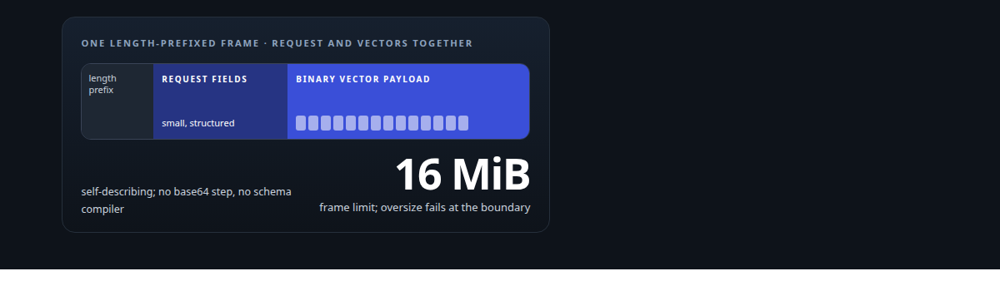
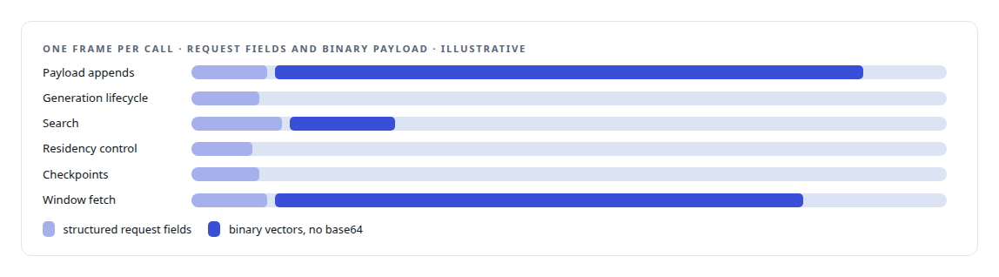
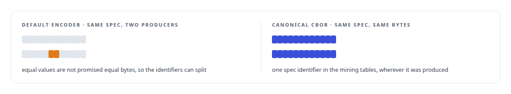
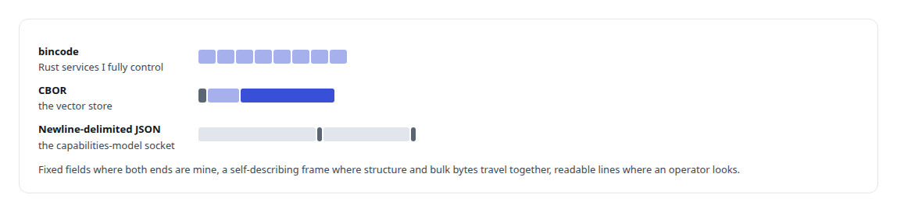

# CBOR

**Canonical CBOR encodes the vector store's RPC wire and the extraction specifications, so equal specifications are byte-identical.**

Canonical: https://coreyjames.ai/technologies/cbor/  
Author: Corey James · Published: 2026-10-28 · Kind: technology  
Systems: [Inference Fabric](https://github.com/coreyjames-ai/inference-fabric) · [Capabilities model](https://github.com/coreyjames-ai/capabilities-model)  



## Result

| Figure | What it measures |
| --- | --- |
| **33** | RPC variants in the vector store's service API |
| **6** | families they fall into, search among them |
| **3** | encodings across the fabric's links |

## What was built

### One wire for requests and vectors

[Inference Fabric](https://coreyjames.ai/systems/inference-fabric)'s Vector Shard Manager needed a wire that carries small structured requests and large binary vector payloads in the same frame. I chose CBOR, length-prefixed over TCP to mirror the framing of the fabric's broker protocol, through the ciborium [Rust](https://coreyjames.ai/technologies/rust) library.



### Specs that are the same bytes everywhere

[Inference Fabric](https://coreyjames.ai/systems/inference-fabric) also runs hidden-state extraction, and each run is described by a spec that tells the GPU worker which layer's states to capture and how. Producers attach the spec to every work item and the broker carries it opaquely.

I wanted two equal specs to be the same bytes wherever they were produced, so the spec is encoded as canonical, deterministic CBOR, and the mining tables store spec identifiers derived from that encoding.




The extraction workload is described on the [Hidden-state extraction](https://coreyjames.ai/technologies/hidden-state-extraction) page.

### An encoding per link

The broker's own transport uses bincode for its fixed Rust-to-Rust message types; that choice and the broker's design are in [A message broker that understands tokens](https://coreyjames.ai/stories/a-message-broker-that-understands-tokens). I choose an encoding per link from what crosses it, as described on [Binary wire protocol design](https://coreyjames.ai/technologies/binary-wire-protocol-design).



> I use canonical encoding wherever bytes stand for identity.

## What was verified

Each line is a claim the canonical page supports, with the figure as the page states it.

- Binary wire protocol design: a length-prefixed CBOR wire for a vector store with 33 RPC variants in 6 families, carrying structured fields and binary vectors in one frame with no base64 step.
- Canonical encoding and content identity: hidden-state extraction specs encoded as canonical CBOR so equal specs are byte-identical and their identifiers match wherever they were produced.

## Related

- [A message broker that understands tokens](https://github.com/coreyjames-ai/inference-fabric/tree/main/stories/a-message-broker-that-understands-tokens) · https://coreyjames.ai/stories/a-message-broker-that-understands-tokens/
- [Rust](https://github.com/coreyjames-ai/portfolio/tree/main/technologies/rust) · https://coreyjames.ai/technologies/rust/
- [Hidden-state extraction](https://github.com/coreyjames-ai/portfolio/tree/main/technologies/hidden-state-extraction) · https://coreyjames.ai/technologies/hidden-state-extraction/
- [Binary wire protocol design](https://github.com/coreyjames-ai/portfolio/tree/main/technologies/binary-wire-protocol-design) · https://coreyjames.ai/technologies/binary-wire-protocol-design/
- System: [Inference Fabric](https://github.com/coreyjames-ai/inference-fabric)
- System: [Capabilities model](https://github.com/coreyjames-ai/capabilities-model)

## Citation

Corey James. "CBOR." coreyjames.ai, 2026. https://coreyjames.ai/technologies/cbor/

```bibtex
@misc{coreyjames-cbor,
  author = {Corey James},
  title = {CBOR},
  year = {2026},
  howpublished = {\url{https://coreyjames.ai/technologies/cbor/}},
  note = {GitHub copy: https://github.com/coreyjames-ai/portfolio/tree/main/technologies/cbor}
}
```

Part of [Corey James's portfolio](https://github.com/coreyjames-ai/portfolio) · site: https://coreyjames.ai/ · MCP server: https://coreyjames.ai/mcp · agent card: https://coreyjames.ai/.well-known/agent.json
