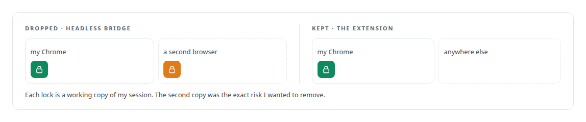
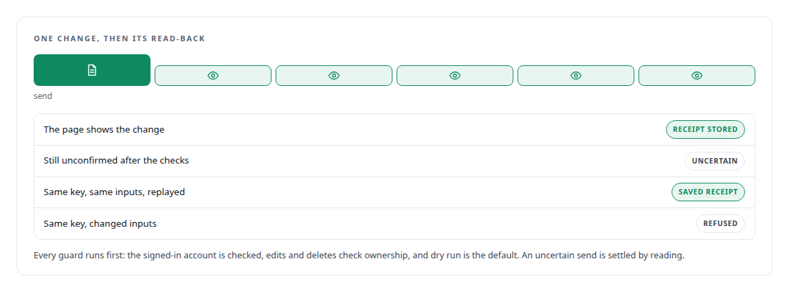
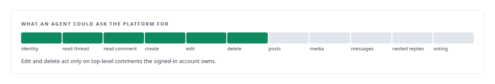

# Chrome extensions (Manifest V3)

**A browser extension lets an agent act through my own authenticated browser session where no API exists, with duplicate-safe receipts and a read-back after every change.**

Canonical: https://coreyjames.ai/technologies/chrome-extensions-manifest-v3/  
Author: Corey James · Published: 2026-10-28 · Kind: technology  
Systems: [FAFOHive](https://github.com/coreyjames-ai/fafohive)  


## Result

| Figure | What it measures |
| --- | --- |
| **~800** | lines across the extension, native host and installer |
| **6** | agent tools behind it |
| **5** | read-only checks at most after each change, one second apart |

## What was built

### Working through the browser I already use

[FAFOHive](https://coreyjames.ai/systems/fafohive) needed a way for agents to read Reddit threads and to post, edit and delete their own comments, and no Reddit API path was usable from my estate. Copying session cookies to a server or running an automation browser would have moved my credentials somewhere they should never be.

So I built a Manifest V3 Chrome extension that lives in my normal, signed-in Chrome. The provider service reaches it through Chrome's native messaging, the extension returns only results, and the provider is reachable only through the existing tunnel.



### Every change confirmed by reading it back

The service never switches accounts, and an idempotency key is bound to each operation's inputs. An unconfirmed send is never resent, so a network error cannot become a duplicate comment.




### A deliberately small surface

I kept the surface to top-level comments.



I look for the narrowest route that keeps a credential where it already lives, and I put idempotency and read-back around any action an agent takes on a platform I do not control.

> A change counts when the page itself shows it.

## What was verified

Each line is a claim the canonical page supports, with the figure as the page states it.

- Browser extension development (Manifest V3): about 800 lines across an extension, native host and installer that let agents act through a signed-in browser session where no API exists, with no copied cookies.
- Idempotent agent actions on external platforms: every change read back with at most 5 read-only checks one second apart, idempotency keys bound to inputs, and an unconfirmed send never resent.

## Related

- System: [FAFOHive](https://github.com/coreyjames-ai/fafohive)

## Citation

Corey James. "Chrome extensions (Manifest V3)." coreyjames.ai, 2026. https://coreyjames.ai/technologies/chrome-extensions-manifest-v3/

```bibtex
@misc{coreyjames-chrome-extensions-manifest-v3,
  author = {Corey James},
  title = {Chrome extensions (Manifest V3)},
  year = {2026},
  howpublished = {\url{https://coreyjames.ai/technologies/chrome-extensions-manifest-v3/}},
  note = {GitHub copy: https://github.com/coreyjames-ai/portfolio/tree/main/technologies/chrome-extensions-manifest-v3}
}
```

Part of [Corey James's portfolio](https://github.com/coreyjames-ai/portfolio) · site: https://coreyjames.ai/ · MCP server: https://coreyjames.ai/mcp · agent card: https://coreyjames.ai/.well-known/agent.json
