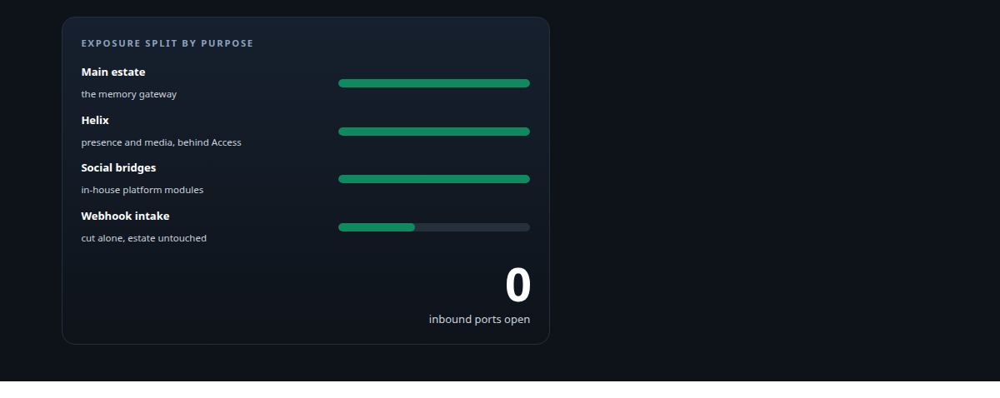
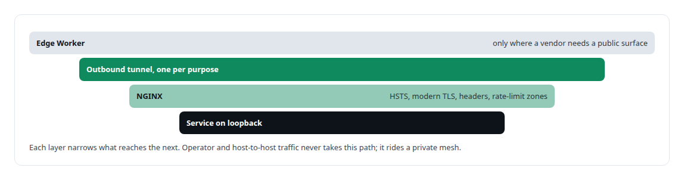
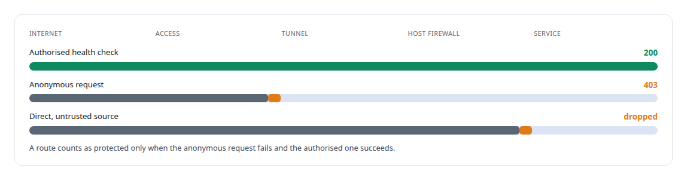
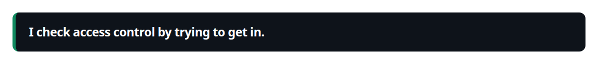
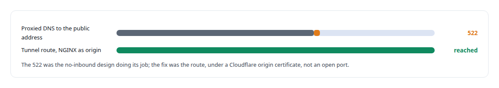

# Cloudflare Tunnel

**Tunnelled ingress means my estate has no open inbound ports.**

Canonical: https://coreyjames.ai/technologies/cloudflare-tunnel/  
Author: Corey James · Published: 2026-10-28 · Kind: technology  
Systems: [Auth and access plane](https://github.com/coreyjames-ai/auth-and-access-plane) · [Helix](https://github.com/coreyjames-ai/helix) · [FAFOHive](https://github.com/coreyjames-ai/fafohive)  
Skills: [zero-trust and zero-inbound networking](https://github.com/coreyjames-ai/portfolio/tree/main/skills/zero-trust-and-zero-inbound-networking) · [inference serving architecture](https://github.com/coreyjames-ai/portfolio/tree/main/skills/inference-serving-architecture) · [evidence-gated acceptance](https://github.com/coreyjames-ai/portfolio/tree/main/skills/evidence-gated-acceptance)  



## What was built

Every public surface, from the memory gateway to the Teams bridge, arrives through an authenticated tunnel.

## Outbound tunnels, one per purpose

[Auth and access plane](https://coreyjames.ai/systems/auth-and-access-plane) lets outside services reach parts of my estate.

I chose outbound-only Cloudflare tunnels and split them by purpose, so webhook intake and the social bridges can be shut without touching the main estate.



## A route behind Access, tested from both sides

[Helix](https://coreyjames.ai/systems/helix) has to accept Teams media from Microsoft's side and stay closed to everyone else. I published its presence and media endpoint through a tunnel route behind Cloudflare Access, and when the voice services moved to another host, I re-pointed the route and tested it from both sides.





Inside the estate, Helix services authenticate each other with mutual TLS and client certificates, so service identity comes from the transport and no bearer token sits in a configuration file.

## Replacing a proxied DNS entry with a route

[FAFOHive](https://coreyjames.ai/systems/fafohive) serves its in-house social-platform modules through a tunnel the social bridges share. The first pattern I was handed was a proxied DNS entry pointing at the host's public address, and the no-inbound design refused it.



Webhook intake for the governed third-party gateway arrives through its own tunnel, and those events are signature-checked and stored before they are acknowledged.

The work is configuration and operation of Cloudflare's product around services I built.

> I check access control by trying to get in.

## What was verified

Each line is a claim the canonical page supports, with the figure as the page states it.

- Zero-trust and zero-inbound networking: every public surface carried by outbound-only tunnels split by purpose, with no inbound port open and services bound to loopback behind NGINX.
- Access control testing: a re-pointed route behind Cloudflare Access proved from both sides, an authorised check returning 200 while an anonymous request got 403 and a direct connection was dropped at the firewall.

## Related

- [Agents with real tools and no keys](https://github.com/coreyjames-ai/fafohive/tree/main/stories/agents-with-real-tools-and-no-keys) · https://coreyjames.ai/stories/agents-with-real-tools-and-no-keys/
- System: [Auth and access plane](https://github.com/coreyjames-ai/auth-and-access-plane)
- System: [Helix](https://github.com/coreyjames-ai/helix)
- System: [FAFOHive](https://github.com/coreyjames-ai/fafohive)

## Citation

Corey James. "Cloudflare Tunnel." coreyjames.ai, 2026. https://coreyjames.ai/technologies/cloudflare-tunnel/

```bibtex
@misc{coreyjames-cloudflare-tunnel,
  author = {Corey James},
  title = {Cloudflare Tunnel},
  year = {2026},
  howpublished = {\url{https://coreyjames.ai/technologies/cloudflare-tunnel/}},
  note = {GitHub copy: https://github.com/coreyjames-ai/portfolio/tree/main/technologies/cloudflare-tunnel}
}
```

Part of [Corey James's portfolio](https://github.com/coreyjames-ai/portfolio) · site: https://coreyjames.ai/ · MCP server: https://coreyjames.ai/mcp · agent card: https://coreyjames.ai/.well-known/agent.json
