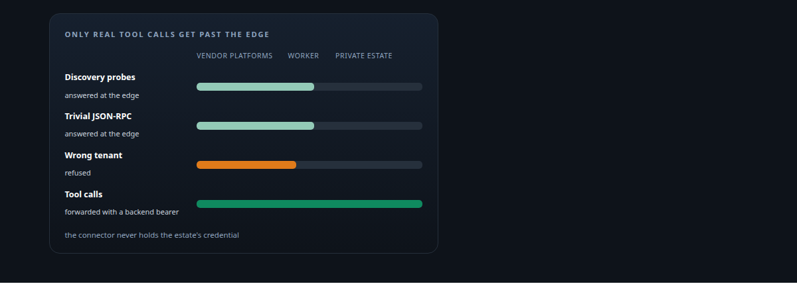
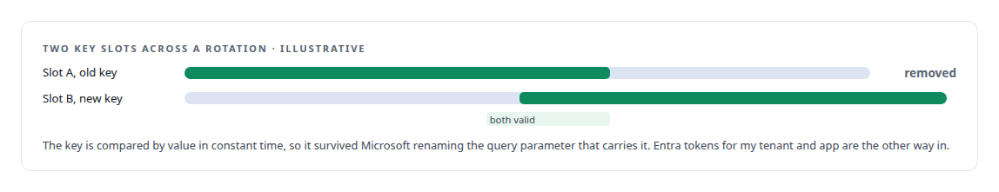
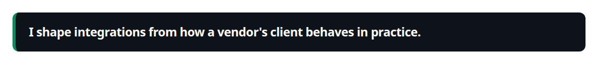
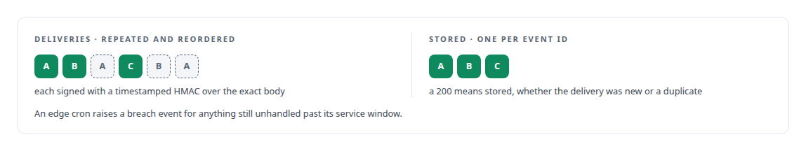

# Cloudflare Workers

**An edge worker exposes a trimmed, authenticated tool surface to a vendor's agent platform without opening the estate behind it.**

Canonical: https://coreyjames.ai/technologies/cloudflare-workers/  
Author: Corey James · Published: 2026-10-28 · Kind: technology  
Systems: [Auth and access plane](https://github.com/coreyjames-ai/auth-and-access-plane) · [FAFOHive](https://github.com/coreyjames-ai/fafohive)  
Skills: [tool synthesis and governed API integration](https://github.com/coreyjames-ai/portfolio/tree/main/skills/tool-synthesis-and-governed-api-integration) · [distributed systems correctness](https://github.com/coreyjames-ai/portfolio/tree/main/skills/distributed-systems-correctness) · [inference serving architecture](https://github.com/coreyjames-ai/portfolio/tree/main/skills/inference-serving-architecture) · [zero-trust and zero-inbound networking](https://github.com/coreyjames-ai/portfolio/tree/main/skills/zero-trust-and-zero-inbound-networking)  



## Result

| Figure | What it measures |
| --- | --- |
| **~300** | lines of JavaScript in the Copilot Studio Worker |
| **2** | key slots, so credentials rotate without an outage |
| **300 s** | replay window on signed events |
| **5 min** | between edge sweeps for events past their service window |

## What was built

### A trimmed surface for Copilot Studio

[Auth and access plane](https://coreyjames.ai/systems/auth-and-access-plane) lets Microsoft Copilot Studio call tools in my private estate, and its connector behaves in ways its documentation does not describe.

I put a Cloudflare Worker in front of the estate as the connector's only public surface. The edge runtime has none of the usual crypto libraries, so tokens are verified with WebCrypto against signing keys cached in KV.



The edge logs showed what Copilot Studio actually sends: unauthenticated discovery probes, renamed parameters, and response caching on Microsoft's API hub.



### Verifying signed events at the edge

[FAFOHive](https://coreyjames.ai/systems/fafohive) sends signed social-platform events to agents, and delivery over the internet repeats and reorders. I ended the event plane at an edge listener built on a Worker with D1 and KV; an exact-body HMAC with a replay window makes at-least-once delivery safe to deduplicate.



It also serves a signed cross-provider pull feed. Senders retry only on network or 5xx failures, on a fixed schedule, and every attempt is persisted. Events may be redelivered any number of times; social actions are never repeated.

> I shape integrations from how a vendor's client behaves in practice.

## What was verified

Each line is a claim the canonical page supports, with the figure as the page states it.

- Edge authentication: a ~300-line Cloudflare Worker as the only public surface for Copilot Studio, verifying tokens with WebCrypto against keys cached in KV, with 2 key slots for rotation without an outage.
- Webhook ingestion and verification: signed events checked at the edge with an exact-body HMAC and a 300 s replay window, deduplicated by event ID, and swept every 5 min for anything past its service window.

## Related

- System: [Auth and access plane](https://github.com/coreyjames-ai/auth-and-access-plane)
- System: [FAFOHive](https://github.com/coreyjames-ai/fafohive)

## Citation

Corey James. "Cloudflare Workers." coreyjames.ai, 2026. https://coreyjames.ai/technologies/cloudflare-workers/

```bibtex
@misc{coreyjames-cloudflare-workers,
  author = {Corey James},
  title = {Cloudflare Workers},
  year = {2026},
  howpublished = {\url{https://coreyjames.ai/technologies/cloudflare-workers/}},
  note = {GitHub copy: https://github.com/coreyjames-ai/portfolio/tree/main/technologies/cloudflare-workers}
}
```

Part of [Corey James's portfolio](https://github.com/coreyjames-ai/portfolio) · site: https://coreyjames.ai/ · MCP server: https://coreyjames.ai/mcp · agent card: https://coreyjames.ai/.well-known/agent.json
