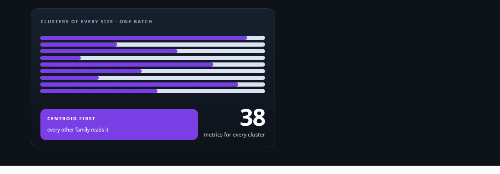
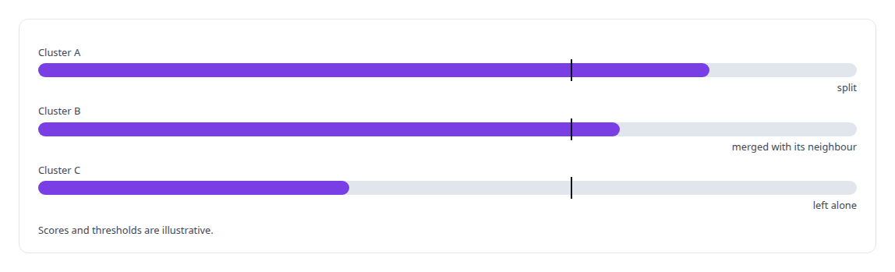

# Cluster-health metrics on the GPU

**Per-cluster metrics, each answering a question a corpus manager asks, computed across thousands of clusters in fused GPU launches and defined by CPU reference code.**

Canonical: https://coreyjames.ai/technologies/cluster-health-metrics-on-the-gpu/  
Author: Corey James · Published: 2026-10-28 · Kind: technology  
Systems: [Inference Fabric](https://github.com/coreyjames-ai/inference-fabric)  
Skills: [embedding analytics and cluster metrics](https://github.com/coreyjames-ai/portfolio/tree/main/skills/embedding-analytics-and-cluster-metrics) · [CUDA kernel development](https://github.com/coreyjames-ai/portfolio/tree/main/skills/cuda-kernel-development) · [AI-assisted engineering methodology](https://github.com/coreyjames-ai/portfolio/tree/main/skills/ai-assisted-engineering-methodology) · [GPU inference optimisation](https://github.com/coreyjames-ai/portfolio/tree/main/skills/gpu-inference-optimisation)  



## Result

| Figure | What it measures |
| --- | --- |
| **6** | families of metrics, each answering one kind of question about a cluster |
| **~12** | fused GPU launches for a batch of thousands of clusters |
| **8** | operational metrics about a cluster's life in the database, beside the geometry |
| **5** | composite scores, weighted from a table in the database |

## What was built

### What the engine measures

My distillation research keeps millions of embeddings in clusters, and the corpus is managed by what the clusters measure: a cluster is split, merged or left alone on the strength of its scores. I built a CUDA engine that computes every metric across every cluster at once, under the [Inference Fabric](https://coreyjames.ai/systems/inference-fabric) on the same leased GPU memory as the search kernels.


### One block per cluster, one block per tile pair

Clusters of any size are processed together through compressed-row offsets. Streaming metrics get one block per cluster; quadratic metrics get one block per tile pair.

The centroid family is the streaming foundation. One three-pass kernel writes each cluster's centroid once and produces cohesion, inertia, vector spread, density skew, embedding quality, novelty against the global centroid, the outlier ratio beyond two standard deviations and the core-periphery ratio. The other families read that centroid, and the rewrite that removed its atomics is told in [Removing the sampling caps](https://coreyjames.ai/stories/removing-the-sampling-caps).

The pairwise family is tiled over every pair: coherence, the mean pairwise cosine rescaled to the unit interval, and compactness, one over one plus the mean pairwise distance. The diversity family extends the same tiles into entropy over a twenty-bin distance histogram, coverage, redundancy, information density and concept breadth. It needs two passes because entropy wants its range first, as told in [Diversity in three kernels](https://coreyjames.ai/stories/diversity-in-three-kernels).


### Splitting, neighbours and fields

The substructure family asks whether a cluster wants to be two. A fixed two-means split gives clustering tendency, the fragmentation index, a continuous sub-cluster count and the silhouette, in [Two-means as a measuring instrument](https://coreyjames.ai/stories/two-means-as-a-measuring-instrument).

The neighbourhood family places a cluster among the clusters around it: local gap, overlap, isolation, nearest distance, density, drift, cross-cluster similarity, member relevance, boundary clarity, topic alignment, phantom proximity and question-and-answer divergence, in [Where a cluster sits](https://coreyjames.ai/stories/where-a-cluster-sits). The Gaussian family treats the cluster as a field with a per-cluster length scale: potential depth, curvature, escape probability, superposition, interference and entanglement, in [Physics as a lens on embeddings](https://coreyjames.ai/stories/physics-as-a-lens-on-embeddings).


### From scores to decisions

Composite scores fold the families, with their weights held in a database table rather than in code, and operational metrics about a cluster's life in the database sit beside the geometry. Those scores decide what happens to a cluster, in [From health scores to decisions](https://coreyjames.ai/stories/from-health-scores-to-decisions).



### A CPU twin for every metric

Every metric is defined by a CPU reference, and the kernel is checked against it at a tolerance derived from single-precision reduction behaviour. The kernels, the references and the lineage documentation are checked against each other, in [Every metric gets a CPU twin](https://coreyjames.ai/stories/every-metric-gets-a-cpu-twin).


Metrics stay unclamped where their sign is informative, and every degenerate case has a written answer. A metric that would need a hidden size limit on the GPU stays on the CPU with an explicit limit until a bounded kernel exists.


> A number means the same thing wherever it is read.

## What was verified

Each line is a claim the canonical page supports, with the figure as the page states it.

- Embedding analytics and cluster metrics: thirty-eight per-cluster metrics in 6 families, each answering a question a corpus manager asks, folded into 5 composite scores.
- CUDA kernel development: clusters of any size computed together through compressed-row offsets, a batch of thousands of clusters in ~12 fused GPU launches.
- Numerical validation against CPU references: every metric defined by CPU reference code, with each kernel checked against it at a single-precision tolerance.

## Related

- [Thirty-eight metrics in a dozen passes](https://github.com/coreyjames-ai/inference-fabric/tree/main/stories/thirty-eight-metrics-in-a-dozen-passes) · https://coreyjames.ai/stories/thirty-eight-metrics-in-a-dozen-passes/
- [Every metric gets a CPU twin](https://github.com/coreyjames-ai/inference-fabric/tree/main/stories/every-metric-gets-a-cpu-twin) · https://coreyjames.ai/stories/every-metric-gets-a-cpu-twin/
- [Removing the sampling caps](https://github.com/coreyjames-ai/inference-fabric/tree/main/stories/removing-the-sampling-caps) · https://coreyjames.ai/stories/removing-the-sampling-caps/
- [Where a cluster sits](https://github.com/coreyjames-ai/inference-fabric/tree/main/stories/where-a-cluster-sits) · https://coreyjames.ai/stories/where-a-cluster-sits/
- [Diversity in three kernels](https://github.com/coreyjames-ai/inference-fabric/tree/main/stories/diversity-in-three-kernels) · https://coreyjames.ai/stories/diversity-in-three-kernels/
- [Physics as a lens on embeddings](https://github.com/coreyjames-ai/inference-fabric/tree/main/stories/physics-as-a-lens-on-embeddings) · https://coreyjames.ai/stories/physics-as-a-lens-on-embeddings/
- [Two-means as a measuring instrument](https://github.com/coreyjames-ai/inference-fabric/tree/main/stories/two-means-as-a-measuring-instrument) · https://coreyjames.ai/stories/two-means-as-a-measuring-instrument/
- [From health scores to decisions](https://github.com/coreyjames-ai/inference-fabric/tree/main/stories/from-health-scores-to-decisions) · https://coreyjames.ai/stories/from-health-scores-to-decisions/
- System: [Inference Fabric](https://github.com/coreyjames-ai/inference-fabric)

## Citation

Corey James. "Cluster-health metrics on the GPU." coreyjames.ai, 2026. https://coreyjames.ai/technologies/cluster-health-metrics-on-the-gpu/

```bibtex
@misc{coreyjames-cluster-health-metrics-on-the-gpu,
  author = {Corey James},
  title = {Cluster-health metrics on the GPU},
  year = {2026},
  howpublished = {\url{https://coreyjames.ai/technologies/cluster-health-metrics-on-the-gpu/}},
  note = {GitHub copy: https://github.com/coreyjames-ai/portfolio/tree/main/technologies/cluster-health-metrics-on-the-gpu}
}
```

Part of [Corey James's portfolio](https://github.com/coreyjames-ai/portfolio) · site: https://coreyjames.ai/ · MCP server: https://coreyjames.ai/mcp · agent card: https://coreyjames.ai/.well-known/agent.json
