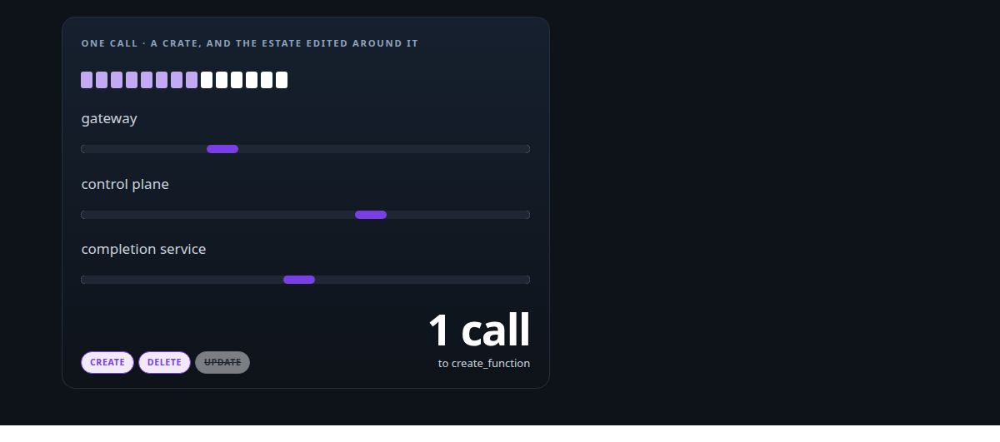
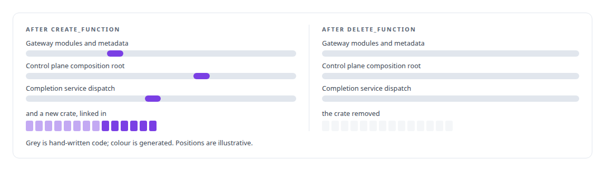
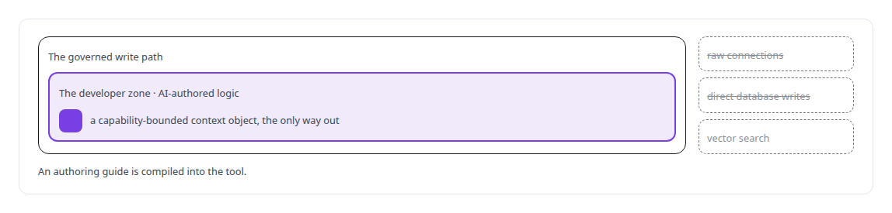
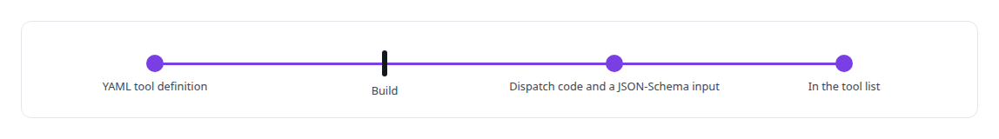

# Code generation and metaprogramming

**I generate code where repetition is the risk: a generator that emits a whole function and wires it into the estate transactionally, and YAML tool schemas compiled into dispatch at build time.**

Canonical: https://coreyjames.ai/technologies/code-generation-and-metaprogramming/  
Author: Corey James · Published: 2026-10-28 · Kind: technology  
Systems: [FAFO Core and Function Forge](https://github.com/coreyjames-ai/fafo-core) · [FAFOHive](https://github.com/coreyjames-ai/fafohive)  
Skills: [tool synthesis and governed API integration](https://github.com/coreyjames-ai/portfolio/tree/main/skills/tool-synthesis-and-governed-api-integration) · [Rust systems engineering](https://github.com/coreyjames-ai/portfolio/tree/main/skills/rust-systems-engineering) · [AI-assisted engineering methodology](https://github.com/coreyjames-ai/portfolio/tree/main/skills/ai-assisted-engineering-methodology) · [sandboxing and container hardening](https://github.com/coreyjames-ai/portfolio/tree/main/skills/sandboxing-and-container-hardening)  



## Result

| Figure | What it measures |
| --- | --- |
| **8 + 6** | files in each generated crate: framework the author leaves alone, and a sandboxed developer zone |
| **7 of 14** | function crates in the estate carry the generator's fingerprints |
| **83** | operations compiled from a vendor's OpenAPI specification into an internal catalog |
| **15** | points in the integration check the first generator passed while its code did not compile |

## What was built

### A generator that wires a function into the estate

In [FAFO Core and Function Forge](https://coreyjames.ai/systems/fafo-core), every new capability used to mean a person wiring a crate into the gateway, the control plane and the result path by hand, and a half-wired function shows up later as a hang. I decided agents should generate fully wired functions themselves, inside a sandbox, active only after a human rebuild.

Function Forge is a Rust generator built on Handlebars templates and exposed as an MCP (Model Context Protocol) tool. One `create_function` call emits the crate and, in the same rollback-protected transaction, edits the rest of the estate: the gateway's module, function and metadata definitions, the control plane's composition root and the completion service's dispatch. Those edits go into hand-written Rust at marked landmarks, and `delete_function` reverses each one by landmark and removes the crate.



The generator creates and deletes and never updates, because an update would overwrite the developer zone. The full account is [Tools that build tools, under governance](https://coreyjames.ai/stories/tools-that-build-tools-under-governance).

### The sandbox and the rebuild

The first generator passed its own integration check and produced code that did not compile. I had it redesigned around the sandbox and inverted file ownership, and the first design was discarded. The developer zone now sees a capability-bounded context object, which keeps AI-authored logic inside the governed write path.



Generated crates register themselves at link time, so a function is either compiled in fully wired or the build fails. Activation is a rebuild plus a human restart. Hot-loading would be faster, and the restart is the governance step.

### Tool schemas compiled into dispatch

The gateway compiles YAML tool definitions into dispatch code and JSON-Schema tool inputs at build time, which is how a new function appears in the tool list with no hand-written registration.



### A vendor specification, compiled and kept private

[FAFOHive](https://coreyjames.ai/systems/fafohive) needed an X integration, and the vendor's OpenAPI specification describes far more than an agent should see. I had a generator compile the specification into a typed internal catalog of operations, each with method, path, safety class, unit cost, fields and pagination, with credential fields injected on the server.


> The generated breadth stays private.

## What was verified

Each line is a claim the canonical page supports, with the figure as the page states it.

- Code generation and metaprogramming: a Rust generator on Handlebars templates that emits a crate of 8 + 6 files and edits four services in one rollback-protected transaction.
- Tool synthesis and governed API integration: a vendor OpenAPI specification compiled into an internal catalog of 83 typed, costed operations, with about fifteen designed tools shown to agents.
- Sandboxing for AI-authored code: generated logic confined to a developer zone with a capability-bounded context object, active only after a rebuild and a human restart.
- Build-time schema compilation: YAML tool definitions compiled into dispatch code and JSON-Schema tool inputs at build time.

## Related

- [Tools that build tools, under governance](https://github.com/coreyjames-ai/fafo-core/tree/main/stories/tools-that-build-tools-under-governance) · https://coreyjames.ai/stories/tools-that-build-tools-under-governance/
- System: [FAFO Core and Function Forge](https://github.com/coreyjames-ai/fafo-core)
- System: [FAFOHive](https://github.com/coreyjames-ai/fafohive)

## Citation

Corey James. "Code generation and metaprogramming." coreyjames.ai, 2026. https://coreyjames.ai/technologies/code-generation-and-metaprogramming/

```bibtex
@misc{coreyjames-code-generation-and-metaprogramming,
  author = {Corey James},
  title = {Code generation and metaprogramming},
  year = {2026},
  howpublished = {\url{https://coreyjames.ai/technologies/code-generation-and-metaprogramming/}},
  note = {GitHub copy: https://github.com/coreyjames-ai/portfolio/tree/main/technologies/code-generation-and-metaprogramming}
}
```

Part of [Corey James's portfolio](https://github.com/coreyjames-ai/portfolio) · site: https://coreyjames.ai/ · MCP server: https://coreyjames.ai/mcp · agent card: https://coreyjames.ai/.well-known/agent.json
