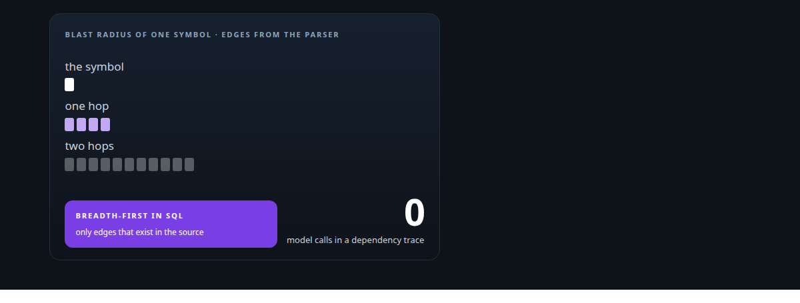
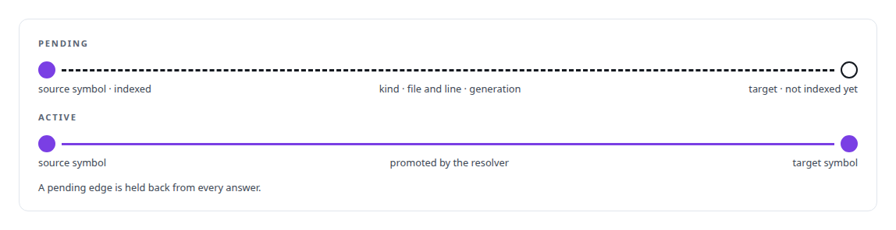
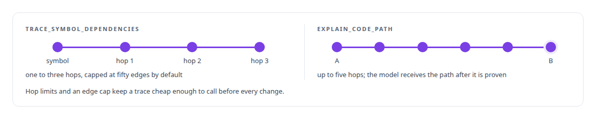
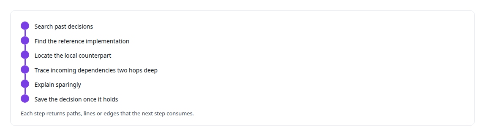

# Code graph and static dependency analysis

**The code graph under my memory service is extracted with a parser into partitioned edge tables; dependency traces are bounded database traversals with no model involved, and the explainer may narrate only proven edges.**

Canonical: https://coreyjames.ai/technologies/code-graph-and-static-dependency-analysis/  
Author: Corey James · Published: 2026-10-28 · Kind: technology  
Systems: [FAFOHive](https://github.com/coreyjames-ai/fafohive)  
Skills: [AI-assisted engineering methodology](https://github.com/coreyjames-ai/portfolio/tree/main/skills/ai-assisted-engineering-methodology) · [inference serving architecture](https://github.com/coreyjames-ai/portfolio/tree/main/skills/inference-serving-architecture) · [evidence-gated acceptance](https://github.com/coreyjames-ai/portfolio/tree/main/skills/evidence-gated-acceptance)  



## Result

| Figure | What it measures |
| --- | --- |
| **6** | edge kinds extracted from source by the parser |
| **3** | languages with edge extractors: Rust, Python and TypeScript |
| **294,033** | of the index's 294,362 code chunks covered by the graph |
| **~19,000** | files in the monorepo the graph is built over |

## What was built

### Edges from a parser, not from a model

In [FAFOHive](https://coreyjames.ai/systems/fafohive), my agents had to know the blast radius of a symbol before changing it, and a language model asked for call paths invents some.


tree-sitter extracts calls, imports, implements, references, definitions and re-exports from source, and they land in partitioned PostgreSQL edge tables. An edge whose endpoint is not indexed yet stays pending, and a resolver promotes it only once both endpoints are indexed. Graph generations let me rebuild an index without serving a half-built graph, and each request is pinned to one generation.



### Two tools over one graph

`trace_symbol_dependencies` is plain traversal: a bounded breadth-first search in SQL with a Redis fast path, returning edges and nodes with file and line. `explain_code_path` walks the same graph between two points and only then hands the proven path to a model to describe.



### A standing rule before every change

I also made the graph part of how agents work. Their operating doctrine requires a sequence before any change, told in [A code explainer that is not allowed to invent](https://coreyjames.ai/stories/a-code-explainer-that-is-not-allowed-to-invent).



> Structure must come from a parser and a database; a model may only put that structure into words.

## What was verified

Each line is a claim the canonical page supports, with the figure as the page states it.

- Static dependency analysis: a parser-built code graph of 6 edge kinds over a monorepo of ~19,000 files, covering 294,033 of 294,362 code chunks.
- PostgreSQL graph traversal: dependency traces as bounded breadth-first searches in SQL with a Redis fast path and no model call.
- Evidence-grounded LLM output: an explainer that hands a model only a path the code graph has proven, up to five hops.

## Related

- [A code explainer that is not allowed to invent](https://github.com/coreyjames-ai/fafohive/tree/main/stories/a-code-explainer-that-is-not-allowed-to-invent) · https://coreyjames.ai/stories/a-code-explainer-that-is-not-allowed-to-invent/
- System: [FAFOHive](https://github.com/coreyjames-ai/fafohive)

## Citation

Corey James. "Code graph and static dependency analysis." coreyjames.ai, 2026. https://coreyjames.ai/technologies/code-graph-and-static-dependency-analysis/

```bibtex
@misc{coreyjames-code-graph-and-static-dependency-analysis,
  author = {Corey James},
  title = {Code graph and static dependency analysis},
  year = {2026},
  howpublished = {\url{https://coreyjames.ai/technologies/code-graph-and-static-dependency-analysis/}},
  note = {GitHub copy: https://github.com/coreyjames-ai/portfolio/tree/main/technologies/code-graph-and-static-dependency-analysis}
}
```

Part of [Corey James's portfolio](https://github.com/coreyjames-ai/portfolio) · site: https://coreyjames.ai/ · MCP server: https://coreyjames.ai/mcp · agent card: https://coreyjames.ai/.well-known/agent.json
