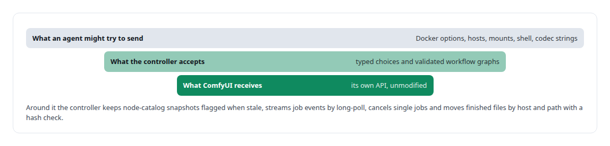
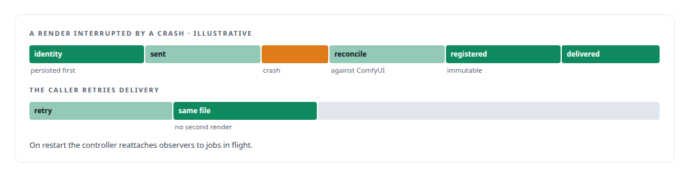

# ComfyUI

**A node-based media pipeline runs as a GPU media studio behind my memory gateway, with provenance tracked on every generated asset.**

Canonical: https://coreyjames.ai/technologies/comfyui/  
Author: Corey James · Published: 2026-10-28 · Kind: technology  
Systems: [FAFOHive](https://github.com/coreyjames-ai/fafohive)  
Skills: [exactly-once delivery and crash recovery](https://github.com/coreyjames-ai/portfolio/tree/main/skills/exactly-once-delivery-and-crash-recovery) · [Rust systems engineering](https://github.com/coreyjames-ai/portfolio/tree/main/skills/rust-systems-engineering) · [tool synthesis and governed API integration](https://github.com/coreyjames-ai/portfolio/tree/main/skills/tool-synthesis-and-governed-api-integration) · [inference serving architecture](https://github.com/coreyjames-ai/portfolio/tree/main/skills/inference-serving-architecture)  


## Result

| Figure | What it measures |
| --- | --- |
| **33** | media tools any agent can call |
| **1** | CPU-only controller container per host |
| **9** | frames in the video workflows that render and deliver end to end |

## What was built

### A controller in front of an unmodified engine

[FAFOHive](https://coreyjames.ai/systems/fafohive) hosts a GPU media studio as tools any agent can call, and ComfyUI is its render engine. The risk I saw was agents treating a GPU and a third-party HTTP engine as free and repeatable: a retried render costs GPU time, a crash mid-render leaves an unknown outcome, and an agent-supplied Docker or shell option is an escape hatch.

I decided to leave ComfyUI unmodified and put all of the control in a Rust controller in front of it. ComfyUI's own APIs do the rendering; I built no engine and changed none of its code.



### A render paid for once

A render's identity is written down before ComfyUI sees the request, so a crash never pays for the same render twice.



Image workflows and video workflows render and deliver end to end through this path.

### A person at the licence boundary

Approving a model licence takes a person at a console, and no remote call can do it.


Inventory reports what is there: a host with zero models reports zero, and an unreachable host is reported as unreachable.


> When agents are the callers, I wrap third-party engines in idempotent, crash-safe control and place the human decision at the licence boundary.

## What was verified

Each line is a claim the canonical page supports, with the figure as the page states it.

- Governed AI media pipelines: 33 media tools for agents on an unmodified ComfyUI engine behind a Rust controller that accepts typed choices only, with no Docker options, mounts or shell strings.
- Exactly-once delivery and crash recovery: render identity persisted before submission, uncertain outcomes reconciled against the engine and never resubmitted, outputs registered immutably.
- Human approval at the licence boundary: model downloads approved by a person at a local console that no remote call can reach, then resumable, hash-checked and registered.

## Related

- System: [FAFOHive](https://github.com/coreyjames-ai/fafohive)

## Citation

Corey James. "ComfyUI." coreyjames.ai, 2026. https://coreyjames.ai/technologies/comfyui/

```bibtex
@misc{coreyjames-comfyui,
  author = {Corey James},
  title = {ComfyUI},
  year = {2026},
  howpublished = {\url{https://coreyjames.ai/technologies/comfyui/}},
  note = {GitHub copy: https://github.com/coreyjames-ai/portfolio/tree/main/technologies/comfyui}
}
```

Part of [Corey James's portfolio](https://github.com/coreyjames-ai/portfolio) · site: https://coreyjames.ai/ · MCP server: https://coreyjames.ai/mcp · agent card: https://coreyjames.ai/.well-known/agent.json
