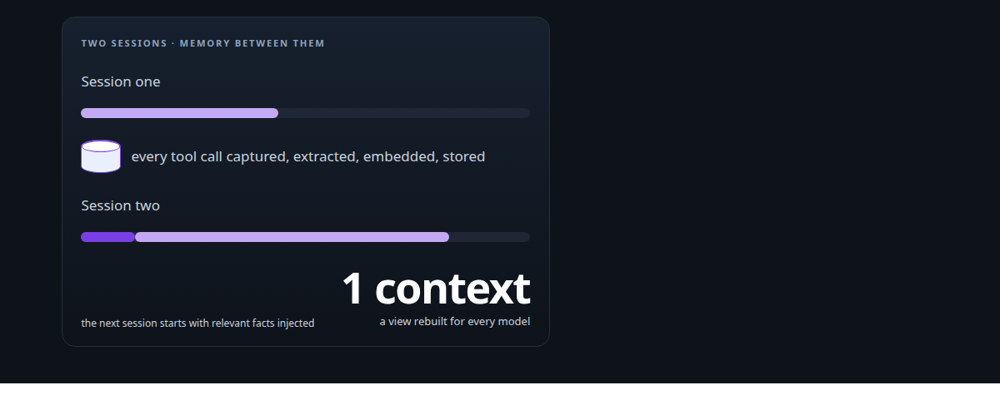
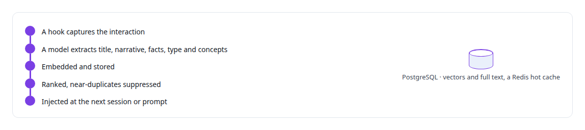
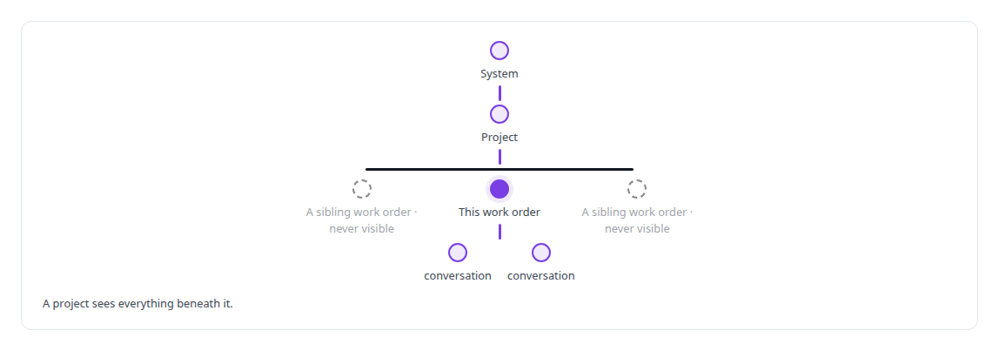
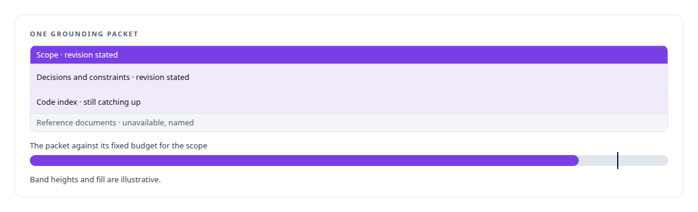

# Context engineering and persistent agent memory

**Agents forget between sessions, so I built the memory that remembers for them: every tool call captured, extracted and re-injected into later sessions, and a council shell with durable state in PostgreSQL.**

Canonical: https://coreyjames.ai/technologies/context-engineering-and-persistent-agent-memory/  
Author: Corey James · Published: 2026-10-28 · Kind: technology  
Systems: [FAFOHive](https://github.com/coreyjames-ai/fafohive) · [Helix](https://github.com/coreyjames-ai/helix)  
Skills: [AI-assisted engineering methodology](https://github.com/coreyjames-ai/portfolio/tree/main/skills/ai-assisted-engineering-methodology) · [inference serving architecture](https://github.com/coreyjames-ai/portfolio/tree/main/skills/inference-serving-architecture) · [technical leadership of agent teams](https://github.com/coreyjames-ai/portfolio/tree/main/skills/technical-leadership-of-agent-teams)  



## Result

| Figure | What it measures |
| --- | --- |
| **7** | lifecycle events hooked, from session start to sub-agent stop |
| **~6,000** | tokens of grounding per turn, the budget for one scope |

## What was built

### Memory that outlives the session

In [FAFOHive](https://coreyjames.ai/systems/fafohive), my coding agents used to forget everything between sessions and rediscover the same facts about my code over and over. Hooks on the coding agent's lifecycle events capture every tool interaction, and a worker pool hands each one to a configurable model provider, local models included.



Context that matters has to survive compaction, so it lives in a store and is injected again; the same diagnosis shaped AgentOS, told in [Why long agent runs fail](https://coreyjames.ai/stories/why-long-agent-runs-fail). In very long sessions, older tool outputs are compressed into references the agent can expand on demand, so compaction loses nothing. The service tracks what each fact cost to discover against what reusing it saved, so I can see whether memory pays for itself.

The design follows an open-source session-memory plugin for coding agents (AGPL-3.0), which I credit as its origin. No code was copied; the layer is my own Rust implementation. Local-model extraction, the de-duplication stages, the token accounting and the ties to code intelligence are mine.

### Shared state outside every model

In [Helix](https://coreyjames.ai/systems/helix), once several people and several models share one conversation, no single model's memory can be the truth, because models join late, leave and get swapped. So I made one authoritative context, and every model receives a view of it rebuilt for the current moment.


This design is the subject of U.S. Provisional Patent Application No. 64/147,766, "Methods and Systems for Maintaining Unified Conversation Context Across Heterogeneous Reasoning Backends Using a Provider-Neutral Substrate and a Transcript Authority Decoupled From a Scoped Semantic Store" (patent pending).

### Scoped grounding packets

That context draws on many sources: the conversation itself, files, decisions and constraints captured along the way, and the project's code and reference material in FAFOHive. It is organised as a hierarchy, and each participant gets context for its own place in it. Retrieval follows the scope a request comes from and never widens to the whole estate by default.



Each turn the model receives a bounded grounding packet for its scope, carrying the objective, recent activity, decisions, constraints, open questions, and the relevant code and documents. A fixed budget per scope keeps the model on what is relevant and makes cost predictable.

### Revisions, and a source that is missing

The memory changes over time under explicit revisions. Every packet states which revision of the scope and of each source it reflects, so a model can tell current knowledge from knowledge that is still catching up. If a source is unavailable, the packet names it and the turn goes ahead with what is there.



The conversation itself never disappears. What participants decide and discover goes back to the exact scope it belongs to, ready for the next participant.

### Spoken and written, one conversation

A person can also speak to Helix. They hear a short spoken answer while the full written answer appears in the attached chat location, and both belong to one conversation. Helix keeps the people and the machinery in that exchange apart.


> Knowledge outlives any model session, so the system owns the context and each model holds only its own continuity.

## What was verified

Each line is a claim the canonical page supports, with the figure as the page states it.

- Persistent memory for AI agents: 7 lifecycle events hooked to capture every tool interaction, which is extracted, embedded, stored in PostgreSQL and injected into later sessions.
- Context engineering for multi-model systems: one authoritative context owned by the system, with each model given a scoped grounding packet budgeted at ~6,000 tokens per turn.
- Scoped retrieval for agent hierarchies: context follows a system, project, work order and conversation hierarchy, and a work order never sees a sibling.

## Related

- [Why long agent runs fail](https://github.com/coreyjames-ai/agentos/tree/main/stories/why-long-agent-runs-fail) · https://coreyjames.ai/stories/why-long-agent-runs-fail/
- System: [FAFOHive](https://github.com/coreyjames-ai/fafohive)
- System: [Helix](https://github.com/coreyjames-ai/helix)

## Citation

Corey James. "Context engineering and persistent agent memory." coreyjames.ai, 2026. https://coreyjames.ai/technologies/context-engineering-and-persistent-agent-memory/

```bibtex
@misc{coreyjames-context-engineering-and-persistent-agent-memory,
  author = {Corey James},
  title = {Context engineering and persistent agent memory},
  year = {2026},
  howpublished = {\url{https://coreyjames.ai/technologies/context-engineering-and-persistent-agent-memory/}},
  note = {GitHub copy: https://github.com/coreyjames-ai/portfolio/tree/main/technologies/context-engineering-and-persistent-agent-memory}
}
```

Part of [Corey James's portfolio](https://github.com/coreyjames-ai/portfolio) · site: https://coreyjames.ai/ · MCP server: https://coreyjames.ai/mcp · agent card: https://coreyjames.ai/.well-known/agent.json
