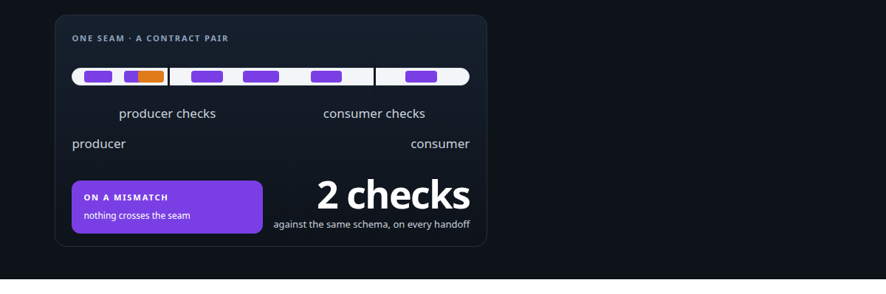
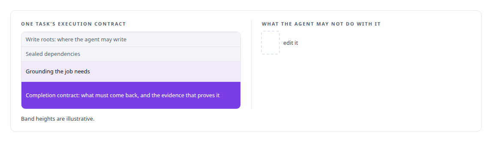
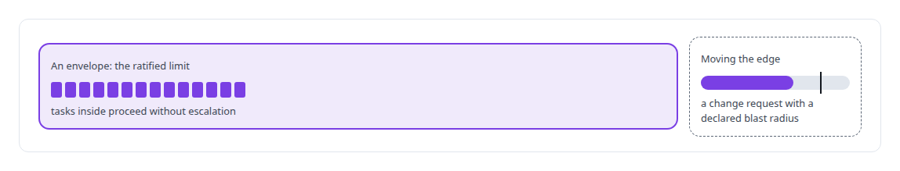
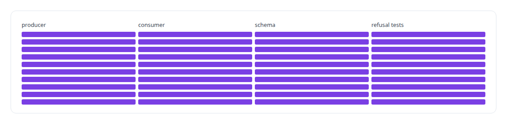
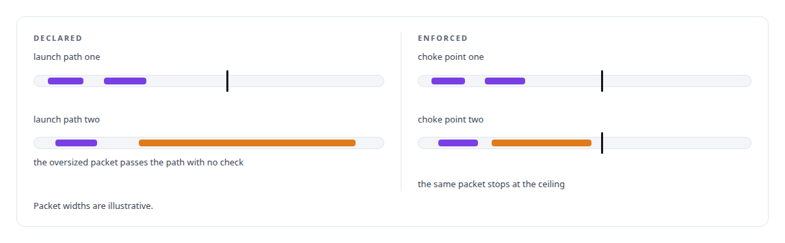
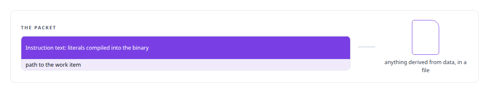

# Contract-first interface design

**Every job an agent receives in my governance platform carries a schema that says what must come back. Contracts first, prose only for behaviour.**

Canonical: https://coreyjames.ai/technologies/contract-first-interface-design/  
Author: Corey James · Published: 2026-10-28 · Kind: technology  
Systems: [AgentOS](https://github.com/coreyjames-ai/agentos)  
Skills: [multi-agent governance](https://github.com/coreyjames-ai/portfolio/tree/main/skills/multi-agent-governance) · [distributed systems correctness](https://github.com/coreyjames-ai/portfolio/tree/main/skills/distributed-systems-correctness) · [tool synthesis and governed API integration](https://github.com/coreyjames-ai/portfolio/tree/main/skills/tool-synthesis-and-governed-api-integration) · [evidence-gated acceptance](https://github.com/coreyjames-ai/portfolio/tree/main/skills/evidence-gated-acceptance)  



## Result

| Figure | What it measures |
| --- | --- |
| **10** | seams in the registry, each with producer, consumer, schema and refusal tests |
| **6 + 4** | input contracts and overlays delivered in the first phase |
| **4.78 MB** | the packet that went out past a ceiling one launch path never checked |

## What was built

### A contract for every task

In [AgentOS](https://coreyjames.ai/systems/agentos), free-form messages between agents were where long runs drifted, so I made every handoff in AgentOS a typed contract from its first phase. That phase delivered the input contracts and overlays under change control, pinned by a hashed manifest. Each task gets an execution contract rendered by AgentOS.



Above tasks sit envelopes, the ratified limits of autonomous work.



### Both sides of every seam

Every seam has a contract pair. The producer validates against a JSON Schema when it builds a payload, and the consumer validates again when it ingests it. Both call one shared validator, so the two sides cannot drift apart, and a refusal names the schema it enforced, which gives an agent something concrete to fix.

A seam registry lists every seam, and census tests keep the registry matched to the source.



### Ceilings at the choke points

A packet-size budget sat in the pinned contracts while one launch path never checked it, and an oversized packet went out. I moved the ceiling into both choke points every packet passes, including the path that leaked.




### Data never travels as instructions

AgentOS renders and keeps every packet it sends, so the lead agent issues one-line decisions and has no path to edit an artifact; [Why long agent runs fail](https://coreyjames.ai/stories/why-long-agent-runs-fail) explains that rule. I also ruled that work items never travel inside instructions.



Quality verdicts anchor to the work graph's generation and the content actually read. Stored file digests had raised false alarms with no content defect behind any of them.

The schemas are JSON Schema and the validators are standard libraries; my part is where the contracts sit and what they refuse.

> A declared limit nobody checks is documentation.

## What was verified

Each line is a claim the canonical page supports, with the figure as the page states it.

- Contract-first interface design: every agent handoff a typed contract validated by producer and consumer against one JSON Schema, in a registry of 10 seams with refusal tests.
- Multi-agent governance: execution contracts that name write roots, sealed dependencies and the evidence a task must return, under envelopes of ratified autonomy.
- Limit enforcement at choke points: a packet-size ceiling moved into both choke points after a 4.78 MB packet passed a launch path that never checked it.

## Related

- [Why long agent runs fail](https://github.com/coreyjames-ai/agentos/tree/main/stories/why-long-agent-runs-fail) · https://coreyjames.ai/stories/why-long-agent-runs-fail/
- System: [AgentOS](https://github.com/coreyjames-ai/agentos)

## Citation

Corey James. "Contract-first interface design." coreyjames.ai, 2026. https://coreyjames.ai/technologies/contract-first-interface-design/

```bibtex
@misc{coreyjames-contract-first-interface-design,
  author = {Corey James},
  title = {Contract-first interface design},
  year = {2026},
  howpublished = {\url{https://coreyjames.ai/technologies/contract-first-interface-design/}},
  note = {GitHub copy: https://github.com/coreyjames-ai/portfolio/tree/main/technologies/contract-first-interface-design}
}
```

Part of [Corey James's portfolio](https://github.com/coreyjames-ai/portfolio) · site: https://coreyjames.ai/ · MCP server: https://coreyjames.ai/mcp · agent card: https://coreyjames.ai/.well-known/agent.json
