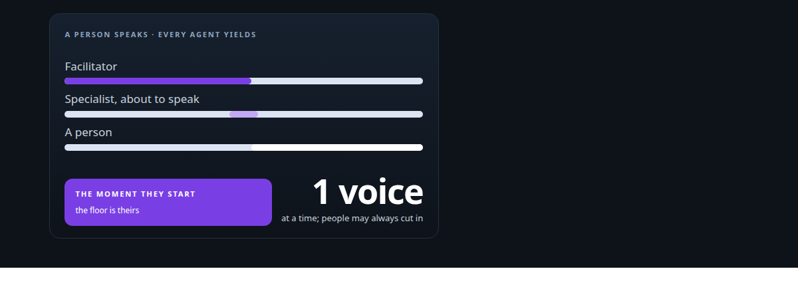
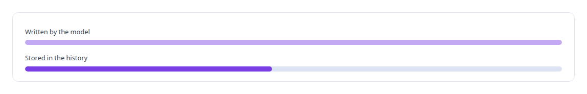
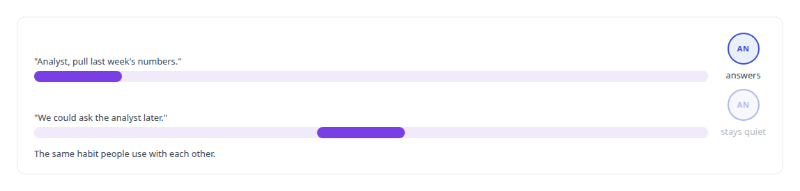
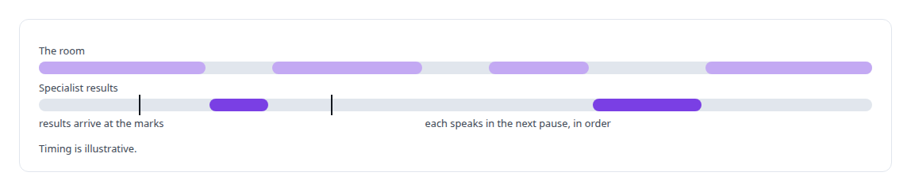
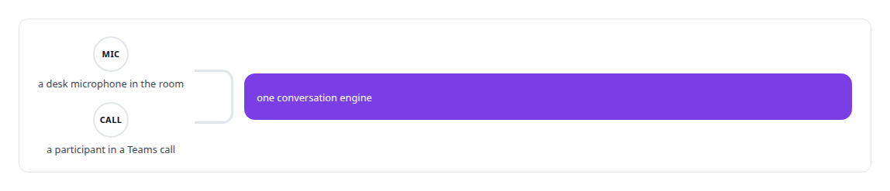

# Conversational turn-taking and barge-in

**I built a voice engine in which several AI voices share one conversation without talking over each other, and a person speaking stops the agent.**

Canonical: https://coreyjames.ai/technologies/conversational-turn-taking-and-barge-in/  
Author: Corey James · Published: 2026-10-28 · Kind: technology  
Systems: [Helix](https://github.com/coreyjames-ai/helix)  
Skills: [real-time voice AI](https://github.com/coreyjames-ai/portfolio/tree/main/skills/real-time-voice-ai) · [Microsoft Teams real-time media](https://github.com/coreyjames-ai/portfolio/tree/main/skills/microsoft-teams-real-time-media)  



## Result

| Figure | What it measures |
| --- | --- |
| **0** | stale audio after an interruption in the local voice room |

## What was built

### A person speaking stops every agent

In [Helix](https://coreyjames.ai/systems/helix), a voice colleague that keeps talking when someone starts to speak is unusable, so I made interruption the first requirement of Helix's voice engine. When a person starts speaking while an agent talks, the agent stops. If several agents are speaking or about to speak, all of them stop, and nothing from before the interruption plays afterwards.


The conversation history keeps what the room heard, so a reply cut off halfway is stored cut off and later reasoning builds on the words people actually heard.



### Addressing a persona by name

In the local room, Helix acts as facilitator alongside specialist personas, each with its own voice and prompt over shared model back ends, which makes a new specialist a configuration change.



### Work handed off aloud, results at the pauses

The facilitator can bring a specialist in and hand it work aloud, and the specialist starts on it while the conversation continues.



### The room and the call share one engine

On Microsoft Teams, a participant can talk over Helix in a call and it stops. A desk microphone and a Teams call run on the same conversation engine, so behaviour proven in the room carries into calls. [A self-hosted colleague in a Teams call](https://coreyjames.ai/stories/a-self-hosted-colleague-in-a-teams-call) covers the Teams side.



> I judge an interruption by what plays afterwards.

## What was verified

Each line is a claim the canonical page supports, with the figure as the page states it.

- Real-time voice AI: barge-in where a person speaking stops every agent, with 0 stale audio after an interruption in the local voice room.
- Conversational AI design: several AI voices in one conversation, a persona addressed by its name at the start of a sentence, and background results spoken at the next pause.
- Microsoft Teams voice integration: one conversation engine behind a desk microphone and a Teams call, so behaviour proven in the room carries into calls.

## Related

- [A self-hosted colleague in a Teams call](https://github.com/coreyjames-ai/helix/tree/main/stories/a-self-hosted-colleague-in-a-teams-call) · https://coreyjames.ai/stories/a-self-hosted-colleague-in-a-teams-call/
- System: [Helix](https://github.com/coreyjames-ai/helix)

## Citation

Corey James. "Conversational turn-taking and barge-in." coreyjames.ai, 2026. https://coreyjames.ai/technologies/conversational-turn-taking-and-barge-in/

```bibtex
@misc{coreyjames-conversational-turn-taking-and-barge-in,
  author = {Corey James},
  title = {Conversational turn-taking and barge-in},
  year = {2026},
  howpublished = {\url{https://coreyjames.ai/technologies/conversational-turn-taking-and-barge-in/}},
  note = {GitHub copy: https://github.com/coreyjames-ai/portfolio/tree/main/technologies/conversational-turn-taking-and-barge-in}
}
```

Part of [Corey James's portfolio](https://github.com/coreyjames-ai/portfolio) · site: https://coreyjames.ai/ · MCP server: https://coreyjames.ai/mcp · agent card: https://coreyjames.ai/.well-known/agent.json
