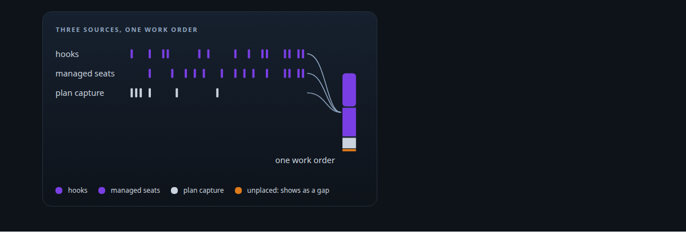
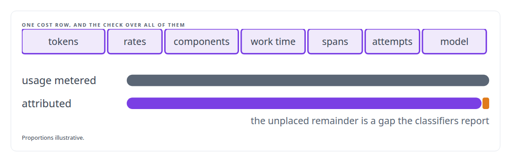
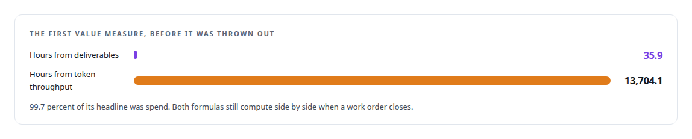

# Cost attribution for AI work

**Every token my agents spend is attributed to the work order that bought it.**

Canonical: https://coreyjames.ai/technologies/cost-attribution-for-ai-work/  
Author: Corey James · Published: 2026-10-28 · Kind: technology  
Systems: [AgentOS](https://github.com/coreyjames-ai/agentos)  
Skills: [cost attribution for AI work](https://github.com/coreyjames-ai/portfolio/tree/main/skills/cost-attribution-for-ai-work)  



## Result

| Figure | What it measures |
| --- | --- |
| **31,811** | metered usage records tied to work orders |
| **246** | work orders those records roll up to |
| **43–97%** | cache reuse across seats on one work order over a 24-hour window |

## What was built

### Every token placed against the work that bought it

AI work costs money per token, and a cost nobody can tie to a deliverable cannot be managed. [AgentOS](https://coreyjames.ai/systems/agentos) gathers usage from three sources. Hooks capture coding-agent transcripts. Managed seats emit signed, replay-safe usage events, each attributed to the model the provider reported, which is the model that actually ran.

Planning a work order costs tokens too. A capture step binds the authoring of a work order to the exact native conversation where the planning happened, passing only private file references, so no transcript content crosses the tool boundary.



### A value measure that counts delivered work first

On top of attribution sits a value measure, Validated Human-Equivalent Engineering Hours (Validated HEH). It estimates engineering hours from approved work with evidence behind it inside a metered work order, and it counts token spend only when that spend is classified, approved or tied to an outcome, attributable, and capped.

The first version was dominated by token volume. I threw it out and ratified a version in which approved deliverables come first; the flattering metric was mostly measuring spend.



Cost still has a place, and I fixed where it sits. I removed a per-dispatch budget gate from the quality checks.


> Cost informs strategy and must never silently block dispatch.

## What was verified

Each line is a claim the canonical page supports, with the figure as the page states it.

- Cost attribution for AI work: 31,811 metered usage records tied to 246 work orders, every token placed on the work that bought it.
- Engineering productivity metrics: a value measure rebuilt after 99.7 percent of the first version's headline turned out to be token spend.
- Prompt caching analysis: cache reuse of 43-97% across seats on one work order over a 24-hour window.

## Related

- [Closed by evidence](https://github.com/coreyjames-ai/agentos/tree/main/stories/closed-by-evidence) · https://coreyjames.ai/stories/closed-by-evidence/
- System: [AgentOS](https://github.com/coreyjames-ai/agentos)

## Citation

Corey James. "Cost attribution for AI work." coreyjames.ai, 2026. https://coreyjames.ai/technologies/cost-attribution-for-ai-work/

```bibtex
@misc{coreyjames-cost-attribution-for-ai-work,
  author = {Corey James},
  title = {Cost attribution for AI work},
  year = {2026},
  howpublished = {\url{https://coreyjames.ai/technologies/cost-attribution-for-ai-work/}},
  note = {GitHub copy: https://github.com/coreyjames-ai/portfolio/tree/main/technologies/cost-attribution-for-ai-work}
}
```

Part of [Corey James's portfolio](https://github.com/coreyjames-ai/portfolio) · site: https://coreyjames.ai/ · MCP server: https://coreyjames.ai/mcp · agent card: https://coreyjames.ai/.well-known/agent.json
