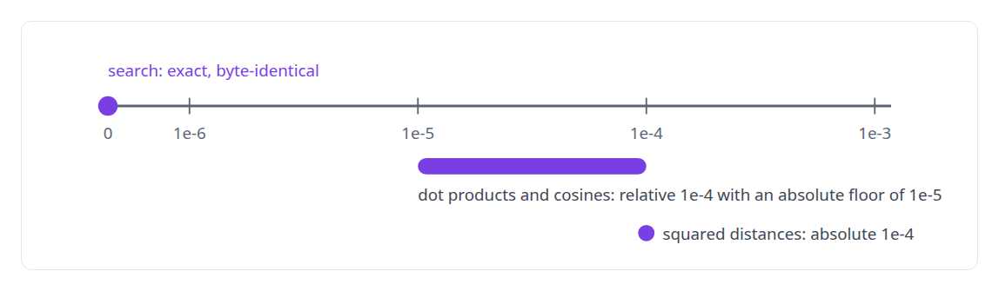
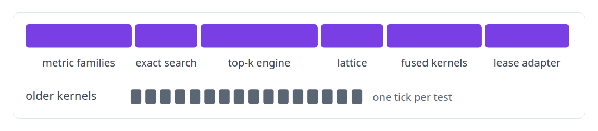

# CPU reference implementations and GPU equivalence testing

**Every GPU metric has a plain-Rust CPU twin that defines it.**

Canonical: https://coreyjames.ai/technologies/cpu-reference-implementations-and-gpu-equivalence-testing/  
Author: Corey James · Published: 2026-10-28 · Kind: technology  
Systems: [Inference Fabric](https://github.com/coreyjames-ai/inference-fabric)  
Skills: [Rust systems engineering](https://github.com/coreyjames-ai/portfolio/tree/main/skills/rust-systems-engineering) · [evidence-gated acceptance](https://github.com/coreyjames-ai/portfolio/tree/main/skills/evidence-gated-acceptance)  


## Result

| Figure | What it measures |
| --- | --- |
| **~9,000** | lines of plain-Rust reference across thirteen modules |
| **32** | Rust integration tests, beside fifteen CUDA test files |
| **20** | older kernels kept with tests as regression baselines |

## What was built

### The reference is the definition

In the [Inference Fabric](https://coreyjames.ai/systems/inference-fabric)'s CUDA engine every metric and every search family has a CPU reference in plain Rust. The reference states the formula the obvious way and decides every edge case; the kernel is an implementation that must match it.


A consistency check keeps the kernels, the references and the per-kernel lineage documentation in agreement for every kernel group. A metric that has no kernel yet stays on the CPU with its limit stated. The method is told in [Every metric gets a CPU twin](https://coreyjames.ai/stories/every-metric-gets-a-cpu-twin).


### Tolerances derived from the arithmetic

The tolerances are part of the method. They come from how single-precision reductions behave on 1,024-dimensional vectors and from the fact that the kernels compile with fast-math; tighter tolerances fail spuriously and looser ones hide bugs.

Where determinism is a design goal, in the search kernels, the comparison is exact: ties break on position, a seeded host-side draw replaces floating-point randomness, and the result is byte-identical run to run.



### Old generations kept as baselines

The Rust tests reach every part of the engine, and the CUDA tests exercise the device library on its own.



Older kernels are kept with sixteen tests of their own, so a rewrite is measured against the generation it replaces.

> I do not trust a GPU kernel to define the number it computes.

## What was verified

Each line is a claim the canonical page supports, with the figure as the page states it.

- Numerical testing of GPU kernels: a plain-Rust CPU reference of about 9,000 lines behind every metric, with a three-way check between kernel, reference and documentation.
- Floating-point tolerance design: tolerances derived from single-precision reductions on 1,024-dimensional vectors, exact and byte-identical where search promises determinism.
- Regression testing for GPU code: 32 Rust integration tests and 20 older kernels kept as baselines a rewrite is measured against.

## Related

- [Thirty-eight metrics in a dozen passes](https://github.com/coreyjames-ai/inference-fabric/tree/main/stories/thirty-eight-metrics-in-a-dozen-passes) · https://coreyjames.ai/stories/thirty-eight-metrics-in-a-dozen-passes/
- [Every metric gets a CPU twin](https://github.com/coreyjames-ai/inference-fabric/tree/main/stories/every-metric-gets-a-cpu-twin) · https://coreyjames.ai/stories/every-metric-gets-a-cpu-twin/
- [Removing the sampling caps](https://github.com/coreyjames-ai/inference-fabric/tree/main/stories/removing-the-sampling-caps) · https://coreyjames.ai/stories/removing-the-sampling-caps/
- [Where a cluster sits](https://github.com/coreyjames-ai/inference-fabric/tree/main/stories/where-a-cluster-sits) · https://coreyjames.ai/stories/where-a-cluster-sits/
- [Diversity in three kernels](https://github.com/coreyjames-ai/inference-fabric/tree/main/stories/diversity-in-three-kernels) · https://coreyjames.ai/stories/diversity-in-three-kernels/
- [Physics as a lens on embeddings](https://github.com/coreyjames-ai/inference-fabric/tree/main/stories/physics-as-a-lens-on-embeddings) · https://coreyjames.ai/stories/physics-as-a-lens-on-embeddings/
- [Two-means as a measuring instrument](https://github.com/coreyjames-ai/inference-fabric/tree/main/stories/two-means-as-a-measuring-instrument) · https://coreyjames.ai/stories/two-means-as-a-measuring-instrument/
- [From health scores to decisions](https://github.com/coreyjames-ai/inference-fabric/tree/main/stories/from-health-scores-to-decisions) · https://coreyjames.ai/stories/from-health-scores-to-decisions/
- System: [Inference Fabric](https://github.com/coreyjames-ai/inference-fabric)

## Citation

Corey James. "CPU reference implementations and GPU equivalence testing." coreyjames.ai, 2026. https://coreyjames.ai/technologies/cpu-reference-implementations-and-gpu-equivalence-testing/

```bibtex
@misc{coreyjames-cpu-reference-implementations-and-gpu-equivalence-testing,
  author = {Corey James},
  title = {CPU reference implementations and GPU equivalence testing},
  year = {2026},
  howpublished = {\url{https://coreyjames.ai/technologies/cpu-reference-implementations-and-gpu-equivalence-testing/}},
  note = {GitHub copy: https://github.com/coreyjames-ai/portfolio/tree/main/technologies/cpu-reference-implementations-and-gpu-equivalence-testing}
}
```

Part of [Corey James's portfolio](https://github.com/coreyjames-ai/portfolio) · site: https://coreyjames.ai/ · MCP server: https://coreyjames.ai/mcp · agent card: https://coreyjames.ai/.well-known/agent.json
