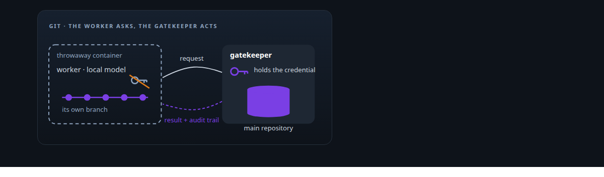
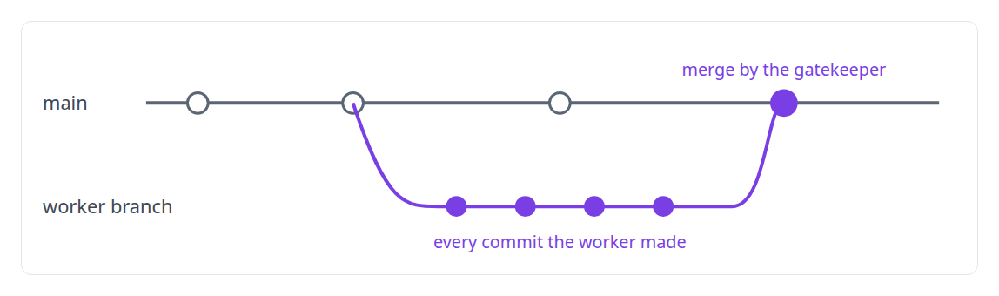
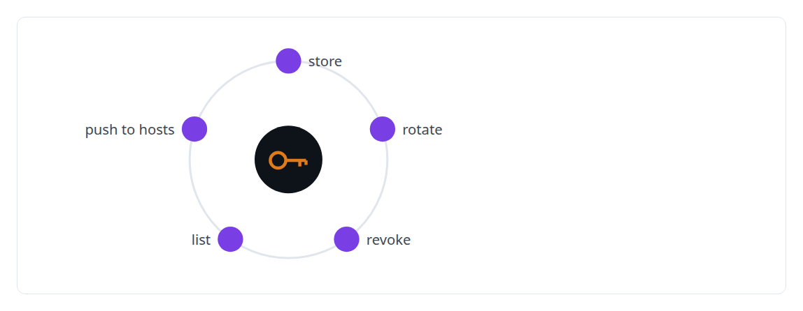
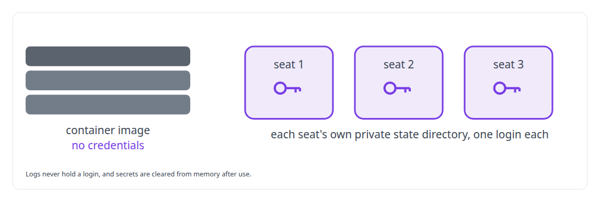

# Credential brokering and secrets management

**No agent in my estate holds a credential it does not need, and most hold none.**

Canonical: https://coreyjames.ai/technologies/credential-brokering-and-secrets-management/  
Author: Corey James · Published: 2026-10-28 · Kind: technology  
Systems: [AgentOS](https://github.com/coreyjames-ai/agentos) · [Agent Swarm](https://github.com/coreyjames-ai/agent-swarm)  
Skills: [multi-agent governance](https://github.com/coreyjames-ai/portfolio/tree/main/skills/multi-agent-governance)  



## What was built

### A gatekeeper holds each domain credential

The usual way to give an agent access is a scoped token and hope. In [Agent Swarm](https://coreyjames.ai/systems/agent-swarm) I wanted a plain property instead: an agent cannot call what it was not granted and never holds a credential it does not need. How sensitive an action is depends on which agent holds the credential for it, so I decide which agent may hold one, and every other agent asks that one for an outcome.


Git is the domain with its own gatekeeper. A coding agent on a local open-source model edits, tests and pushes to its own branch in a throwaway container, then asks the gatekeeper persona to open a merge request. The gatekeeper checks the request, acts with its own credential and returns the result with an audit trail. The worker never receives the means to push to the main branch. See [A coding agent that never holds the keys](https://coreyjames.ai/stories/a-coding-agent-that-never-holds-the-keys).



### Secrets used for the agent, never shown to it

Tools that need a secret use it on the agent's behalf and keep it away from the model. Secret bytes are never logged anywhere in the codebase, and the operator's own tools manage a secret's whole lifecycle without displaying it.



### One login per managed seat

[AgentOS](https://coreyjames.ai/systems/agentos) runs vendors' authenticated CLIs as managed seats, and I decided a seat's login belongs to that seat alone. The operator holds the login, AgentOS refers to it by an opaque reference, and it is copied into a private per-seat state directory.



Container images carry no credentials, so an image can be shared or inspected safely. The estate uses a mix of API keys and subscription logins, and the isolation covers both.

> Sensitivity follows the holder.

## What was verified

Each line is a claim the canonical page supports, with the figure as the page states it.

- Identity and least privilege for AI agents: a gatekeeper persona holds the git credential, and a coding agent on a local model opens merge requests without ever holding it.
- Secrets management: operator tools that store, rotate, revoke, list and push secrets without ever returning a value, and no secret bytes in any log.
- Credential isolation for managed AI seats: each seat's login held by reference in its own private state directory, never in an image or a log.

## Related

- [A coding agent that never holds the keys](https://github.com/coreyjames-ai/agent-swarm/tree/main/stories/a-coding-agent-that-never-holds-the-keys) · https://coreyjames.ai/stories/a-coding-agent-that-never-holds-the-keys/
- System: [AgentOS](https://github.com/coreyjames-ai/agentos)
- System: [Agent Swarm](https://github.com/coreyjames-ai/agent-swarm)

## Citation

Corey James. "Credential brokering and secrets management." coreyjames.ai, 2026. https://coreyjames.ai/technologies/credential-brokering-and-secrets-management/

```bibtex
@misc{coreyjames-credential-brokering-and-secrets-management,
  author = {Corey James},
  title = {Credential brokering and secrets management},
  year = {2026},
  howpublished = {\url{https://coreyjames.ai/technologies/credential-brokering-and-secrets-management/}},
  note = {GitHub copy: https://github.com/coreyjames-ai/portfolio/tree/main/technologies/credential-brokering-and-secrets-management}
}
```

Part of [Corey James's portfolio](https://github.com/coreyjames-ai/portfolio) · site: https://coreyjames.ai/ · MCP server: https://coreyjames.ai/mcp · agent card: https://coreyjames.ai/.well-known/agent.json
