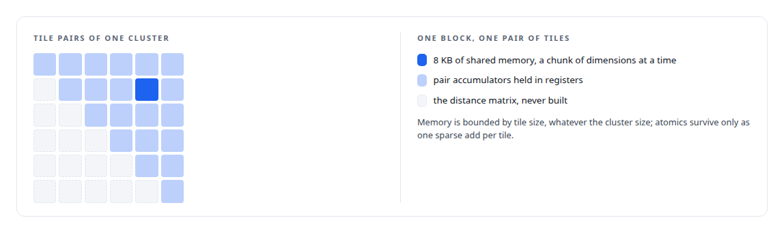
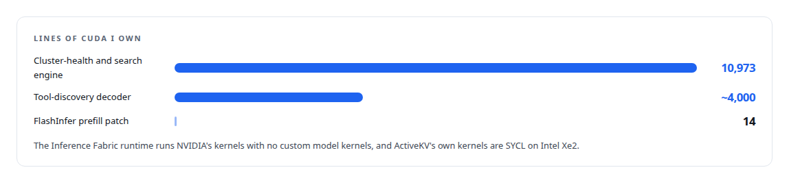

# CUDA C++

**I write CUDA where it earns its place: a cluster-health and vector-search engine for the newest NVIDIA architecture, and a tool-discovery decoder whose reductions are ordered so output bits never depend on the batch.**

Canonical: https://coreyjames.ai/technologies/cuda-c-plus-plus/  
Author: Corey James · Published: 2026-10-28 · Kind: technology  
Systems: [Inference Fabric](https://github.com/coreyjames-ai/inference-fabric) · [ActiveKV](https://github.com/coreyjames-ai/activekv) · [Capabilities model](https://github.com/coreyjames-ai/capabilities-model)  
Skills: [CUDA kernel development](https://github.com/coreyjames-ai/portfolio/tree/main/skills/cuda-kernel-development) · [NVIDIA Blackwell development](https://github.com/coreyjames-ai/portfolio/tree/main/skills/nvidia-blackwell-development) · [GPU inference optimisation](https://github.com/coreyjames-ai/portfolio/tree/main/skills/gpu-inference-optimisation) · [vector search and ANN indexes](https://github.com/coreyjames-ai/portfolio/tree/main/skills/vector-search-and-ann-indexes)  


## Result

| Figure | What it measures |
| --- | --- |
| **29** | kernels in 13 families, with exact, inverted-file and lattice search |
| **59** | kernel and header files in the analytics engine, tests included |
| **~500,000** | vectors a second for two-means clustering, rewritten without atomics |
| **2,740** | MiB, the batched decoder's footprint beside the serving model |

## What was built

### Cluster-health kernels with no library to lean on

In the [Inference Fabric](https://coreyjames.ai/systems/inference-fabric) I needed health statistics for every embedding cluster computed on the GPU next to vector search, over millions of vectors on consumer cards, and no library offered them, so I had the kernels written.

Every kernel takes all clusters in one launch. Linear-time statistics run one block per cluster with a grid-stride loop and block reductions. Pairwise statistics run one block per pair of tiles; the dimension loop sits outside the pair loop so every thread reaches every barrier.



### Rewriting a kernel whose memory traffic was wrong

The centroid kernel shows the style. Its first version accumulated the centroid with atomics and re-read every vector for threshold counts. I had it rebuilt in three passes, and it now scales linearly from 1,000 vectors.


Two-means clustering was rewritten the same way, dimension-parallel. Statistics that need a median of all pairwise distances use a 256-bin shared-memory histogram filled during the tile loop.

### Search that never builds the score matrix

Search uses one block per query with a top-k buffer in shared memory, and a shared two-pass top-k engine merges partial results for every search family. Race-freedom and cross-block tests run beside every metric family and search executor.


### A decoder whose bits never depend on the batch

In [Capabilities model](https://coreyjames.ai/systems/capabilities-model), the tool-routing model had to share a GPU with the serving model and return the same answer whatever else was in the batch, so I had a decoding engine written for it in CUDA, across decoder, grammar, batched, prefill and NVFP4 kernels.

On this hardware cuBLAS defaulted f32 GEMM to TF32 and changed reduction order. I chose determinism from structure instead: one block per output row, a fixed reduction order and no K-split tiling. The decode loop runs as a device graph with a device-side conditional. Before any NVFP4 kernel existed I had the packed layout identified by correlating candidate decodings against the same weights in the fp32 checkpoint.


See [Bit-identical across batch compositions](https://coreyjames.ai/stories/bit-identical-across-batch-compositions) and [A router beside a production model](https://coreyjames.ai/stories/a-router-beside-a-production-model).

### Where my CUDA ends

[ActiveKV](https://coreyjames.ai/systems/activekv) started from a problem on a Blackwell GPU: vLLM's KV offload did not handle hybrid-attention models, so I patched vLLM's KV-offloading connector for them, including a change to FlashInfer's recurrent-prefill launcher.



> Every kernel has a CPU reference and an equivalence test, so a fast kernel is never the only definition of the answer.

## What was verified

Each line is a claim the canonical page supports, with the figure as the page states it.

- CUDA kernel development: a cluster-health and vector-search engine of 29 kernels in 13 families, with exact, inverted-file and lattice search, each kernel with a CPU reference and an equivalence test.
- CUDA performance optimisation: a centroid kernel rebuilt in three passes without atomics, from 521 ms to 47 ms at 100,000 vectors per cluster, and two-means clustering rewritten to about 500,000 vectors a second.
- Deterministic GPU computation: a CUDA decoder with one block per output row, a fixed reduction order and no K-split tiling, so output bits never depend on the batch, in 2,740 MiB beside the serving model.
- NVIDIA Blackwell development: decode as a device graph with a device-side conditional, about 518 microseconds removed from every token, and NVFP4 weights 2.53 times smaller than FP8 at about 5 percent slower at batch 1.

## Related

- [A hundred tokens instead of forty-two thousand](https://github.com/coreyjames-ai/capabilities-model/tree/main/stories/a-hundred-tokens-instead-of-forty-two-thousand) · https://coreyjames.ai/stories/a-hundred-tokens-instead-of-forty-two-thousand/
- [A router beside a production model](https://github.com/coreyjames-ai/capabilities-model/tree/main/stories/a-router-beside-a-production-model) · https://coreyjames.ai/stories/a-router-beside-a-production-model/
- [Bit-identical across batch compositions](https://github.com/coreyjames-ai/capabilities-model/tree/main/stories/bit-identical-across-batch-compositions) · https://coreyjames.ai/stories/bit-identical-across-batch-compositions/
- [Trying the industrial path first](https://github.com/coreyjames-ai/capabilities-model/tree/main/stories/trying-the-industrial-path-first) · https://coreyjames.ai/stories/trying-the-industrial-path-first/
- [Thirty-eight metrics in a dozen passes](https://github.com/coreyjames-ai/inference-fabric/tree/main/stories/thirty-eight-metrics-in-a-dozen-passes) · https://coreyjames.ai/stories/thirty-eight-metrics-in-a-dozen-passes/
- System: [Inference Fabric](https://github.com/coreyjames-ai/inference-fabric)
- System: [ActiveKV](https://github.com/coreyjames-ai/activekv)
- System: [Capabilities model](https://github.com/coreyjames-ai/capabilities-model)

## Citation

Corey James. "CUDA C++." coreyjames.ai, 2026. https://coreyjames.ai/technologies/cuda-c-plus-plus/

```bibtex
@misc{coreyjames-cuda-c-plus-plus,
  author = {Corey James},
  title = {CUDA C++},
  year = {2026},
  howpublished = {\url{https://coreyjames.ai/technologies/cuda-c-plus-plus/}},
  note = {GitHub copy: https://github.com/coreyjames-ai/portfolio/tree/main/technologies/cuda-c-plus-plus}
}
```

Part of [Corey James's portfolio](https://github.com/coreyjames-ai/portfolio) · site: https://coreyjames.ai/ · MCP server: https://coreyjames.ai/mcp · agent card: https://coreyjames.ai/.well-known/agent.json
