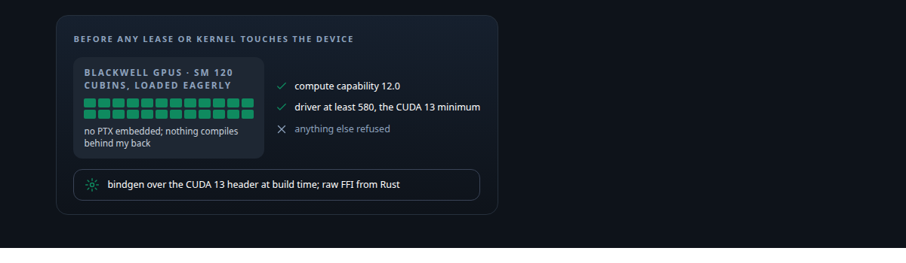
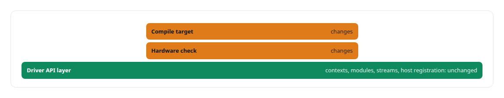
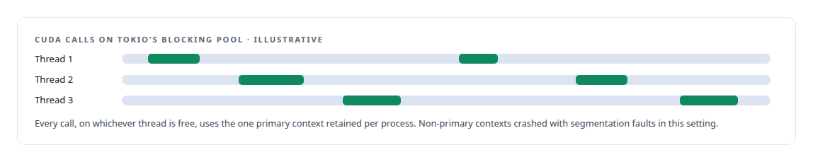
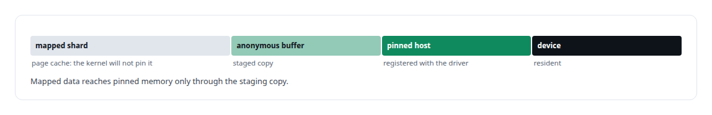
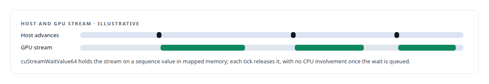

# CUDA Driver API

**My CUDA analytics engine talks to the driver API directly from Rust, built for a GPU architecture the Rust ecosystem had not caught up with.**

Canonical: https://coreyjames.ai/technologies/cuda-driver-api/  
Author: Corey James · Published: 2026-10-28 · Kind: technology  
Systems: [Inference Fabric](https://github.com/coreyjames-ai/inference-fabric)  
Skills: [Rust systems engineering](https://github.com/coreyjames-ai/portfolio/tree/main/skills/rust-systems-engineering) · [tool synthesis and governed API integration](https://github.com/coreyjames-ai/portfolio/tree/main/skills/tool-synthesis-and-governed-api-integration) · [NVIDIA Blackwell development](https://github.com/coreyjames-ai/portfolio/tree/main/skills/nvidia-blackwell-development) · [GPU inference optimisation](https://github.com/coreyjames-ai/portfolio/tree/main/skills/gpu-inference-optimisation)  



## Result

| Figure | What it measures |
| --- | --- |
| **2** | Blackwell GPUs the engine loads its own cubins onto |
| **3** | memory classes a lease can hold |
| **13.1** | the CUDA version the build defaults to |

## What was built

### Raw FFI for an architecture nobody had wrapped

In the [Inference Fabric](https://coreyjames.ai/systems/inference-fabric) I was targeting CUDA 13 and NVIDIA Blackwell when no Rust CUDA crate supported either, and I needed to ship compiled kernels to remote workers and control streams, events and devices directly.

I chose raw CUDA Driver API FFI from Rust, because no wrapper supported the toolkit and the architecture, and because cubin loading had to stay under my control. The Driver API is the same across the Blackwell generation.




### One primary context for a moving thread pool

The analytics service runs on Tokio, and CUDA calls happen on blocking-pool threads that change from one call to the next.



### Pinning host memory for leases

The Vector Shard Manager's lease layer calls libcuda directly to pin host memory with `cuMemHostRegister`. A type-only lease crate is the boundary between storage and CUDA, so storage code reaches the GPU only through it; the storage daemon never links CUDA, and a build-time check enforces that boundary.



### A doorbell the GPU waits on

Where latency matters, the GPU waits and the host does no polling.



> I work at the level of contexts, modules, streams and host memory registration when the higher-level tools do not yet reach the hardware I am using.

## What was verified

Each line is a claim the canonical page supports, with the figure as the page states it.

- CUDA Driver API from Rust: raw FFI over CUDA 13 for 2 Blackwell GPUs before any Rust crate supported them, loading native cubins with no PTX embedded and refusing any other device.
- GPU memory management: a lease layer with 3 memory classes that pins host memory with cuMemHostRegister, staging page-cache data into an anonymous buffer the kernel will pin.
- Async runtime and GPU integration: one primary CUDA context retained per process for Tokio's moving blocking-pool threads, and a GPU-side doorbell on cuStreamWaitValue64 with no host polling.

## Related

- System: [Inference Fabric](https://github.com/coreyjames-ai/inference-fabric)

## Citation

Corey James. "CUDA Driver API." coreyjames.ai, 2026. https://coreyjames.ai/technologies/cuda-driver-api/

```bibtex
@misc{coreyjames-cuda-driver-api,
  author = {Corey James},
  title = {CUDA Driver API},
  year = {2026},
  howpublished = {\url{https://coreyjames.ai/technologies/cuda-driver-api/}},
  note = {GitHub copy: https://github.com/coreyjames-ai/portfolio/tree/main/technologies/cuda-driver-api}
}
```

Part of [Corey James's portfolio](https://github.com/coreyjames-ai/portfolio) · site: https://coreyjames.ai/ · MCP server: https://coreyjames.ai/mcp · agent card: https://coreyjames.ai/.well-known/agent.json
