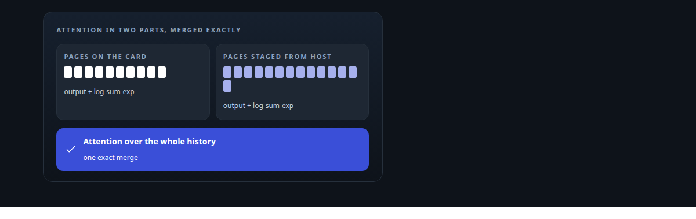
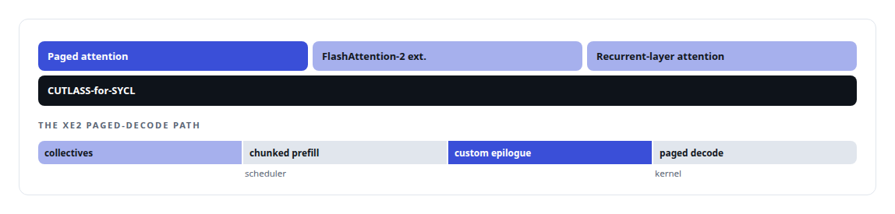
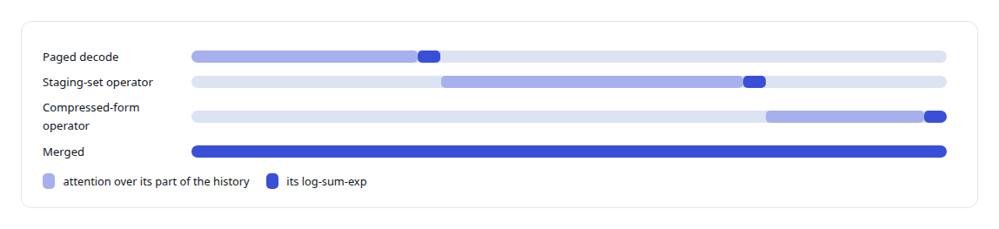
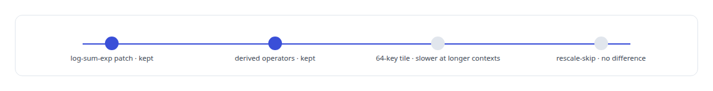

# CUTLASS

**CUTLASS-for-SYCL is part of the kernel stack I patched on Intel's Xe2 architecture for ActiveKV's attention.**

Canonical: https://coreyjames.ai/technologies/cutlass/  
Author: Corey James · Published: 2026-10-28 · Kind: technology  
Systems: [ActiveKV](https://github.com/coreyjames-ai/activekv)  
Skills: [Intel GPU and SYCL/oneAPI engineering](https://github.com/coreyjames-ai/portfolio/tree/main/skills/intel-gpu-and-sycl-oneapi-engineering) · [evidence-gated acceptance](https://github.com/coreyjames-ai/portfolio/tree/main/skills/evidence-gated-acceptance) · [GPU inference optimisation](https://github.com/coreyjames-ai/portfolio/tree/main/skills/gpu-inference-optimisation) · [C++ and native ports with parity proof](https://github.com/coreyjames-ai/portfolio/tree/main/skills/c-and-native-ports-with-parity-proof)  



## Result

| Figure | What it measures |
| --- | --- |
| **3** | kernel libraries in the release built on it |
| **2** | attention needs the stock kernels did not meet |
| **2** | candidate changes rejected and kept as negative results |

## What was built

### Extending the vendor's templates

[ActiveKV](https://coreyjames.ai/systems/activekv) needed two things from attention on the Intel Arc Pro GPU that stock kernels do not provide, and I decided to extend Intel's CUTLASS and CuTe port for SYCL to get them. The library comes from the CUTLASS 4.2.1 lineage.

The vendor's templates already encode the tile, copy and MMA structure for Xe2, so I added only what ActiveKV needed.



### The one statistic exact merging needs

The first need was the log-sum-exp statistic from paged decode. It is the one statistic that makes exact merging across memory tiers possible, so I had it added to the paged-attention path and nothing more.

The second need was attention operators that read history from the staging working set and from the compressed representation. Those were derived from the vendor's templates as specialised operators.



[Context beyond VRAM](https://coreyjames.ai/stories/context-beyond-vram) covers why the exact merge matters.

### Gated on bit-identical output

Every kernel change was built inside the vendor's own image toolchain, so the ABI matched what vLLM loads.




[Bringing a serving stack up on new silicon](https://coreyjames.ai/stories/bringing-a-serving-stack-up-on-new-silicon) covers the wider kernel programme. CUTLASS itself is NVIDIA's, and the SYCL port is Intel's.

> No kernel patch ships unless its outputs match the unpatched path bit for bit.

## What was verified

Each line is a claim the canonical page supports, with the figure as the page states it.

- Intel GPU and SYCL/oneAPI engineering: Intel's CUTLASS-for-SYCL templates extended on Xe2 for 2 attention needs, compiled into 3 kernel libraries inside the vendor's own toolchain for ABI match.
- Bit-exact numerical verification: log-sum-exp added to paged decode so attention over card and host memory merges exactly, every patch gated on output bit-identical to the unpatched path, with 2 candidates rejected.

## Related

- [Context beyond VRAM](https://github.com/coreyjames-ai/activekv/tree/main/stories/context-beyond-vram) · https://coreyjames.ai/stories/context-beyond-vram/
- [Bringing a serving stack up on new silicon](https://github.com/coreyjames-ai/activekv/tree/main/stories/bringing-a-serving-stack-up-on-new-silicon) · https://coreyjames.ai/stories/bringing-a-serving-stack-up-on-new-silicon/
- System: [ActiveKV](https://github.com/coreyjames-ai/activekv)

## Citation

Corey James. "CUTLASS." coreyjames.ai, 2026. https://coreyjames.ai/technologies/cutlass/

```bibtex
@misc{coreyjames-cutlass,
  author = {Corey James},
  title = {CUTLASS},
  year = {2026},
  howpublished = {\url{https://coreyjames.ai/technologies/cutlass/}},
  note = {GitHub copy: https://github.com/coreyjames-ai/portfolio/tree/main/technologies/cutlass}
}
```

Part of [Corey James's portfolio](https://github.com/coreyjames-ai/portfolio) · site: https://coreyjames.ai/ · MCP server: https://coreyjames.ai/mcp · agent card: https://coreyjames.ai/.well-known/agent.json
