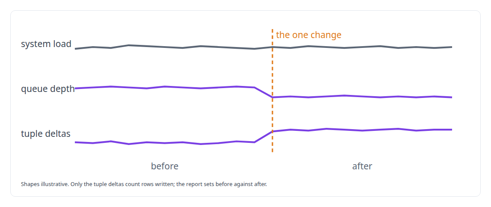
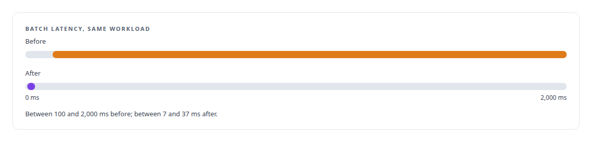

# Database performance diagnosis

**I diagnose database performance from the database's own statistics, one change at a time.**

Canonical: https://coreyjames.ai/technologies/database-performance-diagnosis/  
Author: Corey James · Published: 2026-10-28 · Kind: technology  
Systems: [PostgreSQL Fabric](https://github.com/coreyjames-ai/postgresql-fabric) · [FAFO Core and Function Forge](https://github.com/coreyjames-ai/fafo-core)  
Skills: [PostgreSQL performance tuning](https://github.com/coreyjames-ai/portfolio/tree/main/skills/postgresql-performance-tuning) · [evidence-gated acceptance](https://github.com/coreyjames-ai/portfolio/tree/main/skills/evidence-gated-acceptance)  


## Result

| Figure | What it measures |
| --- | --- |
| **196 → 0** | deadlocks in the same workload, after one index |
| **6,752** | rows per second on average, peaking at 16,370 |
| **185 s** | to write 1,249,048 rows |

## What was built

### Choosing the instrument before measuring

[FAFO Core and Function Forge](https://coreyjames.ai/systems/fafo-core) sends every database write in the estate through one governed write path, so when a bulk update slowed it, every producer slowed with it. Batches took up to two seconds, deadlocks came every few seconds, and the queue in front of the database reported healthy throughput. The queue counts rows taken in; only the database's tuple deltas count rows written.


I had a benchmark harness built that samples the system through a controlled run and renders a before-and-after report.



### One change between runs

The comparison pointed at a missing unique index on the update key of the target table, which pushed concurrent batches into colliding lock patterns. I changed that one thing: the index went in, concurrency and retry settings stayed as they were, and the same workload ran again, bulk-updating a cluster-health metrics table.



The full account is [196 deadlocks to zero](https://coreyjames.ai/stories/196-deadlocks-to-zero).

> The queue was the wrong instrument.

## What was verified

Each line is a claim the canonical page supports, with the figure as the page states it.

- PostgreSQL performance tuning: one unique index on the update key took a write path from 196 deadlocks to 0.
- Performance benchmarking methodology: tuple deltas as ground truth and one change between runs, 1,249,048 rows in 185 seconds at 6,752 rows per second on average.
- Database performance diagnosis: batch latency on the same workload cut from 100-2,000 ms to 7-37 ms.

## Related

- [196 deadlocks to zero](https://github.com/coreyjames-ai/fafo-core/tree/main/stories/196-deadlocks-to-zero) · https://coreyjames.ai/stories/196-deadlocks-to-zero/
- System: [PostgreSQL Fabric](https://github.com/coreyjames-ai/postgresql-fabric)
- System: [FAFO Core and Function Forge](https://github.com/coreyjames-ai/fafo-core)

## Citation

Corey James. "Database performance diagnosis." coreyjames.ai, 2026. https://coreyjames.ai/technologies/database-performance-diagnosis/

```bibtex
@misc{coreyjames-database-performance-diagnosis,
  author = {Corey James},
  title = {Database performance diagnosis},
  year = {2026},
  howpublished = {\url{https://coreyjames.ai/technologies/database-performance-diagnosis/}},
  note = {GitHub copy: https://github.com/coreyjames-ai/portfolio/tree/main/technologies/database-performance-diagnosis}
}
```

Part of [Corey James's portfolio](https://github.com/coreyjames-ai/portfolio) · site: https://coreyjames.ai/ · MCP server: https://coreyjames.ai/mcp · agent card: https://coreyjames.ai/.well-known/agent.json
