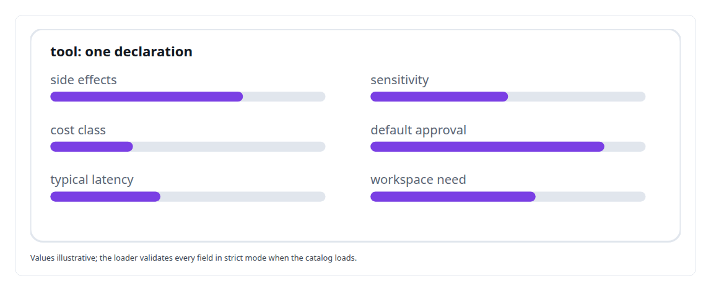
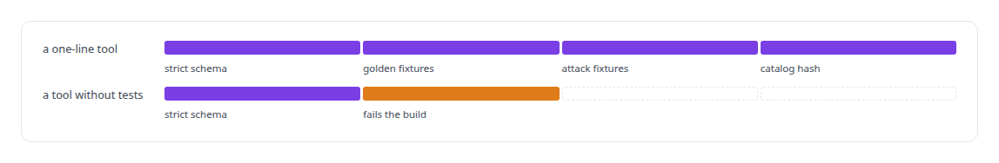
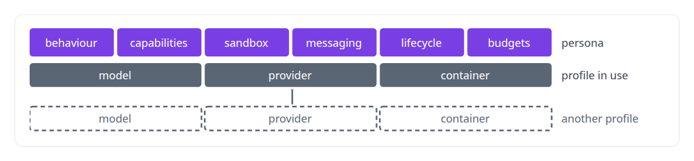
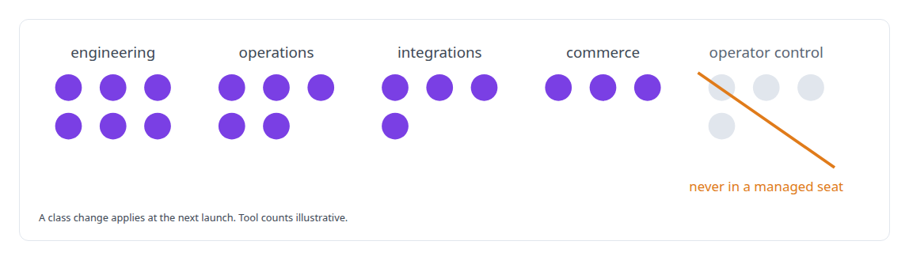

# Declarative tool and agent definition

**In my agent runtime a tool is a YAML declaration and an agent class is a composition.**

Canonical: https://coreyjames.ai/technologies/declarative-tool-and-agent-definition/  
Author: Corey James · Published: 2026-10-28 · Kind: technology  
Systems: [Agent Swarm](https://github.com/coreyjames-ai/agent-swarm) · [AgentOS](https://github.com/coreyjames-ai/agentos)  
Skills: [agent orchestration](https://github.com/coreyjames-ai/portfolio/tree/main/skills/agent-orchestration) · [AI-assisted engineering methodology](https://github.com/coreyjames-ai/portfolio/tree/main/skills/ai-assisted-engineering-methodology) · [tool synthesis and governed API integration](https://github.com/coreyjames-ai/portfolio/tree/main/skills/tool-synthesis-and-governed-api-integration) · [technical leadership of agent teams](https://github.com/coreyjames-ai/portfolio/tree/main/skills/technical-leadership-of-agent-teams)  


## Result

| Figure | What it measures |
| --- | --- |
| **40** | declarative tools in the catalog, beside about twenty Rust built-ins |
| **50** | golden fixtures run through the runtime's own pipeline |
| **29** | personas declared, not coded |

## What was built

### Tools declared as data

Every new agent tends to arrive with its own tooling and permissions, and every one of those is a new place for something to go wrong, so in [Agent Swarm](https://coreyjames.ai/systems/agent-swarm) I decided tools and agent roles would be data. Tools are declared in YAML in four kinds. Composed tools template from inputs and earlier results, with recursion detection and depth caps; HTTP templates use RFC 3986 encoding; and a peer service turns any agent into a tool provider.



A WebAssembly tool kind is declared and the harness rejects it, because a half-finished kind would have meant a partial bypass of the pipeline.

### Every tool tested before it ships

A one-line tool still needs golden and attack fixtures, and a test runner pushes every fixture through the same pipeline the runtime uses.




Catalog hashes and drift detection treat the tool catalog as replicated configuration across hosts.

### Who an agent is, apart from what it runs on

Agent classes are declared the same way. A 545-line persona schema carries who the agent is, and a separate execution profile carries what it runs on, so a model change needs no new persona.



A lint on prompt-personas keeps persona voice from carrying tool rules, packet checks or output-shape rules that belong in other layers.

### Capabilities by class, frozen at launch

A versioned tool-class manifest maps classes onto MCP tool selectors, so a work order asks for capabilities by class rather than by tool. Resolving once at launch and freezing makes every seat auditable.



The same persona library starts the managed seats of [AgentOS](https://coreyjames.ai/systems/agentos). The design is told in [Tools are the platform](https://coreyjames.ai/stories/tools-are-the-platform).

> Exceptions are where the holes are.

## What was verified

Each line is a claim the canonical page supports, with the figure as the page states it.

- Agent tool design: 40 declarative tools in YAML across four kinds, validated in strict mode and pushed through 50 golden fixtures.
- Agent orchestration: 29 personas declared, not coded, with model, provider and container kept in separate execution profiles.
- Security testing for agent tools: injection fixtures that attack every shell template, and a tool without tests fails the build.

## Related

- [Tools are the platform](https://github.com/coreyjames-ai/agent-swarm/tree/main/stories/tools-are-the-platform) · https://coreyjames.ai/stories/tools-are-the-platform/
- System: [Agent Swarm](https://github.com/coreyjames-ai/agent-swarm)
- System: [AgentOS](https://github.com/coreyjames-ai/agentos)

## Citation

Corey James. "Declarative tool and agent definition." coreyjames.ai, 2026. https://coreyjames.ai/technologies/declarative-tool-and-agent-definition/

```bibtex
@misc{coreyjames-declarative-tool-and-agent-definition,
  author = {Corey James},
  title = {Declarative tool and agent definition},
  year = {2026},
  howpublished = {\url{https://coreyjames.ai/technologies/declarative-tool-and-agent-definition/}},
  note = {GitHub copy: https://github.com/coreyjames-ai/portfolio/tree/main/technologies/declarative-tool-and-agent-definition}
}
```

Part of [Corey James's portfolio](https://github.com/coreyjames-ai/portfolio) · site: https://coreyjames.ai/ · MCP server: https://coreyjames.ai/mcp · agent card: https://coreyjames.ai/.well-known/agent.json
