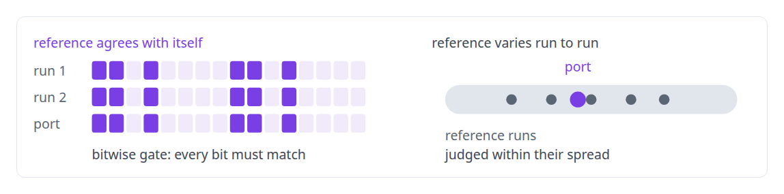
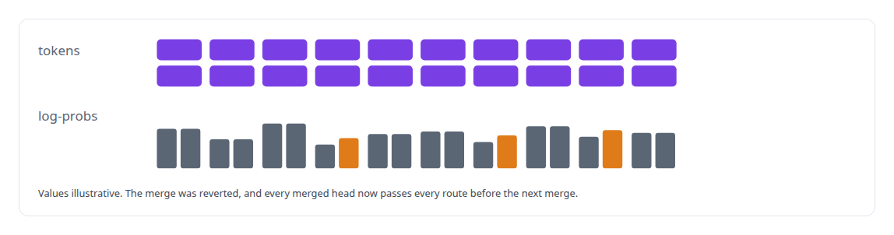
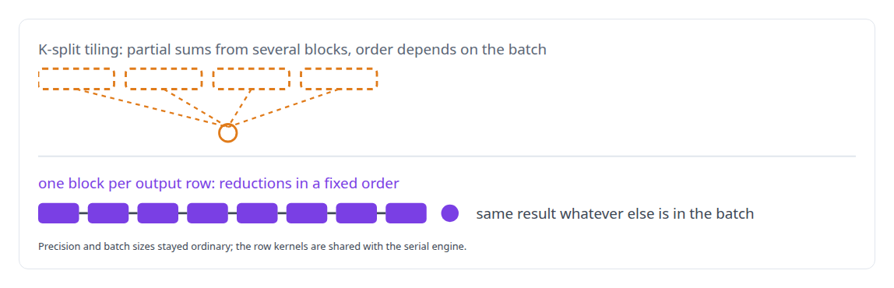
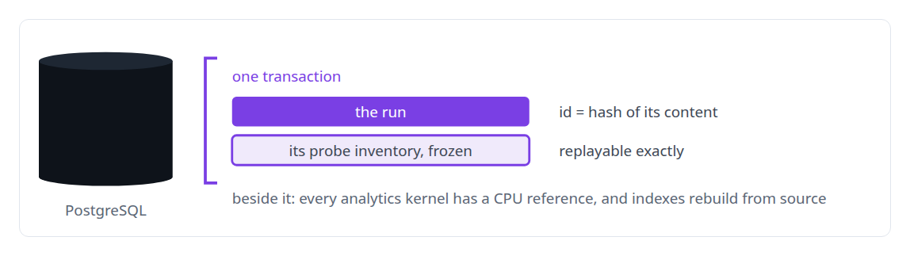

# Determinism and numerical reproducibility

**Bit-identical or nothing, wherever the reference is bitwise with itself.**

Canonical: https://coreyjames.ai/technologies/determinism-and-numerical-reproducibility/  
Author: Corey James · Published: 2026-10-28 · Kind: technology  
Systems: [ActiveKV](https://github.com/coreyjames-ai/activekv) · [Capabilities model](https://github.com/coreyjames-ai/capabilities-model) · [Inference Fabric](https://github.com/coreyjames-ai/inference-fabric)  
Skills: [C++ and native ports with parity proof](https://github.com/coreyjames-ai/portfolio/tree/main/skills/c-and-native-ports-with-parity-proof) · [AI-assisted engineering methodology](https://github.com/coreyjames-ai/portfolio/tree/main/skills/ai-assisted-engineering-methodology)  


## Result

| Figure | What it measures |
| --- | --- |
| **13 of 13** | exact cells matched bitwise by the Python-to-C++ port, and 12 of 12 compressed |
| **2,345** | of 2,345 rank-one checks held across shuffled batch compositions |
| **484** | of 484 ranked lists matched against an independent implementation |

## What was built

### Bit-for-bit parity for a native port

A rewrite or a kernel patch that changes one output bit invalidates every parity result above it, so I made bit-for-bit reproducibility [ActiveKV](https://coreyjames.ai/systems/activekv)'s release standard. The exact BF16 path passes only when its output is bit-identical to fully resident attention. To make that reachable, I had the paged-attention kernel patched to emit its log-sum-exp statistic, so attention computed over on-card and host-resident history merges exactly. For parity runs, a validation switch makes the variable 4-bit GEMM reductions deterministic, and the release build is bit-identical to it with the switch off.

I wrote the parity doctrine, and its first rule is that I run the reference twice before trusting a bitwise gate.




The exact and compressed paths are each judged against their own references; the compressed tier is lossy by design, and I draw no causal conclusions across modes. Parity never removes a guard: when the rewrite refused work the original allowed, I proved the guard right before anything changed.

During release consolidation, one merge broke the standard anyway. See [Proving a rewrite is the same system](https://coreyjames.ai/stories/proving-a-rewrite-is-the-same-system).



### The same ranking whatever else is in the batch

In the [Capabilities model](https://coreyjames.ai/systems/capabilities-model), an agent asking which tool to call must get the same ranking whatever else is in the batch, so I treated determinism as correctness. The batched CUDA decoder passed 12 of 12 bit-identity gates.



Quantisation to NVFP4 takes about 15 seconds and is byte-identical on re-run, so a rebuilt model can be compared with the one it replaces. See [Bit-identical across batch compositions](https://coreyjames.ai/stories/bit-identical-across-batch-compositions).

### Every GPU result checkable on a CPU

In the [Inference Fabric](https://coreyjames.ai/systems/inference-fabric) I wanted every GPU result checkable on a CPU, and every run replayable. The method behind the kernels is on [CPU reference implementations and GPU equivalence testing](https://coreyjames.ai/technologies/cpu-reference-implementations-and-gpu-equivalence-testing).



> A non-deterministic baseline fails against itself.

## What was verified

Each line is a claim the canonical page supports, with the figure as the page states it.

- Numerical reproducibility and bitwise validation: a Python-to-C++ port that matched 13 of 13 exact cells and 12 of 12 compressed cells bitwise.
- Deterministic GPU computation: a batched CUDA decoder identical across shuffled batch compositions in 2,345 of 2,345 rank-one checks, 484 of 484 ranked lists matched.
- Reproducible ML pipelines: NVFP4 quantisation in about 15 seconds, byte-identical on re-run, so a rebuilt model can be compared with the one it replaces.

## Related

- [Bit-identical across batch compositions](https://github.com/coreyjames-ai/capabilities-model/tree/main/stories/bit-identical-across-batch-compositions) · https://coreyjames.ai/stories/bit-identical-across-batch-compositions/
- [Proving a rewrite is the same system](https://github.com/coreyjames-ai/activekv/tree/main/stories/proving-a-rewrite-is-the-same-system) · https://coreyjames.ai/stories/proving-a-rewrite-is-the-same-system/
- [Thirty-eight metrics in a dozen passes](https://github.com/coreyjames-ai/inference-fabric/tree/main/stories/thirty-eight-metrics-in-a-dozen-passes) · https://coreyjames.ai/stories/thirty-eight-metrics-in-a-dozen-passes/
- [CPU reference implementations and GPU equivalence testing](https://github.com/coreyjames-ai/portfolio/tree/main/technologies/cpu-reference-implementations-and-gpu-equivalence-testing) · https://coreyjames.ai/technologies/cpu-reference-implementations-and-gpu-equivalence-testing/
- System: [ActiveKV](https://github.com/coreyjames-ai/activekv)
- System: [Capabilities model](https://github.com/coreyjames-ai/capabilities-model)
- System: [Inference Fabric](https://github.com/coreyjames-ai/inference-fabric)

## Citation

Corey James. "Determinism and numerical reproducibility." coreyjames.ai, 2026. https://coreyjames.ai/technologies/determinism-and-numerical-reproducibility/

```bibtex
@misc{coreyjames-determinism-and-numerical-reproducibility,
  author = {Corey James},
  title = {Determinism and numerical reproducibility},
  year = {2026},
  howpublished = {\url{https://coreyjames.ai/technologies/determinism-and-numerical-reproducibility/}},
  note = {GitHub copy: https://github.com/coreyjames-ai/portfolio/tree/main/technologies/determinism-and-numerical-reproducibility}
}
```

Part of [Corey James's portfolio](https://github.com/coreyjames-ai/portfolio) · site: https://coreyjames.ai/ · MCP server: https://coreyjames.ai/mcp · agent card: https://coreyjames.ai/.well-known/agent.json
