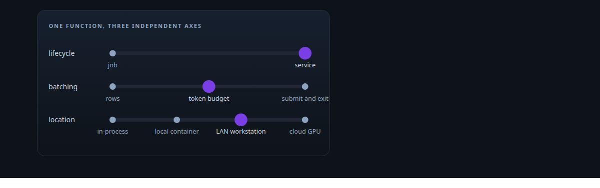
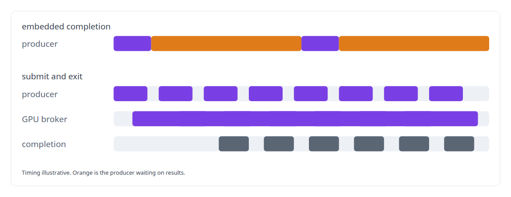
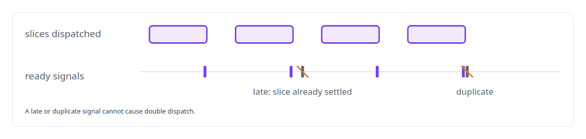
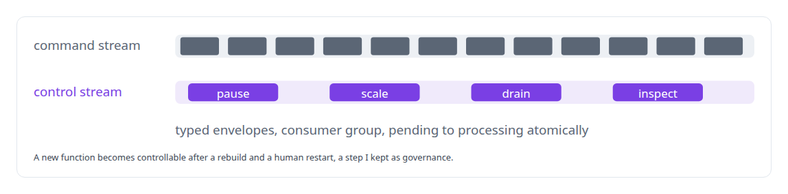

# Distributed job orchestration

**One function definition runs as a job or a service, batched by rows or by GPU token budget, anywhere from in-process to rented cloud GPUs, by configuration.**

Canonical: https://coreyjames.ai/technologies/distributed-job-orchestration/  
Author: Corey James · Published: 2026-10-28 · Kind: technology  
Systems: [FAFO Core and Function Forge](https://github.com/coreyjames-ai/fafo-core)  
Skills: [high-throughput batch inference](https://github.com/coreyjames-ai/portfolio/tree/main/skills/high-throughput-batch-inference) · [Rust systems engineering](https://github.com/coreyjames-ai/portfolio/tree/main/skills/rust-systems-engineering) · [inference serving architecture](https://github.com/coreyjames-ai/portfolio/tree/main/skills/inference-serving-architecture) · [agent orchestration](https://github.com/coreyjames-ai/portfolio/tree/main/skills/agent-orchestration)  



## Result

| Figure | What it measures |
| --- | --- |
| **13** | function crates built on the framework, beside eight service crates |
| **19** | control actions reaching running conductors, among them pause, scale, drain and inspect |
| **970K** | probes in flight at the peak, never below 670K, from one decoupled producer over a two-hour capture |

## What was built

### One trait, three axes

I was going to build many systems and did not want to solve orchestration more than once, so I made [FAFO Core and Function Forge](https://coreyjames.ai/systems/fafo-core) one execution model that every function runs under. A function implements one Rust trait, and a generic conductor runs it along three independent axes over Redis and PostgreSQL.


Services trigger continuously, on queue depth or on an interval. In submit-and-exit, a producer hands generation to the GPU broker and moves on while a completion service closes the loop; I split completion out after an embedded design made producers wait on results.



### The framework owns the hard parts

The framework owns connections, pagination, slicing, worker dispatch, dead-lettering and metrics, and it changes job state in Lua on the Redis server, so state is never half-updated between round-trips. Workers follow an "exactly one ready signal per dispatched slice" protocol.



Submit-and-return workers use a lock-free pending tracker and per-job ready queues, so polling cost follows the number of ready items. Work items are claimed by lease, a rule that came from two workers colliding under the real workload. Schemas, views and column types resolve at run time, and identifiers are validated and quoted before any dynamic SQL.

### A control plane above the conductors

Commands arrive on a Redis stream and control actions on a separate one, and on startup the control plane recovers orphaned services and stale queues.



Under load, a decoupled producer keeps its probes in flight by refilling in waves across Blackwell GPU hosts; see [The workload that shaped the platform](https://coreyjames.ai/stories/the-workload-that-shaped-the-platform).

> Orthogonal axes over named modes: a new combination is a configuration change.

## What was verified

Each line is a claim the canonical page supports, with the figure as the page states it.

- Distributed job orchestration: one Rust trait run as a job or a service, batched by rows or GPU token budget, in-process to rented cloud GPUs, under 13 function crates.
- Control-plane design: 19 control actions, among them pause, scale, drain and inspect, reaching active conductors through a separate high-priority stream.
- High-throughput batch inference: a decoupled producer holding 670K-970K probes in flight over a two-hour capture across Blackwell GPU hosts.

## Related

- [The workload that shaped the platform](https://github.com/coreyjames-ai/fafo-core/tree/main/stories/the-workload-that-shaped-the-platform) · https://coreyjames.ai/stories/the-workload-that-shaped-the-platform/
- System: [FAFO Core and Function Forge](https://github.com/coreyjames-ai/fafo-core)

## Citation

Corey James. "Distributed job orchestration." coreyjames.ai, 2026. https://coreyjames.ai/technologies/distributed-job-orchestration/

```bibtex
@misc{coreyjames-distributed-job-orchestration,
  author = {Corey James},
  title = {Distributed job orchestration},
  year = {2026},
  howpublished = {\url{https://coreyjames.ai/technologies/distributed-job-orchestration/}},
  note = {GitHub copy: https://github.com/coreyjames-ai/portfolio/tree/main/technologies/distributed-job-orchestration}
}
```

Part of [Corey James's portfolio](https://github.com/coreyjames-ai/portfolio) · site: https://coreyjames.ai/ · MCP server: https://coreyjames.ai/mcp · agent card: https://coreyjames.ai/.well-known/agent.json
