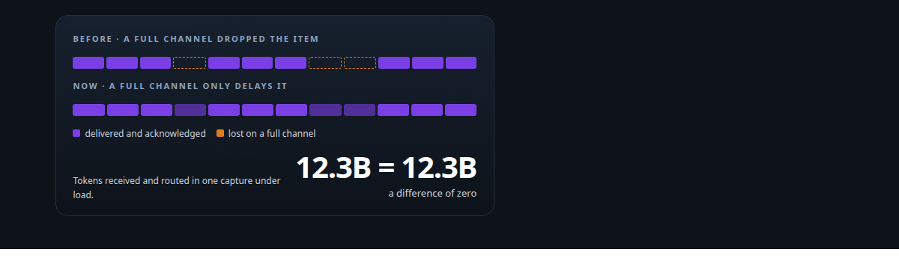
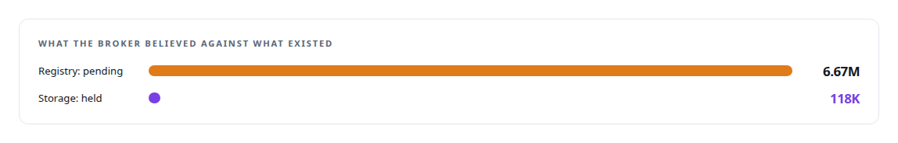
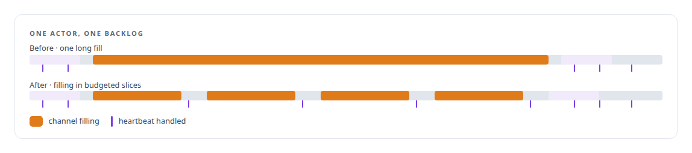
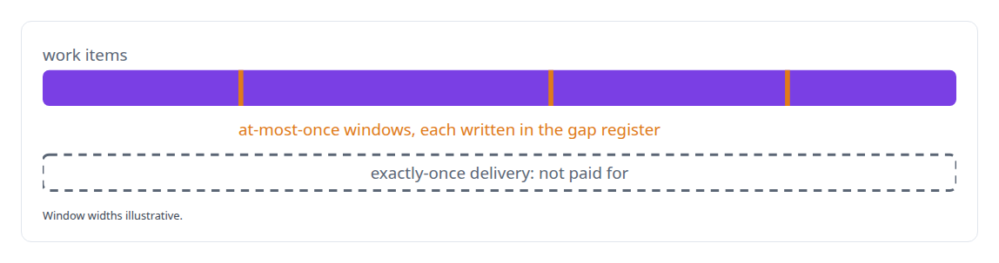
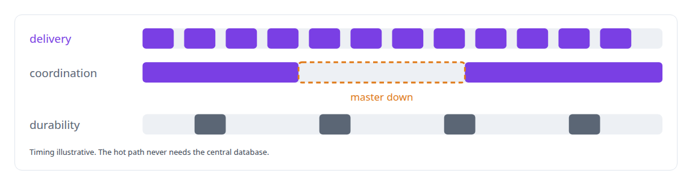

# Distributed-systems reliability

**Nothing waits on anything else, every component restarts independently, and the accounting balances.**

Canonical: https://coreyjames.ai/technologies/distributed-systems-reliability/  
Author: Corey James · Published: 2026-10-28 · Kind: technology  
Systems: [Inference Fabric](https://github.com/coreyjames-ai/inference-fabric) · [Agent Swarm](https://github.com/coreyjames-ai/agent-swarm)  
Skills: [exactly-once delivery and crash recovery](https://github.com/coreyjames-ai/portfolio/tree/main/skills/exactly-once-delivery-and-crash-recovery) · [distributed systems correctness](https://github.com/coreyjames-ai/portfolio/tree/main/skills/distributed-systems-correctness) · [message broker and queue design](https://github.com/coreyjames-ai/portfolio/tree/main/skills/message-broker-and-queue-design)  



## Result

| Figure | What it measures |
| --- | --- |
| **32** | at-most-once windows written into the gap register |
| **3,099** | batches whose fill once blocked the broker for 17 seconds |
| **6** | leakage rules binding the delivery, coordination and durability planes |

## What was built

### Done means delivered and acknowledged

The [Inference Fabric](https://coreyjames.ai/systems/inference-fabric) lost work silently under load. Its buffer service is a custom distributed system: producers, a durable broker and pull-based GPU consumers on separate machines, each restartable on its own, with no distributed transactions and no shared state store on the hot path.



I traced it to a definition. An item counted as consumed when it was read and was dropped if the consumer's channel happened to be full. I redefined done as delivered and acknowledged and rebuilt the accounting around it, accepting bookkeeping cost on the read path, so a full channel delays work and loses none.


A broker restart could also re-run work the GPUs still held, and I closed that path while staying compatible with consumers already in the field.

### Liveness that heavy work cannot starve

The second failure was zombie consumers. Filling a large backlog blocked the broker's single-owner actor long enough that heartbeats starved and working GPUs were declared dead. The fix was a time budget on channel filling, one disconnect rule for every socket error, and deletion of a legacy path with no heartbeat timeout.



### Accounting that balances

Downstream, the completion service stops polling when the database write queue is unhealthy and backs off exponentially, so results never leave the broker with nowhere safe to land. Accounting panels show tokens received, routed, completed and acknowledged side by side. I chose not to pay for exactly-once delivery, and wrote down the windows that remain. See [Millions of queued items that were not there](https://coreyjames.ai/stories/millions-of-queued-items-that-were-not-there).



### Failure domains named before transport

In [Agent Swarm](https://coreyjames.ai/systems/agent-swarm), agents on several hosts must keep talking when a coordinator goes down, so I wrote the failure-domain model before any transport code. The unit is a swarm, a group of containers with its own Redis, and a host is disposable compute; every component knows what it may depend on.



The cross-host relay and hub router carry signed envelopes, deduplication, resume and forged-origin rejection.

> “Consumed on read” was the bug, and “acknowledged on completion” was the cure.

## What was verified

Each line is a claim the canonical page supports, with the figure as the page states it.

- Exactly-once delivery and crash recovery: a broker whose registry showed 6.67M items pending against 118K in storage, fixed by redefining done as delivered and acknowledged.
- Distributed systems correctness: liveness restored after a 3,099-batch fill blocked the broker for 17 seconds, with a time budget on channel filling.
- Failure-domain design: delivery, coordination and durability planes bound by 6 leakage rules, so a coordinator outage leaves delivery alone.
- Delivery guarantees: 32 at-most-once windows written into a gap register instead of paying for exactly-once delivery.

## Related

- [Millions of queued items that were not there](https://github.com/coreyjames-ai/inference-fabric/tree/main/stories/millions-of-queued-items-that-were-not-there) · https://coreyjames.ai/stories/millions-of-queued-items-that-were-not-there/
- System: [Inference Fabric](https://github.com/coreyjames-ai/inference-fabric)
- System: [Agent Swarm](https://github.com/coreyjames-ai/agent-swarm)

## Citation

Corey James. "Distributed-systems reliability." coreyjames.ai, 2026. https://coreyjames.ai/technologies/distributed-systems-reliability/

```bibtex
@misc{coreyjames-distributed-systems-reliability,
  author = {Corey James},
  title = {Distributed-systems reliability},
  year = {2026},
  howpublished = {\url{https://coreyjames.ai/technologies/distributed-systems-reliability/}},
  note = {GitHub copy: https://github.com/coreyjames-ai/portfolio/tree/main/technologies/distributed-systems-reliability}
}
```

Part of [Corey James's portfolio](https://github.com/coreyjames-ai/portfolio) · site: https://coreyjames.ai/ · MCP server: https://coreyjames.ai/mcp · agent card: https://coreyjames.ai/.well-known/agent.json
