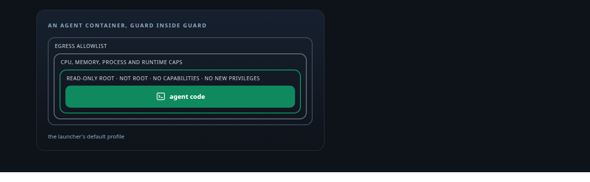
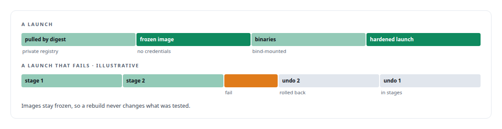
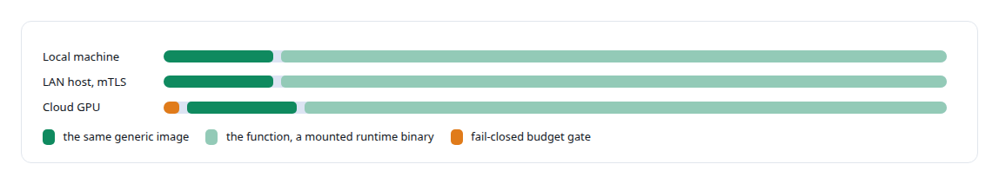
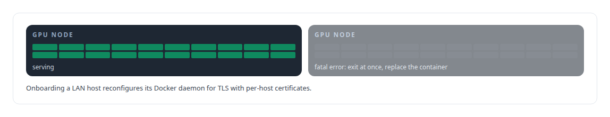
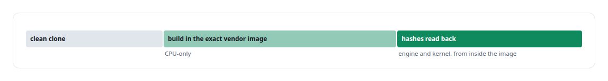
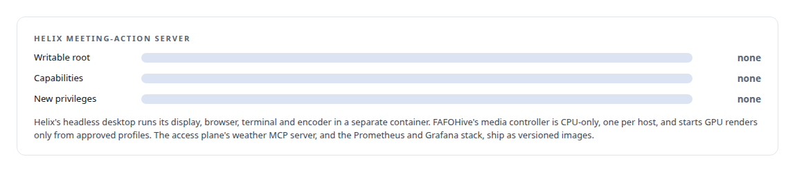

# Docker

**Containers are how my agents are sandboxed, how GPU consumers are provisioned on local, LAN and cloud hosts, and how release images are proven.**

Canonical: https://coreyjames.ai/technologies/docker/  
Author: Corey James · Published: 2026-10-28 · Kind: technology  
Systems: [Agent Swarm](https://github.com/coreyjames-ai/agent-swarm) · [AgentOS](https://github.com/coreyjames-ai/agentos) · [FAFO Core and Function Forge](https://github.com/coreyjames-ai/fafo-core) · [Inference Fabric](https://github.com/coreyjames-ai/inference-fabric) · [ActiveKV](https://github.com/coreyjames-ai/activekv) · [Helix](https://github.com/coreyjames-ai/helix) · [FAFOHive](https://github.com/coreyjames-ai/fafohive) · [Auth and access plane](https://github.com/coreyjames-ai/auth-and-access-plane)  
Skills: [sandboxing and container hardening](https://github.com/coreyjames-ai/portfolio/tree/main/skills/sandboxing-and-container-hardening) · [Rust systems engineering](https://github.com/coreyjames-ai/portfolio/tree/main/skills/rust-systems-engineering) · [tool synthesis and governed API integration](https://github.com/coreyjames-ai/portfolio/tree/main/skills/tool-synthesis-and-governed-api-integration) · [AI-assisted engineering methodology](https://github.com/coreyjames-ai/portfolio/tree/main/skills/ai-assisted-engineering-methodology)  



## Result

| Figure | What it measures |
| --- | --- |
| **10** | image definitions for native workers, coding-CLI seats and infrastructure services |
| **4** | loader modes on one generic image: job, capability, agent, infrastructure |
| **2** | per-GPU images, one for each NVIDIA Blackwell GPU |

## What was built

### A sandbox an agent cannot loosen

In [Agent Swarm](https://coreyjames.ai/systems/agent-swarm), agents that run code need a sandbox they cannot loosen. The launcher drives the Docker Engine API from Rust to create, inspect, pause and kill agent containers.




[AgentOS](https://coreyjames.ai/systems/agentos) needed seats isolated from each other, so every managed seat is its own container started through that launcher, with provider state copied into a private per-seat directory. See [A coding agent that never holds the keys](https://coreyjames.ai/stories/a-coding-agent-that-never-holds-the-keys).

### A function's location as configuration

In [FAFO Core and Function Forge](https://coreyjames.ai/systems/fafo-core) I wanted a function's location to be configuration, so Core injects its runtime into generic containers. One image, a bind-mounted runtime binary and a loader script let any function run anywhere the image runs, with no image rebuild, and agent mode applies the same hardening.



### One GPU, one container, one engine

In the [Inference Fabric](https://coreyjames.ai/systems/inference-fabric) I wanted a broken GPU node fixed by replacing its container, so each node is one GPU, one container and one engine, with a fast exit on any fatal error. The per-GPU images sit on a TensorRT-LLM base.



### Proving a release from inside the image

In [ActiveKV](https://coreyjames.ai/systems/activekv), a kernel patch built against the wrong toolchain breaks the ABI vLLM loads, so I rebuild patches inside a container of the exact vendor image. A release counts as promoted only after its hashes are read back from inside that image.



### Containers with nothing to escalate with

In [Helix](https://coreyjames.ai/systems/helix), a server that acts as a digital employee in meetings should have nothing to escalate with. In [FAFOHive](https://coreyjames.ai/systems/fafohive), agents ask for GPU renders, and an agent-supplied Docker option is an escape hatch. In the [Auth and access plane](https://coreyjames.ai/systems/auth-and-access-plane) I wanted the weather MCP server to install like a product.



> Hardening is the default profile, and an agent has no switch to turn it off.

## What was verified

Each line is a claim the canonical page supports, with the figure as the page states it.

- Sandboxing and container hardening: agent containers driven through the Docker Engine API from Rust with all capabilities dropped, a read-only root, no root user, resource caps and egress allowlists by default.
- Container-based compute provisioning: one generic image with 4 loader modes that runs a function on a local, LAN or cloud GPU host with no rebuild, cloud capacity only past a fail-closed budget gate.
- Reproducible native builds: kernel patches rebuilt inside the exact vendor image from a clean clone and promoted only after engine and kernel hashes are read back from inside the image.

## Related

- [A coding agent that never holds the keys](https://github.com/coreyjames-ai/agent-swarm/tree/main/stories/a-coding-agent-that-never-holds-the-keys) · https://coreyjames.ai/stories/a-coding-agent-that-never-holds-the-keys/
- System: [Agent Swarm](https://github.com/coreyjames-ai/agent-swarm)
- System: [AgentOS](https://github.com/coreyjames-ai/agentos)
- System: [FAFO Core and Function Forge](https://github.com/coreyjames-ai/fafo-core)
- System: [Inference Fabric](https://github.com/coreyjames-ai/inference-fabric)
- System: [ActiveKV](https://github.com/coreyjames-ai/activekv)
- System: [Helix](https://github.com/coreyjames-ai/helix)
- System: [FAFOHive](https://github.com/coreyjames-ai/fafohive)
- System: [Auth and access plane](https://github.com/coreyjames-ai/auth-and-access-plane)

## Citation

Corey James. "Docker." coreyjames.ai, 2026. https://coreyjames.ai/technologies/docker/

```bibtex
@misc{coreyjames-docker,
  author = {Corey James},
  title = {Docker},
  year = {2026},
  howpublished = {\url{https://coreyjames.ai/technologies/docker/}},
  note = {GitHub copy: https://github.com/coreyjames-ai/portfolio/tree/main/technologies/docker}
}
```

Part of [Corey James's portfolio](https://github.com/coreyjames-ai/portfolio) · site: https://coreyjames.ai/ · MCP server: https://coreyjames.ai/mcp · agent card: https://coreyjames.ai/.well-known/agent.json
