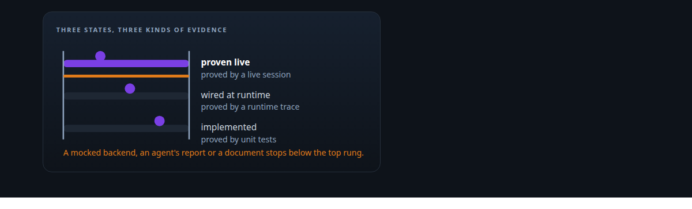
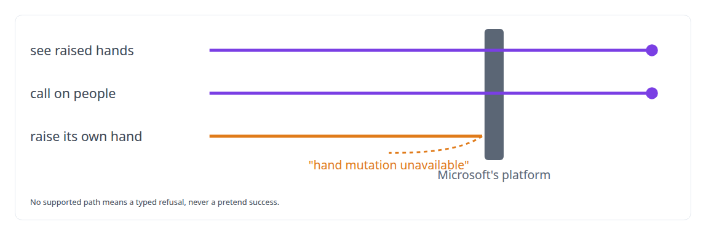
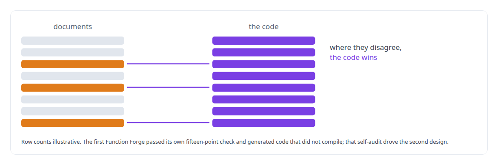
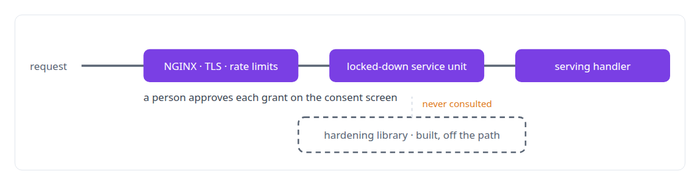

# Evidence-gated acceptance

**A capability counts only when evidence shows it wired and exercised at runtime, and the gates say what is still unproven.**

Canonical: https://coreyjames.ai/technologies/evidence-gated-acceptance/  
Author: Corey James · Published: 2026-10-28 · Kind: technology  
Systems: [Helix](https://github.com/coreyjames-ai/helix) · [FAFO Core and Function Forge](https://github.com/coreyjames-ai/fafo-core) · [Auth and access plane](https://github.com/coreyjames-ai/auth-and-access-plane)  
Skills: [evidence-gated acceptance](https://github.com/coreyjames-ai/portfolio/tree/main/skills/evidence-gated-acceptance) · [AI-assisted engineering methodology](https://github.com/coreyjames-ai/portfolio/tree/main/skills/ai-assisted-engineering-methodology) · [Rust systems engineering](https://github.com/coreyjames-ai/portfolio/tree/main/skills/rust-systems-engineering)  



## Result

| Figure | What it measures |
| --- | --- |
| **55 of 55** | Rust tests passed by the meeting tools, kept open until their runtime gates passed |
| **47** | integration tests that list what they leave unproven |
| **~9,000** | lines of hardening modules built, and kept apart from what guards requests |

## What was built

### Three states, each with its own evidence

AI engineering teams produce plausible claims that something works, and live tests in a real Microsoft tenant are scarce, so I set [Helix](https://coreyjames.ai/systems/helix) a strict vocabulary. Unit tests prove a thing is implemented, a runtime trace proves it is wired, and a live session proves it works in the meeting. Every meeting action moved through those states, and nothing counted as complete until its live gate passed; the second-generation meeting tools passed every Rust test and every stage test, and I kept them open until the live gates passed.

Where Microsoft's platform has no supported path, the action fails closed and says why.



When a voice change let the model promise a delegated action without calling the tool, the change did not pass its real-model gate, and the failed gate stays in the history because it tells me something true about the system. The integration suite for the Teams working service, on synthetic model executables, lists what it leaves unproven: Teams-tab sign-in, and a submission from Teams or by voice.


See [A meeting attendee that will not fake it](https://coreyjames.ai/stories/a-meeting-attendee-that-will-not-fake-it).

### Documents audited against the code

Design documents drift from code, and a document I trust more than the code is a liability, so I had the systems of [FAFO Core and Function Forge](https://coreyjames.ai/systems/fafo-core) re-documented from the code into dossiers with drift tables that set each claim against what the code does. When they disagree, the code wins.



See [Tools that build tools, under governance](https://coreyjames.ai/stories/tools-that-build-tools-under-governance) and [196 deadlocks to zero](https://coreyjames.ai/stories/196-deadlocks-to-zero).

### Built is not the same as guarding

Security code that sits off the request path protects nothing, so for the [Auth and access plane](https://coreyjames.ai/systems/auth-and-access-plane) I keep what is built separate from what guards requests. A hardware-key login variant is a separate entrypoint.



See [The hardening fix that locked everyone out](https://coreyjames.ai/stories/the-hardening-fix-that-locked-everyone-out). Across voice, meetings, an execution substrate and an auth plane, I hold my own systems to the standard I would hold a vendor to.

> A mocked backend never counts as proven live.

## What was verified

Each line is a claim the canonical page supports, with the figure as the page states it.

- Evidence-gated acceptance: meeting tools that passed 55 of 55 Rust tests kept open until their runtime gates passed in the meeting.
- Quality engineering for AI-produced work: 47 integration tests that list what they leave unproven, with failed gates kept in the history.
- Documentation audited against code: system dossiers re-documented from the code with drift tables, where the code wins any disagreement.

## Related

- [Closed by evidence](https://github.com/coreyjames-ai/agentos/tree/main/stories/closed-by-evidence) · https://coreyjames.ai/stories/closed-by-evidence/
- [Separation of duties for AI work](https://github.com/coreyjames-ai/agentos/tree/main/stories/separation-of-duties-for-ai-work) · https://coreyjames.ai/stories/separation-of-duties-for-ai-work/
- [A meeting attendee that will not fake it](https://github.com/coreyjames-ai/helix/tree/main/stories/a-meeting-attendee-that-will-not-fake-it) · https://coreyjames.ai/stories/a-meeting-attendee-that-will-not-fake-it/
- [Proving a rewrite is the same system](https://github.com/coreyjames-ai/activekv/tree/main/stories/proving-a-rewrite-is-the-same-system) · https://coreyjames.ai/stories/proving-a-rewrite-is-the-same-system/
- [Tools that build tools, under governance](https://github.com/coreyjames-ai/fafo-core/tree/main/stories/tools-that-build-tools-under-governance) · https://coreyjames.ai/stories/tools-that-build-tools-under-governance/
- [196 deadlocks to zero](https://github.com/coreyjames-ai/fafo-core/tree/main/stories/196-deadlocks-to-zero) · https://coreyjames.ai/stories/196-deadlocks-to-zero/
- [The hardening fix that locked everyone out](https://github.com/coreyjames-ai/auth-and-access-plane/tree/main/stories/the-hardening-fix-that-locked-everyone-out) · https://coreyjames.ai/stories/the-hardening-fix-that-locked-everyone-out/
- System: [Helix](https://github.com/coreyjames-ai/helix)
- System: [FAFO Core and Function Forge](https://github.com/coreyjames-ai/fafo-core)
- System: [Auth and access plane](https://github.com/coreyjames-ai/auth-and-access-plane)

## Citation

Corey James. "Evidence-gated acceptance." coreyjames.ai, 2026. https://coreyjames.ai/technologies/evidence-gated-acceptance/

```bibtex
@misc{coreyjames-evidence-gated-acceptance,
  author = {Corey James},
  title = {Evidence-gated acceptance},
  year = {2026},
  howpublished = {\url{https://coreyjames.ai/technologies/evidence-gated-acceptance/}},
  note = {GitHub copy: https://github.com/coreyjames-ai/portfolio/tree/main/technologies/evidence-gated-acceptance}
}
```

Part of [Corey James's portfolio](https://github.com/coreyjames-ai/portfolio) · site: https://coreyjames.ai/ · MCP server: https://coreyjames.ai/mcp · agent card: https://coreyjames.ai/.well-known/agent.json
