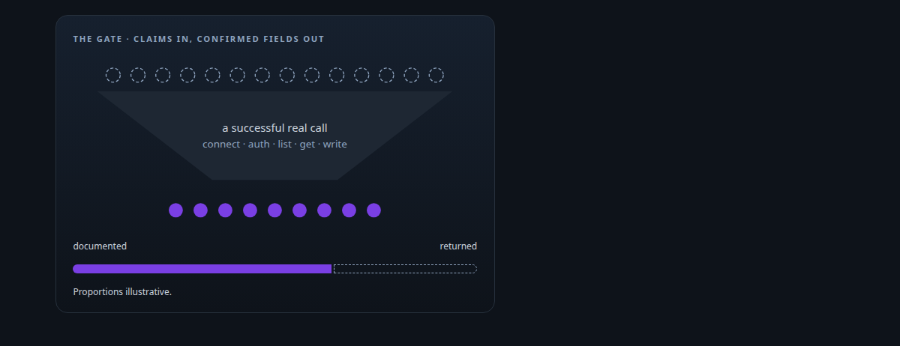
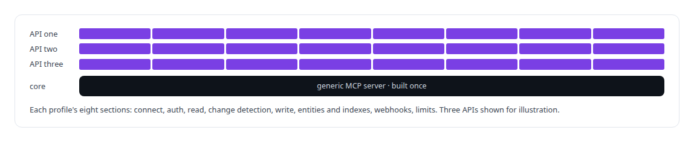
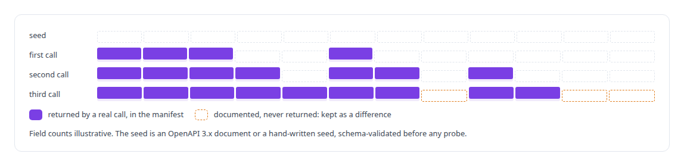
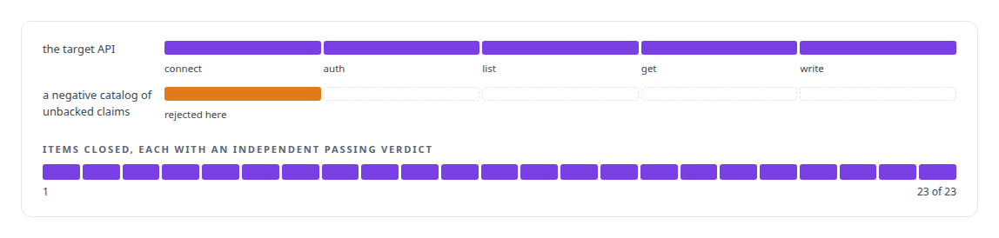
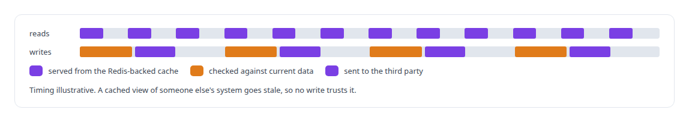

# Evidence-gated API integration

**My API integration platform treats each third-party API as a declarative unit over a generic core, with evidence for every gate.**

Canonical: https://coreyjames.ai/technologies/evidence-gated-api-integration/  
Author: Corey James · Published: 2026-10-28 · Kind: technology  
Systems: [FAFO Core and Function Forge](https://github.com/coreyjames-ai/fafo-core)  
Skills: [tool synthesis and governed API integration](https://github.com/coreyjames-ai/portfolio/tree/main/skills/tool-synthesis-and-governed-api-integration) · [evidence-gated acceptance](https://github.com/coreyjames-ai/portfolio/tree/main/skills/evidence-gated-acceptance) · [Rust systems engineering](https://github.com/coreyjames-ai/portfolio/tree/main/skills/rust-systems-engineering) · [MCP server design](https://github.com/coreyjames-ai/portfolio/tree/main/skills/mcp-server-design)  



## Result

| Figure | What it measures |
| --- | --- |
| **~20,000** | lines of Rust behind one generic MCP server |
| **35** | per-criterion check scripts with re-runnable transcripts |
| **B0–B9** | gated phases the build moved through |

## What was built

### One generic core, one profile per API

The integration platform in [FAFO Core and Function Forge](https://coreyjames.ai/systems/fafo-core) puts an HTTP API behind a generic MCP (Model Context Protocol) server. The generic core is built once, and each API is a declarative connectivity profile, so a new integration is a matter of configuration and probes.



### A field is real once a real call returns it

Integrating a third-party API usually starts from its documentation, and documentation describes fields an API does not always return. I decided the platform would treat a field as real only after a successful real call returned it.


Probing adds to the manifest only what successful calls returned, and the differences are kept.



### A cheap gate before the expensive work

Validation is cheap, so it comes before any investment in tools. A validation harness with no server surface runs against the target before any tool is authored, and a gate that has never rejected anything is untested, so I gave it negative catalogs to reject.



See [Closed by evidence](https://coreyjames.ai/stories/closed-by-evidence).

### Reads cached, writes checked against the source

Reads come from a cache. Writes go through a governed path that checks against current data before anything is sent to the third party.



The language-model help used to write profiles lives in a separate, short-lived developer server, never inside the server agents call.

> A field in the documentation is a claim, and a field in a successful response is a fact.

## What was verified

Each line is a claim the canonical page supports, with the figure as the page states it.

- Tool synthesis and governed API integration: about 20,000 lines of Rust behind one generic MCP server, each API a declarative connectivity profile.
- Evidence-gated acceptance: a field counts only once a successful call returns it, with 35 per-criterion acceptance scripts and 23 of 23 items closed.
- API validation gates: connect, auth, list, get and write must pass before any tool is authored, and negative catalogs show the gate rejecting.

## Related

- [Closed by evidence](https://github.com/coreyjames-ai/agentos/tree/main/stories/closed-by-evidence) · https://coreyjames.ai/stories/closed-by-evidence/
- System: [FAFO Core and Function Forge](https://github.com/coreyjames-ai/fafo-core)

## Citation

Corey James. "Evidence-gated API integration." coreyjames.ai, 2026. https://coreyjames.ai/technologies/evidence-gated-api-integration/

```bibtex
@misc{coreyjames-evidence-gated-api-integration,
  author = {Corey James},
  title = {Evidence-gated API integration},
  year = {2026},
  howpublished = {\url{https://coreyjames.ai/technologies/evidence-gated-api-integration/}},
  note = {GitHub copy: https://github.com/coreyjames-ai/portfolio/tree/main/technologies/evidence-gated-api-integration}
}
```

Part of [Corey James's portfolio](https://github.com/coreyjames-ai/portfolio) · site: https://coreyjames.ai/ · MCP server: https://coreyjames.ai/mcp · agent card: https://coreyjames.ai/.well-known/agent.json
