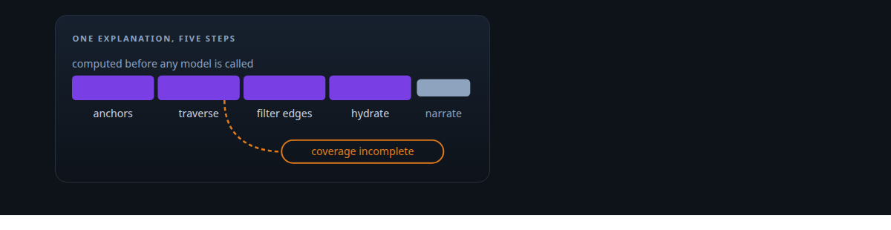
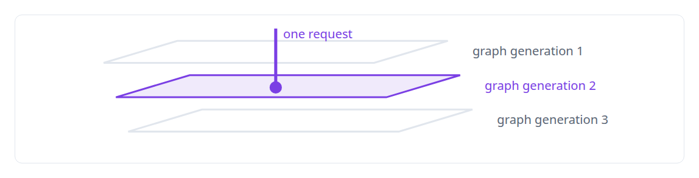
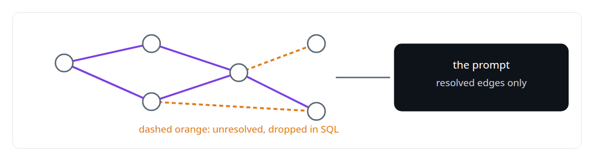
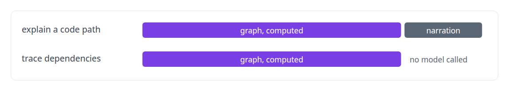

# Evidence-grounded LLM output

**A model in my systems may narrate evidence it was handed; it may not produce evidence.**

Canonical: https://coreyjames.ai/technologies/evidence-grounded-llm-output/  
Author: Corey James · Published: 2026-10-28 · Kind: technology  
Systems: [FAFOHive](https://github.com/coreyjames-ai/fafohive)  
Skills: [AI-assisted engineering methodology](https://github.com/coreyjames-ai/portfolio/tree/main/skills/ai-assisted-engineering-methodology)  



## What was built

### Compute first, narrate second

Engineers act on a model's explanation of how code works, and a fluent explanation can include call paths that do not exist. In [FAFOHive](https://coreyjames.ai/systems/fafohive) I decided the explainer would compute first and narrate second, with that order enforced in code: `explain_code_path` does every structural step before a language model is called, using the parser-built code graph and the index, so every structural statement in an answer comes from a computation that already ran. Each request is pinned to one graph generation, so the path, the code and the narrative all describe the same version.



### Filtering in the data layer, refusing in the open

Filtering happens in the data layer, so the model never sees an unresolved edge it could build on. When the graph does not fully cover the files a query touches, the tool returns a typed "coverage incomplete" result and has no fallback to free-form explanation. I refused a caveated fallback on purpose.




### Citations, and the same contract for every provider

Every answer carries file and line references, so a reader can check the prose against the code it cites in seconds. Any of the language-model providers the service supports can do the narration, including a local open model; the contract binds every one of them, so swapping a frontier model for a local one changes the prose and leaves the structure untouched.



The full account, including why I refused a fallback, is [A code explainer that is not allowed to invent](https://coreyjames.ai/stories/a-code-explainer-that-is-not-allowed-to-invent).

> A caveat attached to a plausible guess is the first thing a reader stops seeing.

## What was verified

Each line is a claim the canonical page supports, with the figure as the page states it.

- Grounded LLM output: a code explainer that computes the graph path before calling a model and returns a typed coverage-incomplete result instead of a guess.
- Code intelligence and static analysis: answers drawn from a parser-built code graph pinned to one generation, with file and line citations.
- Multi-vendor LLM integration: one contract binding every narration provider, local open models included, so a model swap changes prose and never structure.

## Related

- [A code explainer that is not allowed to invent](https://github.com/coreyjames-ai/fafohive/tree/main/stories/a-code-explainer-that-is-not-allowed-to-invent) · https://coreyjames.ai/stories/a-code-explainer-that-is-not-allowed-to-invent/
- System: [FAFOHive](https://github.com/coreyjames-ai/fafohive)

## Citation

Corey James. "Evidence-grounded LLM output." coreyjames.ai, 2026. https://coreyjames.ai/technologies/evidence-grounded-llm-output/

```bibtex
@misc{coreyjames-evidence-grounded-llm-output,
  author = {Corey James},
  title = {Evidence-grounded LLM output},
  year = {2026},
  howpublished = {\url{https://coreyjames.ai/technologies/evidence-grounded-llm-output/}},
  note = {GitHub copy: https://github.com/coreyjames-ai/portfolio/tree/main/technologies/evidence-grounded-llm-output}
}
```

Part of [Corey James's portfolio](https://github.com/coreyjames-ai/portfolio) · site: https://coreyjames.ai/ · MCP server: https://coreyjames.ai/mcp · agent card: https://coreyjames.ai/.well-known/agent.json
