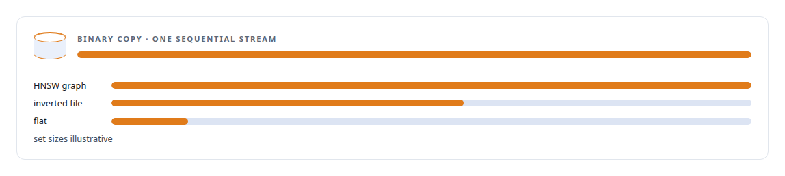
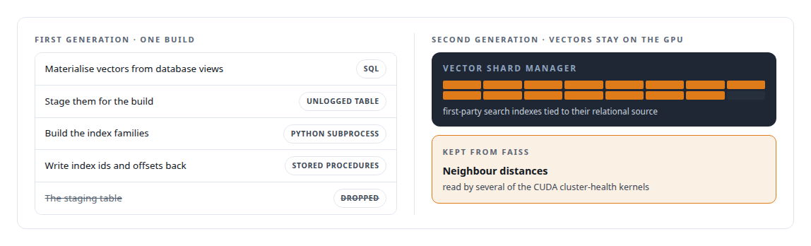
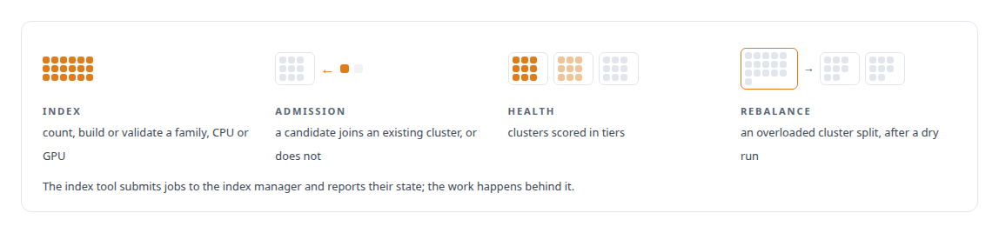

# FAISS

**FAISS is a reference and a bake-off participant in my vector work; my own GPU store builds deterministic indexes and reports their health.**

Canonical: https://coreyjames.ai/technologies/faiss/  
Author: Corey James · Published: 2026-10-28 · Kind: technology  
Systems: [FAFOHive](https://github.com/coreyjames-ai/fafohive) · [Inference Fabric](https://github.com/coreyjames-ai/inference-fabric) · [Capabilities model](https://github.com/coreyjames-ai/capabilities-model)  
Skills: [vector search and ANN indexes](https://github.com/coreyjames-ai/portfolio/tree/main/skills/vector-search-and-ann-indexes) · [AI-assisted engineering methodology](https://github.com/coreyjames-ai/portfolio/tree/main/skills/ai-assisted-engineering-methodology) · [inference serving architecture](https://github.com/coreyjames-ai/portfolio/tree/main/skills/inference-serving-architecture) · [PostgreSQL performance tuning](https://github.com/coreyjames-ai/portfolio/tree/main/skills/postgresql-performance-tuning)  


## Result

| Figure | What it measures |
| --- | --- |
| **3** | index families, each chosen for the set it held |
| **7B** | dense model in FP8 whose answers the pipeline searched |
| **1** | bulk update per build writes index positions back |

## What was built

### Searching for the gaps in what a model knew

[Inference Fabric](https://coreyjames.ai/systems/inference-fabric) grew out of a research pipeline I ran first, and FAISS was the vector engine in both. The pipeline interrogated a model through vLLM, embedded the answers with an embedding model, grouped them into concept clusters of question-and-answer units, and searched for gaps in what the model knew. FAISS ran the batch nearest-neighbour search that found those gaps, rebuilt the GPU indexes after each restructuring pass, and fed the centroid updates.

The knowledge base reached hundreds of thousands of clusters and millions of units. I picked the index type per set, because the centroids, the answer embeddings and the candidates differ by orders of magnitude in size and in how exact the search needs to be. The builder pulls vectors out of PostgreSQL with the binary COPY protocol and parses the vector type's binary layout itself, which keeps a multi-million-vector load to a single sequential transfer.



### An index service, and where its cost sat

When the fabric needed an index service, I wrote the FAISS index manager as a function on my execution substrate. I staged vectors in an unlogged table, because the staging data is discarded after every build and gains nothing from write-ahead logging, and index positions go back to PostgreSQL through set-based stored procedures.

That design showed me where the cost sat: every vector made a round trip through SQL and a Python process. I replaced the FAISS path in the fabric once I decided vectors should stay on the GPU and out of SQL, and I kept the FAISS-computed distances that the health kernels still use.



FAISS carried a research pipeline to millions of vectors; when the fabric needed GPU-resident storage with its own guarantees, I built that and kept the one FAISS output that still paid for itself. I used FAISS as a library and did not modify it.


### Index maintenance as an agent tool

[FAFOHive](https://coreyjames.ai/systems/fafohive) gives agents the index manager as an MCP (Model Context Protocol) tool, beside the other maintenance jobs for the same knowledge base.



> I use a library where it solves the problem at hand and replace it when the architecture outgrows it.

## What was verified

Each line is a claim the canonical page supports, with the figure as the page states it.

- Vector search and ANN indexes: inverted-file, HNSW and flat FAISS indexes chosen per set for hundreds of thousands of cluster centroids and millions of answer embeddings from a 7B model.
- PostgreSQL bulk data movement: vectors read out with binary COPY and parsed directly, staged in an unlogged table, and index positions written back in one bulk update per build.
- Architecture evolution: a FAISS index service retired for a GPU-resident vector store once its SQL and Python round trip set the cost, keeping the neighbour distances the CUDA health kernels read.

## Related

- System: [FAFOHive](https://github.com/coreyjames-ai/fafohive)
- System: [Inference Fabric](https://github.com/coreyjames-ai/inference-fabric)
- System: [Capabilities model](https://github.com/coreyjames-ai/capabilities-model)

## Citation

Corey James. "FAISS." coreyjames.ai, 2026. https://coreyjames.ai/technologies/faiss/

```bibtex
@misc{coreyjames-faiss,
  author = {Corey James},
  title = {FAISS},
  year = {2026},
  howpublished = {\url{https://coreyjames.ai/technologies/faiss/}},
  note = {GitHub copy: https://github.com/coreyjames-ai/portfolio/tree/main/technologies/faiss}
}
```

Part of [Corey James's portfolio](https://github.com/coreyjames-ai/portfolio) · site: https://coreyjames.ai/ · MCP server: https://coreyjames.ai/mcp · agent card: https://coreyjames.ai/.well-known/agent.json
