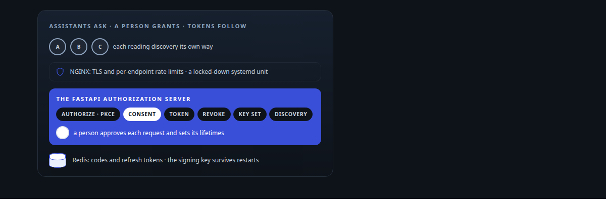
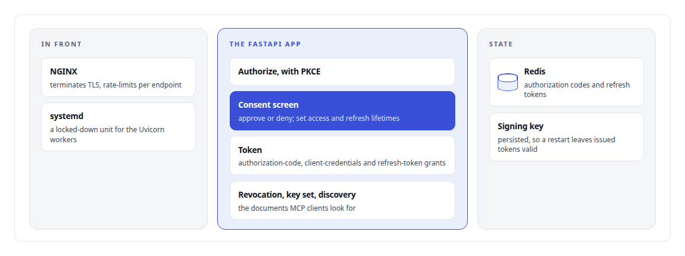
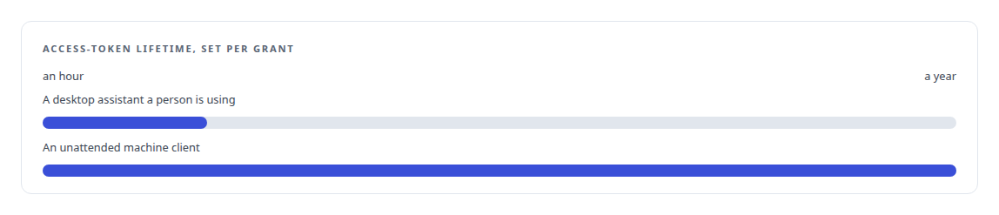
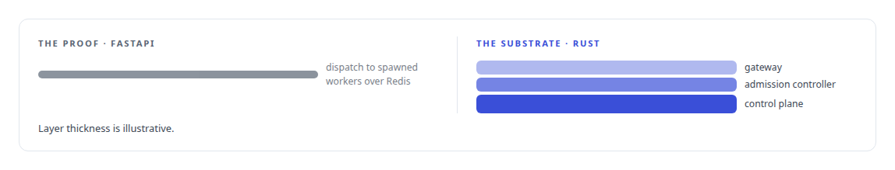

# FastAPI

**The OAuth authorization server and the earlier Python dispatch layer are FastAPI.**

Canonical: https://coreyjames.ai/technologies/fastapi/  
Author: Corey James · Published: 2026-10-28 · Kind: technology  
Systems: [Auth and access plane](https://github.com/coreyjames-ai/auth-and-access-plane) · [FAFO Core and Function Forge](https://github.com/coreyjames-ai/fafo-core)  
Skills: [OAuth 2.0 and identity architecture](https://github.com/coreyjames-ai/portfolio/tree/main/skills/oauth-2-0-and-identity-architecture) · [tool synthesis and governed API integration](https://github.com/coreyjames-ai/portfolio/tree/main/skills/tool-synthesis-and-governed-api-integration) · [AI-assisted engineering methodology](https://github.com/coreyjames-ai/portfolio/tree/main/skills/ai-assisted-engineering-methodology) · [inference serving architecture](https://github.com/coreyjames-ai/portfolio/tree/main/skills/inference-serving-architecture)  



## Result

| Figure | What it measures |
| --- | --- |
| **4** | Uvicorn workers on uvloop behind NGINX |
| **3** | vendors' assistants authenticating against one server |
| **2** | FastAPI apps: the authorization server and the operator console |

## What was built

### An OAuth server for AI assistants

[Auth and access plane](https://coreyjames.ai/systems/auth-and-access-plane) exists because I wanted commercial AI assistants to reach my private tool estate through standard OAuth, with a person approving every grant. I built the authorization server as a FastAPI application. Access tokens are RS256-signed JWTs.

I put TLS, rate limits and process sandboxing in NGINX and systemd, so the front end protects the application independently of the application's own code.



Most of the effort went into interoperability, which is where the real work in OAuth for AI assistants lies. Each vendor reads discovery documents its own way, orders consent differently and caches its client identity differently, and it took a long series of fixes before every vendor's assistant authenticated against one server.

The consent screen also sets token lifetimes per grant, because a desktop assistant and an unattended machine client need different terms.




### A hardened operator console

A second FastAPI app with server-side templates is the operator console: single sign-on with an allow-list, minting tokens for machine clients, revoking them, and approving or deleting pending dynamically registered clients.

In the hardening pass I turned off the console's generated API documentation pages, since an admin surface has no reason to describe itself to whoever finds it, and cut the server's health endpoint down to a bare status. The registration lock I added in that pass, and reverted the next day when it broke every client, is the story [The hardening fix that locked everyone out](https://coreyjames.ai/stories/the-hardening-fix-that-locked-everyone-out).


### A prototype rebuilt in Rust

[FAFO Core and Function Forge](https://coreyjames.ai/systems/fafo-core) started as a FastAPI dispatch service. I wanted to prove that embedding, local-LLM and cluster-health jobs could be pushed to spawned workers over Redis and offered to AI clients, and Python was the quickest way to prove it. Once the idea held, I rebuilt it in Rust as the control plane, admission controller and gateway that make up the substrate, because the prototype was never going to carry the load or the correctness guarantees I wanted.



> I made the consent screen the control point, because it is the one place a person sees exactly which client is asking for exactly what.

## What was verified

Each line is a claim the canonical page supports, with the figure as the page states it.

- OAuth and identity architecture: a FastAPI authorization server with PKCE, consent, token, revocation, key set and discovery endpoints and RS256-signed JWTs, 4 Uvicorn workers behind NGINX.
- Interoperability engineering: 3 vendors' AI assistants authenticating against one server despite reading discovery, ordering consent and caching client identity differently.
- Application security hardening: generated API documentation turned off on the operator console, the health endpoint cut to a bare status, and a registration lock reverted when it broke every client.
- Prototyping to Rust systems engineering: a FastAPI dispatch service proved the idea and was rebuilt in Rust as a control plane, admission controller and gateway.

## Related

- [The hardening fix that locked everyone out](https://github.com/coreyjames-ai/auth-and-access-plane/tree/main/stories/the-hardening-fix-that-locked-everyone-out) · https://coreyjames.ai/stories/the-hardening-fix-that-locked-everyone-out/
- System: [Auth and access plane](https://github.com/coreyjames-ai/auth-and-access-plane)
- System: [FAFO Core and Function Forge](https://github.com/coreyjames-ai/fafo-core)

## Citation

Corey James. "FastAPI." coreyjames.ai, 2026. https://coreyjames.ai/technologies/fastapi/

```bibtex
@misc{coreyjames-fastapi,
  author = {Corey James},
  title = {FastAPI},
  year = {2026},
  howpublished = {\url{https://coreyjames.ai/technologies/fastapi/}},
  note = {GitHub copy: https://github.com/coreyjames-ai/portfolio/tree/main/technologies/fastapi}
}
```

Part of [Corey James's portfolio](https://github.com/coreyjames-ai/portfolio) · site: https://coreyjames.ai/ · MCP server: https://coreyjames.ai/mcp · agent card: https://coreyjames.ai/.well-known/agent.json
