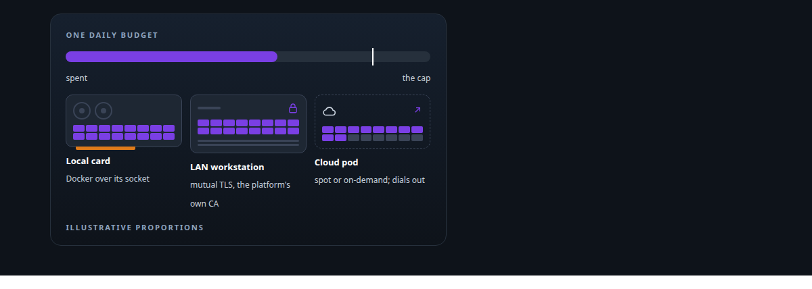
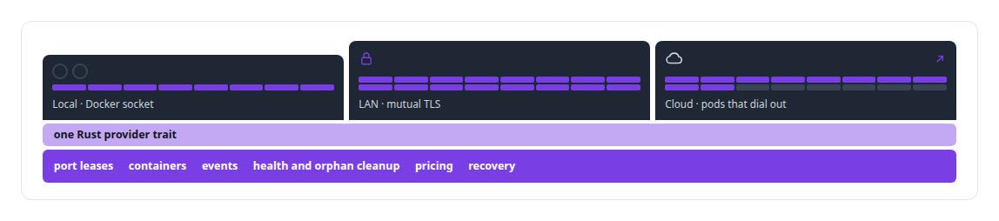
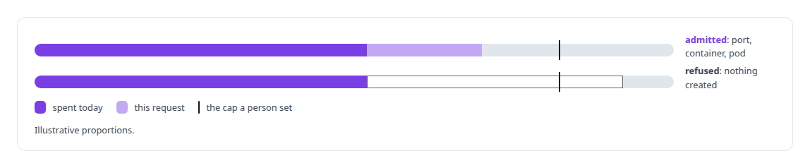
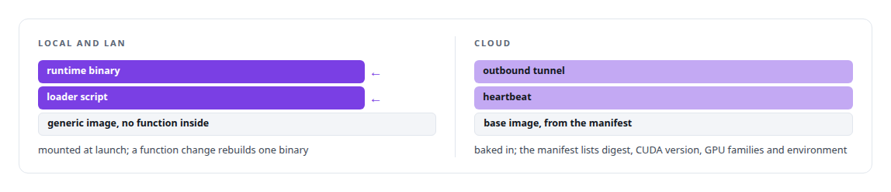
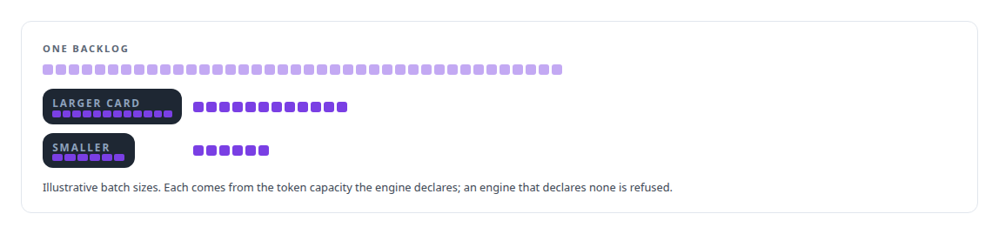
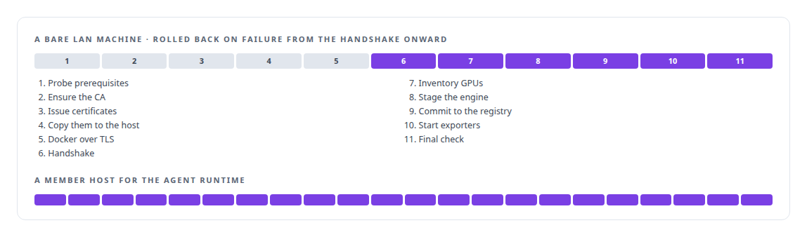
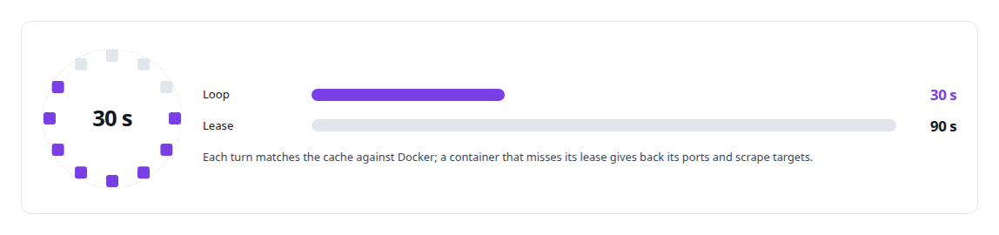

# Federated compute provisioning

**One call stands up GPU capacity on a local card, a LAN workstation over mutual TLS, or rented cloud spot capacity, behind a fail-closed daily budget.**

Canonical: https://coreyjames.ai/technologies/federated-compute-provisioning/  
Author: Corey James · Published: 2026-10-28 · Kind: technology  
Systems: [FAFO Core and Function Forge](https://github.com/coreyjames-ai/fafo-core) · [Inference Fabric](https://github.com/coreyjames-ai/inference-fabric) · [Agent Swarm](https://github.com/coreyjames-ai/agent-swarm)  
Skills: [Rust systems engineering](https://github.com/coreyjames-ai/portfolio/tree/main/skills/rust-systems-engineering) · [zero-trust and zero-inbound networking](https://github.com/coreyjames-ai/portfolio/tree/main/skills/zero-trust-and-zero-inbound-networking) · [MCP server design](https://github.com/coreyjames-ai/portfolio/tree/main/skills/mcp-server-design) · [tool synthesis and governed API integration](https://github.com/coreyjames-ai/portfolio/tree/main/skills/tool-synthesis-and-governed-api-integration)  



## Result

| Figure | What it measures |
| --- | --- |
| **15** | MCP actions on the node-management tool |
| **17,303** | lines of Rust in the provisioning substrate, across 26 files |
| **3** | providers behind one trait: local, LAN and cloud |

## What was built

### One call, wherever the GPU is

[FAFO Core and Function Forge](https://coreyjames.ai/systems/fafo-core) needed compute from wherever I had it: the workstation, a spare machine on the LAN, or a rented cloud GPU up to datacentre Blackwell. I made location a parameter of one MCP call.

Underneath is one [Rust](https://coreyjames.ai/technologies/rust) provider trait, implemented for local [Docker](https://coreyjames.ai/technologies/docker), LAN Docker daemons reached over [mutual TLS](https://coreyjames.ai/technologies/tls-and-mtls), and [RunPod](https://coreyjames.ai/technologies/runpod) for cloud pods. I kept one implementation of ports, health, events and spend, and every family of workloads composes it.



I chose plain Docker with a provider trait and my own CA over Kubernetes.


### A budget gate before anything exists

The dollar budget sits inside the provisioning call and only a person can set it. I put the [budget gate](https://coreyjames.ai/technologies/budget-enforcement-and-cost-governance) ahead of the port lease, the container and any cloud request, so a refusal leaves nothing behind.



I bill cloud pods from the moment the provider confirms creation, because the provider bills from power-on, and terminating a node returns its final cost. One cloud provider is wired in, and pre-empted spot nodes are cleaned up without automatic replacement.

### Images that carry no function

Local and LAN containers never carry a function in their image. I injected the runtime into generic images, which took an image build out of every function change. Cloud images bake in an outbound tunnel and a heartbeat instead.



The pod dials back to the private network, so reaching it opens no inbound port and no GPU host needs one ([zero-inbound exposure](https://coreyjames.ai/technologies/zero-inbound-network-exposure)). The Blackwell cloud image covers [consumer](https://coreyjames.ai/technologies/nvidia-blackwell-gpus) and datacentre Blackwell parts, so one call can ask for datacentre capacity with the matching image.

### GPU consumers for the Inference Fabric

A loader mode decides what a node becomes: a one-off job, a long-running inference consumer, a hardened agent container with every Linux capability dropped and privilege escalation off, or a stock infrastructure service such as Redis or a credential broker. [Inference Fabric](https://coreyjames.ai/systems/inference-fabric) gets its GPU consumers this way.

The node-management tool's MCP (Model Context Protocol) actions cover provision and terminate, status, drain, idle timeouts, LAN host onboarding and teardown, engine sync, and image and engine listings. Provisioning reads the [TensorRT-LLM](https://coreyjames.ai/technologies/nvidia-tensorrt-llm) engine's configuration and publishes its token capacity for the batch planners.



### Onboarding a bare machine in one call

Onboarding a bare LAN machine is a single call, and the node-management tool provisions member hosts for the agent runtime the same way.



A reconcile loop keeps the cache honest against Docker.



I build the infrastructure layer once and let every other system inherit it. [Agent Swarm](https://coreyjames.ai/systems/agent-swarm) launches persona containers through the same path in agent mode, and [Helix](https://coreyjames.ai/systems/helix) media services start GPU render instances behind the same budget.

> The estate is a handful of machines, and the scheduler I needed was a budget.

## What was verified

Each line is a claim the canonical page supports, with the figure as the page states it.

- Cloud GPU provisioning with cost controls: one MCP call places capacity on a local card, a LAN host over mutual TLS or a cloud pod, behind a daily budget only a person sets, checked before anything exists.
- Rust systems engineering: one provider trait with three implementations over shared port leases, health, events and spend, 17,303 lines across 26 files.
- Zero-trust and zero-inbound networking: cloud pods dial back to the private network so no GPU host opens an inbound port, and LAN hosts join through an 11-step onboarding with rollback.
- MCP server design: a node-management tool of 15 actions that reads each engine's declared token capacity, so cards of different sizes drain one backlog.

## Related

- [Rust](https://github.com/coreyjames-ai/portfolio/tree/main/technologies/rust) · https://coreyjames.ai/technologies/rust/
- [Docker](https://github.com/coreyjames-ai/portfolio/tree/main/technologies/docker) · https://coreyjames.ai/technologies/docker/
- [TLS and mTLS](https://github.com/coreyjames-ai/portfolio/tree/main/technologies/tls-and-mtls) · https://coreyjames.ai/technologies/tls-and-mtls/
- [RunPod](https://github.com/coreyjames-ai/portfolio/tree/main/technologies/runpod) · https://coreyjames.ai/technologies/runpod/
- [Budget enforcement and cost governance](https://github.com/coreyjames-ai/portfolio/tree/main/technologies/budget-enforcement-and-cost-governance) · https://coreyjames.ai/technologies/budget-enforcement-and-cost-governance/
- [Zero-inbound network exposure](https://github.com/coreyjames-ai/portfolio/tree/main/technologies/zero-inbound-network-exposure) · https://coreyjames.ai/technologies/zero-inbound-network-exposure/
- [NVIDIA Blackwell GPUs](https://github.com/coreyjames-ai/portfolio/tree/main/technologies/nvidia-blackwell-gpus) · https://coreyjames.ai/technologies/nvidia-blackwell-gpus/
- [NVIDIA TensorRT-LLM](https://github.com/coreyjames-ai/portfolio/tree/main/technologies/nvidia-tensorrt-llm) · https://coreyjames.ai/technologies/nvidia-tensorrt-llm/
- System: [FAFO Core and Function Forge](https://github.com/coreyjames-ai/fafo-core)
- System: [Inference Fabric](https://github.com/coreyjames-ai/inference-fabric)
- System: [Agent Swarm](https://github.com/coreyjames-ai/agent-swarm)

## Citation

Corey James. "Federated compute provisioning." coreyjames.ai, 2026. https://coreyjames.ai/technologies/federated-compute-provisioning/

```bibtex
@misc{coreyjames-federated-compute-provisioning,
  author = {Corey James},
  title = {Federated compute provisioning},
  year = {2026},
  howpublished = {\url{https://coreyjames.ai/technologies/federated-compute-provisioning/}},
  note = {GitHub copy: https://github.com/coreyjames-ai/portfolio/tree/main/technologies/federated-compute-provisioning}
}
```

Part of [Corey James's portfolio](https://github.com/coreyjames-ai/portfolio) · site: https://coreyjames.ai/ · MCP server: https://coreyjames.ai/mcp · agent card: https://coreyjames.ai/.well-known/agent.json
