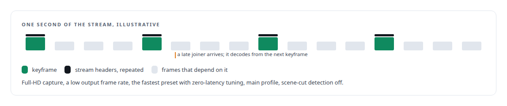
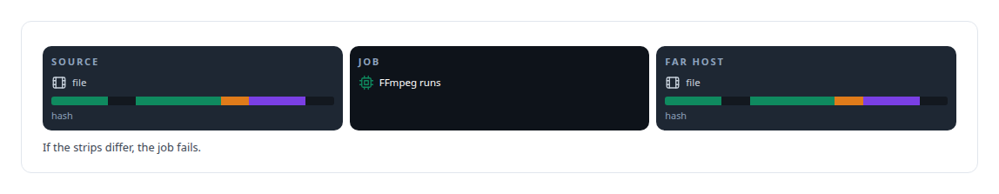

# FFmpeg

**FFmpeg frames a headless Linux desktop as H.264 for screen sharing into Teams meetings and drives the media studio's transforms.**

Canonical: https://coreyjames.ai/technologies/ffmpeg/  
Author: Corey James · Published: 2026-10-28 · Kind: technology  
Systems: [Helix](https://github.com/coreyjames-ai/helix) · [FAFOHive](https://github.com/coreyjames-ai/fafohive)  
Skills: [Microsoft Teams real-time media](https://github.com/coreyjames-ai/portfolio/tree/main/skills/microsoft-teams-real-time-media) · [tool synthesis and governed API integration](https://github.com/coreyjames-ai/portfolio/tree/main/skills/tool-synthesis-and-governed-api-integration) · [sandboxing and container hardening](https://github.com/coreyjames-ai/portfolio/tree/main/skills/sandboxing-and-container-hardening)  


## What was built

### Screen sharing for an AI colleague

[Helix](https://coreyjames.ai/systems/helix) needed a way for the digital employee to show its work in a Teams meeting. I decided it should share a real screen: a headless Linux desktop with a virtual display, a window manager, Chromium and a terminal, captured by FFmpeg's X11 grabber and encoded to H.264. I tuned the encoder for slides and terminal text, and for the viewer who joins late.



FFmpeg serves the raw H.264 stream on a local socket. The Rust voice engine frames each access unit into a small versioned contract and hands it to the Windows media bridge, which publishes it into the call as Teams screen sharing. Terminal text is typed at a pace people can read, and the pace speeds up for long outputs so a large update does not time out: short commands look human and long outputs still finish. The full meeting surface is the story [A meeting attendee that will not fake it](https://coreyjames.ai/stories/a-meeting-attendee-that-will-not-fake-it).

### A media studio's edit path

[FAFOHive](https://coreyjames.ai/systems/fafohive) publishes the tools of a media studio I built for agents, and FFmpeg is its edit path. Agents run on different machines and want narration muxed onto video, clips joined, frames resized and audio levelled. I did not want any of them building a shell command. The studio's Rust controller offers a fixed set of transforms as typed enums in the tool contract, and writes the FFmpeg arguments itself, which closes the injection path an agent-facing media tool would otherwise open.


Inputs and outputs are explicit host-and-path references, staged onto the machine that runs the job and delivered with a hash check at the destination, because a silently truncated video is worse than a failed job.



I drive FFmpeg as a process with arguments generated by typed code and keep the binary unmodified, which keeps upgrades trivial. I did not write codecs or filters.

> I treat an agent-facing tool as an attack surface first and a convenience second.

## What was verified

Each line is a claim the canonical page supports, with the figure as the page states it.

- Video encoding for screen sharing: a headless Linux desktop encoded to H.264 for slides and terminal text and for late joiners, shared into Teams meetings.
- Sandboxing agent tools: a fixed menu of typed media transforms whose FFmpeg arguments are written by code, with no codec, filter or shell text accepted from the agent.
- Cross-host file delivery: inputs staged onto the machine that runs the job and outputs hash-checked at the destination.

## Related

- [A meeting attendee that will not fake it](https://github.com/coreyjames-ai/helix/tree/main/stories/a-meeting-attendee-that-will-not-fake-it) · https://coreyjames.ai/stories/a-meeting-attendee-that-will-not-fake-it/
- System: [Helix](https://github.com/coreyjames-ai/helix)
- System: [FAFOHive](https://github.com/coreyjames-ai/fafohive)

## Citation

Corey James. "FFmpeg." coreyjames.ai, 2026. https://coreyjames.ai/technologies/ffmpeg/

```bibtex
@misc{coreyjames-ffmpeg,
  author = {Corey James},
  title = {FFmpeg},
  year = {2026},
  howpublished = {\url{https://coreyjames.ai/technologies/ffmpeg/}},
  note = {GitHub copy: https://github.com/coreyjames-ai/portfolio/tree/main/technologies/ffmpeg}
}
```

Part of [Corey James's portfolio](https://github.com/coreyjames-ai/portfolio) · site: https://coreyjames.ai/ · MCP server: https://coreyjames.ai/mcp · agent card: https://coreyjames.ai/.well-known/agent.json
