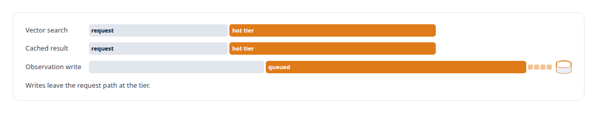
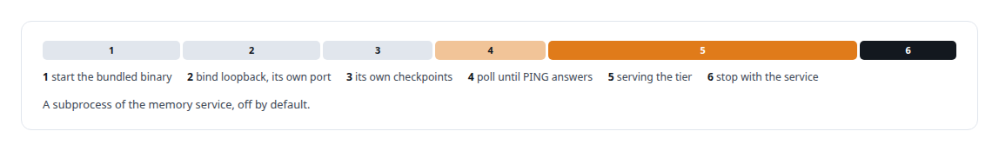

# Garnet

**A Redis-compatible store evaluated for the memory service's hot path.**

Canonical: https://coreyjames.ai/technologies/garnet/  
Author: Corey James · Published: 2026-10-28 · Kind: technology  
Systems: [FAFOHive](https://github.com/coreyjames-ai/fafohive)  
Skills: [Rust systems engineering](https://github.com/coreyjames-ai/portfolio/tree/main/skills/rust-systems-engineering) · [inference serving architecture](https://github.com/coreyjames-ai/portfolio/tree/main/skills/inference-serving-architecture)  


## Result

| Figure | What it measures |
| --- | --- |
| **242** | lines of Rust run the managed instance from start to stop |

## What was built

### A Redis-protocol tier in front of PostgreSQL

The memory service in [FAFOHive](https://coreyjames.ai/systems/fafohive) keeps PostgreSQL as its source of truth and a Redis-protocol tier in front of it.



Protocol compatibility is the seam. The service talks the Redis protocol. On my own host the tier is Redis.


### A managed instance that never collides

Garnet, Microsoft's Redis-compatible server, is wired in as an optional managed instance for that tier. It came in with a self-contained distribution build of the service, and it is a dedicated instance, never shared with any existing cache on the machine.



This is a lifecycle adapter, not Garnet-specific engineering.

> The backing server is a deployment choice, not a code change.

## What was verified

Each line is a claim the canonical page supports, with the figure as the page states it.

- Redis-protocol caching tiers: a hot tier for vector search, cached results and an observation write queue in front of PostgreSQL, with the backing server a deployment choice.
- Rust systems engineering: a 242-line lifecycle module that starts a managed Garnet instance on localhost with its own port and checkpoints, waits for PING and stops with the service.

## Related

- System: [FAFOHive](https://github.com/coreyjames-ai/fafohive)

## Citation

Corey James. "Garnet." coreyjames.ai, 2026. https://coreyjames.ai/technologies/garnet/

```bibtex
@misc{coreyjames-garnet,
  author = {Corey James},
  title = {Garnet},
  year = {2026},
  howpublished = {\url{https://coreyjames.ai/technologies/garnet/}},
  note = {GitHub copy: https://github.com/coreyjames-ai/portfolio/tree/main/technologies/garnet}
}
```

Part of [Corey James's portfolio](https://github.com/coreyjames-ai/portfolio) · site: https://coreyjames.ai/ · MCP server: https://coreyjames.ai/mcp · agent card: https://coreyjames.ai/.well-known/agent.json
