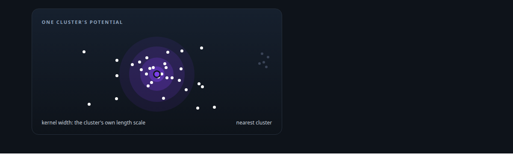
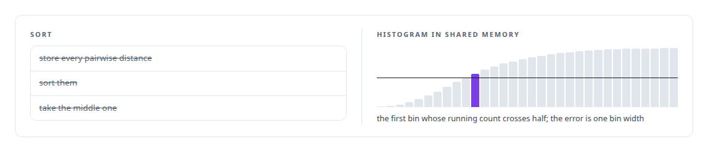
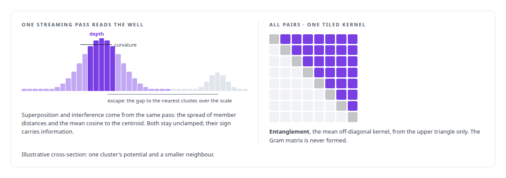
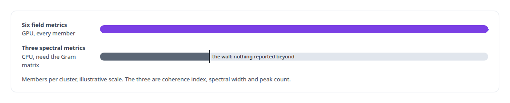

# Gaussian-kernel cluster analysis

**A per-cluster length scale from a histogram median, then potential depth, curvature, escape probability, superposition, interference and entanglement as field metrics over an embedding cluster.**

Canonical: https://coreyjames.ai/technologies/gaussian-kernel-cluster-analysis/  
Author: Corey James · Published: 2026-10-28 · Kind: technology  
Systems: [Inference Fabric](https://github.com/coreyjames-ai/inference-fabric)  
Skills: [embedding analytics and cluster metrics](https://github.com/coreyjames-ai/portfolio/tree/main/skills/embedding-analytics-and-cluster-metrics) · [CUDA kernel development](https://github.com/coreyjames-ai/portfolio/tree/main/skills/cuda-kernel-development) · [AI-assisted engineering methodology](https://github.com/coreyjames-ai/portfolio/tree/main/skills/ai-assisted-engineering-methodology) · [GPU inference optimisation](https://github.com/coreyjames-ai/portfolio/tree/main/skills/gpu-inference-optimisation)  



## Result

| Figure | What it measures |
| --- | --- |
| **256** | bins in the shared-memory histogram that finds the median distance |
| **0.4%** | resolution of that median, held in 10 KB of shared memory |
| **2,000** | members, the most the CPU spectral metrics will report on |

## What was built

### A length scale from a histogram median

One family of my cluster metrics treats a cluster of embeddings as a field rather than a point set. Each member contributes a Gaussian kernel of its distance, the width of the kernel is a per-cluster length scale, and the shape of the resulting potential describes the cluster. The family runs in the [Inference Fabric](https://coreyjames.ai/systems/inference-fabric)'s CUDA engine and is told in [Physics as a lens on embeddings](https://coreyjames.ai/stories/physics-as-a-lens-on-embeddings).

The length scale is a constant times the median pairwise distance of the cluster, clamped to a documented range. A per-cluster scale makes the metrics independent of the embedding model's units. A tiled kernel bins every distance into a shared-memory histogram and reads the midpoint from the cumulative counts, a histogram median instead of a sort.



### Five metrics in one pass, one tiled

The field metrics come from that scale in two kernels. A streaming pass over the members produces five of them, and the one quadratic metric is tiled and bounded.



### Three metrics kept off the GPU

Three spectral metrics do need the Gram matrix, so they exist as CPU reference code with an explicit limit.




> I left three metrics off the GPU until they can run without a hidden cap.

## What was verified

Each line is a claim the canonical page supports, with the figure as the page states it.

- Embedding analytics and cluster metrics: Gaussian-kernel field metrics per cluster (potential depth, curvature, escape probability, superposition, interference, entanglement) on a per-cluster length scale.
- CUDA kernel development: the median pairwise distance read from a 256-bin shared-memory histogram at 0.4% resolution in 10 KB, and entanglement tiled over the upper triangle with no Gram matrix.
- Bounded numerical methods: three Gram-matrix spectral metrics kept as CPU reference code that reports nothing above 2,000 members instead of sampling.

## Related

- [Thirty-eight metrics in a dozen passes](https://github.com/coreyjames-ai/inference-fabric/tree/main/stories/thirty-eight-metrics-in-a-dozen-passes) · https://coreyjames.ai/stories/thirty-eight-metrics-in-a-dozen-passes/
- [Every metric gets a CPU twin](https://github.com/coreyjames-ai/inference-fabric/tree/main/stories/every-metric-gets-a-cpu-twin) · https://coreyjames.ai/stories/every-metric-gets-a-cpu-twin/
- [Removing the sampling caps](https://github.com/coreyjames-ai/inference-fabric/tree/main/stories/removing-the-sampling-caps) · https://coreyjames.ai/stories/removing-the-sampling-caps/
- [Where a cluster sits](https://github.com/coreyjames-ai/inference-fabric/tree/main/stories/where-a-cluster-sits) · https://coreyjames.ai/stories/where-a-cluster-sits/
- [Diversity in three kernels](https://github.com/coreyjames-ai/inference-fabric/tree/main/stories/diversity-in-three-kernels) · https://coreyjames.ai/stories/diversity-in-three-kernels/
- [Physics as a lens on embeddings](https://github.com/coreyjames-ai/inference-fabric/tree/main/stories/physics-as-a-lens-on-embeddings) · https://coreyjames.ai/stories/physics-as-a-lens-on-embeddings/
- [Two-means as a measuring instrument](https://github.com/coreyjames-ai/inference-fabric/tree/main/stories/two-means-as-a-measuring-instrument) · https://coreyjames.ai/stories/two-means-as-a-measuring-instrument/
- [From health scores to decisions](https://github.com/coreyjames-ai/inference-fabric/tree/main/stories/from-health-scores-to-decisions) · https://coreyjames.ai/stories/from-health-scores-to-decisions/
- System: [Inference Fabric](https://github.com/coreyjames-ai/inference-fabric)

## Citation

Corey James. "Gaussian-kernel cluster analysis." coreyjames.ai, 2026. https://coreyjames.ai/technologies/gaussian-kernel-cluster-analysis/

```bibtex
@misc{coreyjames-gaussian-kernel-cluster-analysis,
  author = {Corey James},
  title = {Gaussian-kernel cluster analysis},
  year = {2026},
  howpublished = {\url{https://coreyjames.ai/technologies/gaussian-kernel-cluster-analysis/}},
  note = {GitHub copy: https://github.com/coreyjames-ai/portfolio/tree/main/technologies/gaussian-kernel-cluster-analysis}
}
```

Part of [Corey James's portfolio](https://github.com/coreyjames-ai/portfolio) · site: https://coreyjames.ai/ · MCP server: https://coreyjames.ai/mcp · agent card: https://coreyjames.ai/.well-known/agent.json
