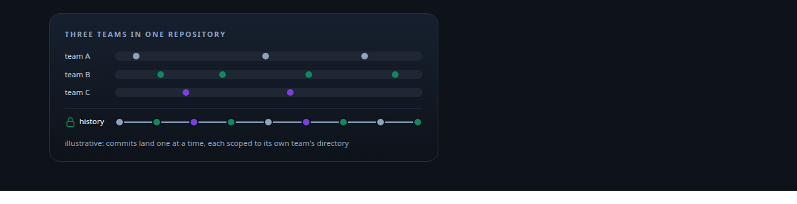
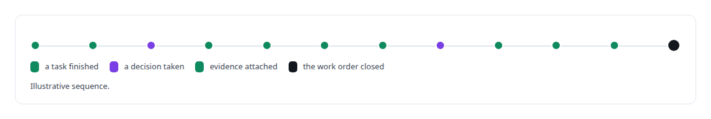
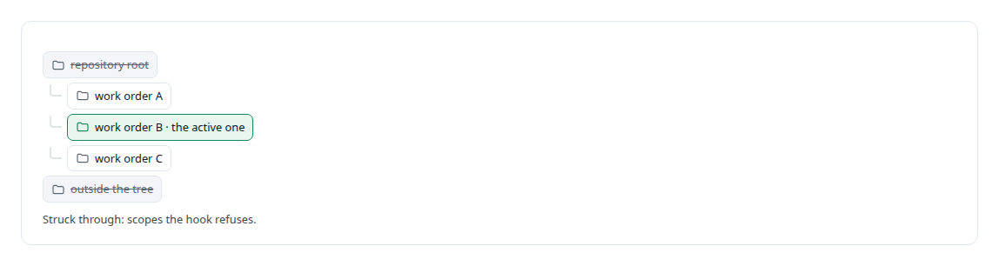
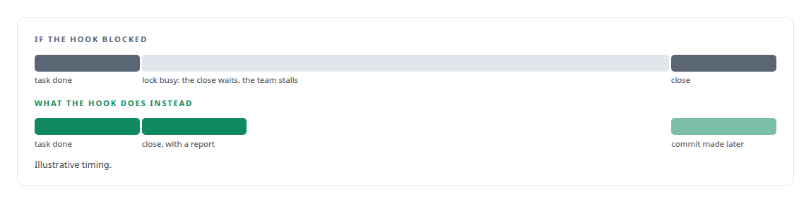
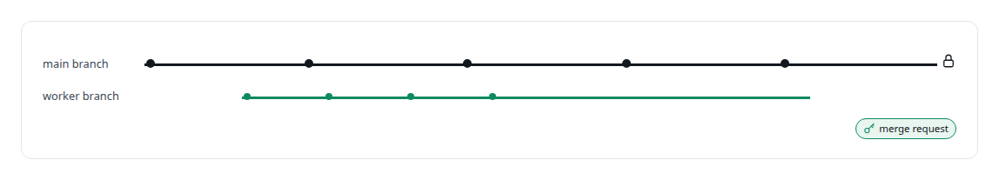

# Git

**My governance platform reads git as evidence: witness, task and decision commits, authorship trailers, and the rule that every commit is pushed and nothing is rewritten.**

Canonical: https://coreyjames.ai/technologies/git/  
Author: Corey James · Published: 2026-10-28 · Kind: technology  
Systems: [AgentOS](https://github.com/coreyjames-ai/agentos) · [Agent Swarm](https://github.com/coreyjames-ai/agent-swarm)  
Skills: [Rust systems engineering](https://github.com/coreyjames-ai/portfolio/tree/main/skills/rust-systems-engineering) · [AI-assisted engineering methodology](https://github.com/coreyjames-ai/portfolio/tree/main/skills/ai-assisted-engineering-methodology) · [append-only log design](https://github.com/coreyjames-ai/portfolio/tree/main/skills/append-only-log-design) · [tool synthesis and governed API integration](https://github.com/coreyjames-ai/portfolio/tree/main/skills/tool-synthesis-and-governed-api-integration)  



## Result

| Figure | What it measures |
| --- | --- |
| **~1,360** | lines of Rust in the commit hook, tested against fake git clients |

## What was built

### Commits as an output of AgentOS

[AgentOS](https://coreyjames.ai/systems/agentos) runs teams of coding agents that finish tasks constantly, often at the same moment, in the same repository. I wanted every finished task to leave a commit I could trace to its work order. I also wanted no agent touching git directly. So git became an output of the platform: agents never run raw git or push. When an agent finishes a task, a lifecycle hook commits the active work order's own project directory, and only that directory, as a tagged commit that names the work order and the task, so the history is searchable by the unit of work.



The history reads as the sequence of work, decisions and proof that built a system, and I use version control as part of the governance of AI work. Authorship trailers on those commits are one of the ways I attribute work to the model that did it. The story [Closed by evidence](https://coreyjames.ai/stories/closed-by-evidence) shows that history at work on a platform build. I did not modify git itself.


### One scope per commit, under a lock

The hook refuses repository-root and out-of-tree scopes, so parallel teams in one repository cannot cross-commit. Concurrent agents serialise on a shared file lock with a timeout, so a stuck agent cannot block the rest. The hook never pushes; a separate service publishes to the remote on its own cadence.



### Failing open

When the lock is busy or git is missing, the hook does not hold the close. It sits behind a git-client interface, so every failure path is exercised without a real repository.



### A worker that pushes, a gatekeeper that proposes

[Agent Swarm](https://coreyjames.ai/systems/agent-swarm) puts git in a worker agent's hands, inside limits. A coding agent on a local open-source model edits, tests, commits and pushes to its own branch from a throwaway container. It holds no credential for the main repository and has no path to the main branch. A separate gatekeeper agent holds the repository credential and opens the merge request on the worker's behalf. That is the story [A coding agent that never holds the keys](https://coreyjames.ai/stories/a-coding-agent-that-never-holds-the-keys).



> Commits mark the work, carry attribution and stay out of agents' direct reach.

## What was verified

Each line is a claim the canonical page supports, with the figure as the page states it.

- Version control as AI governance: tagged commits per finished task, decision and evidence, written by a lifecycle hook so agents never run git or push.
- Concurrency control: commits scoped to one work order's directory under a shared file lock with a timeout, failing open with a report.
- Rust systems engineering: a ~1,360-line commit hook tested against fake git clients, so every failure path is exercised without a real repository.

## Related

- [Directing AI coding agents at program scale](https://github.com/coreyjames-ai/agentos/tree/main/stories/directing-ai-coding-agents-at-program-scale) · https://coreyjames.ai/stories/directing-ai-coding-agents-at-program-scale/
- [Closed by evidence](https://github.com/coreyjames-ai/agentos/tree/main/stories/closed-by-evidence) · https://coreyjames.ai/stories/closed-by-evidence/
- [A coding agent that never holds the keys](https://github.com/coreyjames-ai/agent-swarm/tree/main/stories/a-coding-agent-that-never-holds-the-keys) · https://coreyjames.ai/stories/a-coding-agent-that-never-holds-the-keys/
- System: [AgentOS](https://github.com/coreyjames-ai/agentos)
- System: [Agent Swarm](https://github.com/coreyjames-ai/agent-swarm)

## Citation

Corey James. "Git." coreyjames.ai, 2026. https://coreyjames.ai/technologies/git/

```bibtex
@misc{coreyjames-git,
  author = {Corey James},
  title = {Git},
  year = {2026},
  howpublished = {\url{https://coreyjames.ai/technologies/git/}},
  note = {GitHub copy: https://github.com/coreyjames-ai/portfolio/tree/main/technologies/git}
}
```

Part of [Corey James's portfolio](https://github.com/coreyjames-ai/portfolio) · site: https://coreyjames.ai/ · MCP server: https://coreyjames.ai/mcp · agent card: https://coreyjames.ai/.well-known/agent.json
