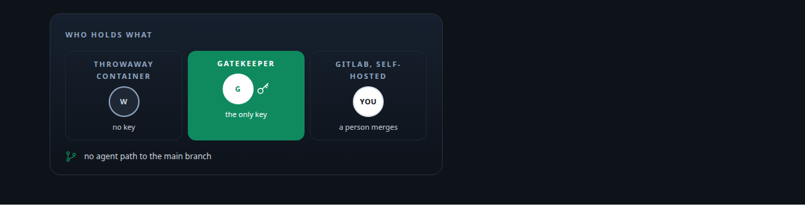
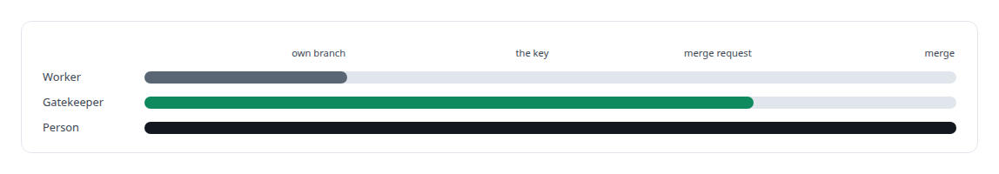
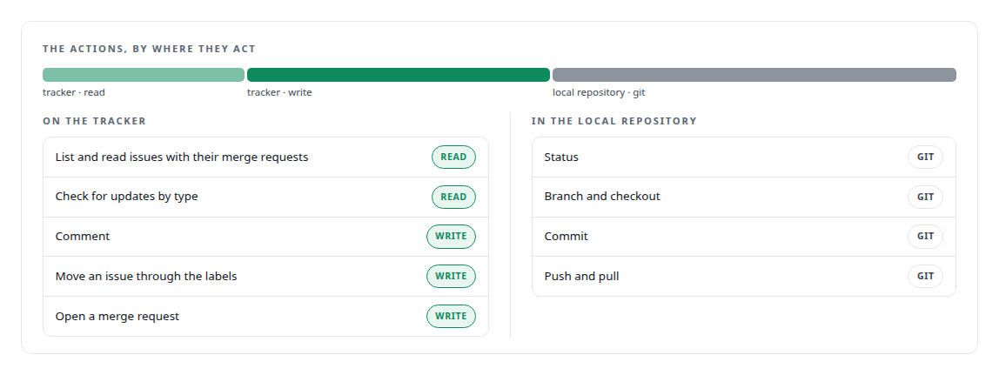
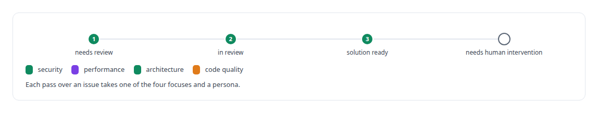

# GitLab

**Self-hosted GitLab is where my agents open merge requests they are not allowed to merge, and where discovered defects are filed as issues.**

Canonical: https://coreyjames.ai/technologies/gitlab/  
Author: Corey James · Published: 2026-10-28 · Kind: technology  
Systems: [Agent Swarm](https://github.com/coreyjames-ai/agent-swarm) · [FAFOHive](https://github.com/coreyjames-ai/fafohive)  
Skills: [separation of duties for AI work](https://github.com/coreyjames-ai/portfolio/tree/main/skills/separation-of-duties-for-ai-work) · [tool synthesis and governed API integration](https://github.com/coreyjames-ai/portfolio/tree/main/skills/tool-synthesis-and-governed-api-integration) · [multi-agent governance](https://github.com/coreyjames-ai/portfolio/tree/main/skills/multi-agent-governance) · [AI-assisted engineering methodology](https://github.com/coreyjames-ai/portfolio/tree/main/skills/ai-assisted-engineering-methodology)  



## Result

| Figure | What it measures |
| --- | --- |
| **2** | end-to-end runs from a worker's edit to an opened merge request |
| **0** | agent commits or merge requests against the main repository |

## What was built

### Merge requests agents cannot merge

[Agent Swarm](https://coreyjames.ai/systems/agent-swarm) needed to show that a coding agent on a local model could do real repository work without ever being able to merge it. I decided the merge request would be the boundary and GitLab, self-hosted, would be where a person sees the result. A worker agent edits, tests, commits and pushes to its own branch from a throwaway container. A separate, long-lived gatekeeper agent is the only holder of the repository credential, so a compromised or confused worker has nothing to leak; it checks the worker's request and opens the merge request through the GitLab API. The story [A coding agent that never holds the keys](https://coreyjames.ai/stories/a-coding-agent-that-never-holds-the-keys) tells it in full.




I kept GitLab self-hosted and separate from the agent runtime, so the tracker is an ordinary GitLab a person can use without any of my tooling. GitLab itself is third-party; my work is the tools, the credential placement and the workflow around it. The agent runtime also carries a declarative HTTP tool for GitLab, so a persona that is granted it can work issues through the same tool pipeline every other tool uses.

### An issue tool with a hand-back state

[FAFOHive](https://coreyjames.ai/systems/fafohive) gives agents one action-dispatched GitLab tool for issue work. The tool carries both the tracker and the local repository work.



I built the issue workflow around labels, with an explicit state for handing a problem back to a human: agents take real part in a conventional engineering workflow, and the decisions that matter stay with people. The focus of a pass is a parameter, so the same tool serves a security pass and an architecture pass.



The tool's description tells agents to use it only under direct guidance, which is the right default for anything that writes to a shared tracker.

> I made the merge request the line agents cannot cross: they propose, a person merges.

## What was verified

Each line is a claim the canonical page supports, with the figure as the page states it.

- Credential isolation for coding agents: a worker that edits, tests and pushes its own branch and a gatekeeper that alone holds the repository credential; 2 runs to merge request, 0 agent commits to main.
- MCP tool design: one action-dispatched GitLab tool for issues, comments, labels, local git and merge requests, with a state that hands a problem back to a person.

## Related

- [A coding agent that never holds the keys](https://github.com/coreyjames-ai/agent-swarm/tree/main/stories/a-coding-agent-that-never-holds-the-keys) · https://coreyjames.ai/stories/a-coding-agent-that-never-holds-the-keys/
- System: [Agent Swarm](https://github.com/coreyjames-ai/agent-swarm)
- System: [FAFOHive](https://github.com/coreyjames-ai/fafohive)

## Citation

Corey James. "GitLab." coreyjames.ai, 2026. https://coreyjames.ai/technologies/gitlab/

```bibtex
@misc{coreyjames-gitlab,
  author = {Corey James},
  title = {GitLab},
  year = {2026},
  howpublished = {\url{https://coreyjames.ai/technologies/gitlab/}},
  note = {GitHub copy: https://github.com/coreyjames-ai/portfolio/tree/main/technologies/gitlab}
}
```

Part of [Corey James's portfolio](https://github.com/coreyjames-ai/portfolio) · site: https://coreyjames.ai/ · MCP server: https://coreyjames.ai/mcp · agent card: https://coreyjames.ai/.well-known/agent.json
