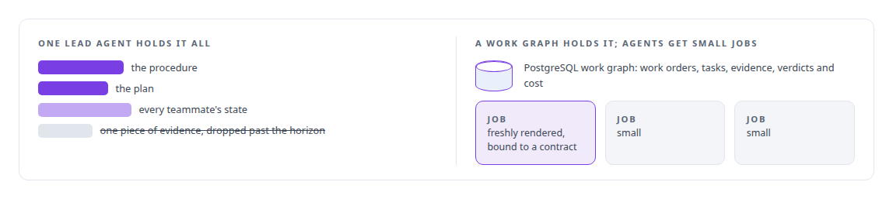
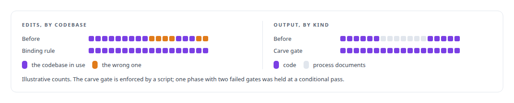
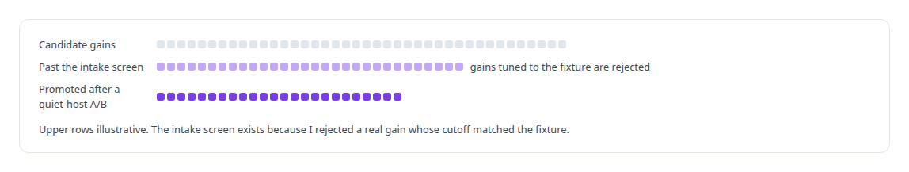
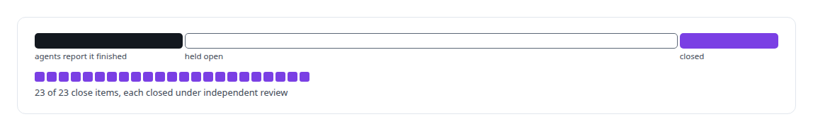

# Governed AI-assisted software engineering

**Written definitions of done, builders and reviewers from different model families, intake and promotion procedures, and evidence that decides.**

Canonical: https://coreyjames.ai/technologies/governed-ai-assisted-software-engineering/  
Author: Corey James · Published: 2026-10-28 · Kind: technology  
Systems: [AgentOS](https://github.com/coreyjames-ai/agentos) · [Agent Swarm](https://github.com/coreyjames-ai/agent-swarm) · [FAFOHive](https://github.com/coreyjames-ai/fafohive) · [FAFO Core and Function Forge](https://github.com/coreyjames-ai/fafo-core) · [Inference Fabric](https://github.com/coreyjames-ai/inference-fabric) · [ActiveKV](https://github.com/coreyjames-ai/activekv) · [Capabilities model](https://github.com/coreyjames-ai/capabilities-model)  
Skills: [AI-assisted engineering methodology](https://github.com/coreyjames-ai/portfolio/tree/main/skills/ai-assisted-engineering-methodology) · [C++ and native ports with parity proof](https://github.com/coreyjames-ai/portfolio/tree/main/skills/c-and-native-ports-with-parity-proof) · [evidence-gated acceptance](https://github.com/coreyjames-ai/portfolio/tree/main/skills/evidence-gated-acceptance) · [technical leadership of agent teams](https://github.com/coreyjames-ai/portfolio/tree/main/skills/technical-leadership-of-agent-teams)  


## Result

| Figure | What it measures |
| --- | --- |
| **3 weeks** | or less for the native C++ port of ActiveKV under a seven-criterion definition of done |
| **24** | performance promotions through the procedure in four days |
| **60+** | locked decisions in the Agent Swarm master plan before parallel work |

## What was built

Most of the code behind the systems on this site was written by AI coding agents. I lead that work as an architect: I keep the agents that build apart from the agents that judge, and make the calls when the evidence is disputed. I write the definition of done, the intake standard and the promotion procedure before work starts, and each new ruling becomes standing doctrine. The method is the story [Directing AI coding agents at program scale](https://coreyjames.ai/stories/directing-ai-coding-agents-at-program-scale).

## Taking the memory out of the model

[AgentOS](https://coreyjames.ai/systems/agentos) started from a diagnosis. Long agent runs drift because the lead agent has to hold the procedure, the plan, every teammate's state and every piece of evidence in its context, and past some horizon it drops one. I moved that memory out of the model.



About a hundred hook modules turn policy into refusals. Builders and judges come from different model families, so one family's blind spots meet another's.


Agent teams built AgentOS while working under it. I then ran it on real deliveries: a fourteen-day platform build the system closed only when every close item had a current passing verdict, and a port of a large open-source agent gateway into a 25-crate Rust workspace, measured against a pinned census of the original source. See [Why long agent runs fail](https://coreyjames.ai/stories/why-long-agent-runs-fail) and [Separation of duties for AI work](https://coreyjames.ai/stories/separation-of-duties-for-ai-work).

## Locked decisions and gatekeepers

[Agent Swarm](https://coreyjames.ai/systems/agent-swarm) is where I first worked the method out. I wrote a master plan of locked decisions, froze interfaces before parallel work began, and used gatekeeper agents that had never implemented what they judged.

When agents drift, I change the machinery so the drift is impossible.



## A port judged bit for bit

[ActiveKV](https://coreyjames.ai/systems/activekv) moved from Python to a native C++ engine under a definition of done I wrote. Served output had to be bit-identical wherever the reference was deterministic, and every line of Python left behind needed a framework contract to justify it. During the port I voided over a thousand passing trials when I found a component had been registered after the code path was chosen.

Performance work then ran through a promotion procedure. See [Rewriting an engine extension without changing a token](https://coreyjames.ai/stories/rewriting-an-engine-extension-without-changing-a-token).



## A model built under one work order

[Capabilities model](https://coreyjames.ai/systems/capabilities-model) was one work order with an independent quality seat, covering data, training, a custom decoder, serving and a frozen evaluation. See [The baseline that tied us](https://coreyjames.ai/stories/the-baseline-that-tied-us).


## Held open until the evidence closed it

[FAFO Core and Function Forge](https://coreyjames.ai/systems/fafo-core) includes an API integration platform built in gated phases with a conformance suite. When the agents reported it finished, I held it open for independent close evidence. See [Closed by evidence](https://coreyjames.ai/stories/closed-by-evidence).



[FAFOHive](https://coreyjames.ai/systems/fafohive) gained three social-platform integrations in about two days, each built against a written standard every tool had to meet before release.

> An agent's report that it is done is a claim; the system closes work on evidence a separate seat has checked.

## What was verified

Each line is a claim the canonical page supports, with the figure as the page states it.

- AI-assisted engineering methodology: definitions of done, intake screens and promotion procedures written before work starts, with builders and judges from different model families.
- C++ and native ports with parity proof: a Python-to-C++ engine port in under 3 weeks against a seven-criterion definition of done, then 24 performance promotions in four days.
- Evidence-gated acceptance: an integration platform held open after agents reported it finished, until 23 of 23 close items closed under independent review.
- Technical leadership of agent teams: a master plan of 60+ locked decisions, gatekeepers that never built what they judged, and a decision ledger of 160 entries with 24 of my rulings.

## Related

- [Why long agent runs fail](https://github.com/coreyjames-ai/agentos/tree/main/stories/why-long-agent-runs-fail) · https://coreyjames.ai/stories/why-long-agent-runs-fail/
- [Closed by evidence](https://github.com/coreyjames-ai/agentos/tree/main/stories/closed-by-evidence) · https://coreyjames.ai/stories/closed-by-evidence/
- [Separation of duties for AI work](https://github.com/coreyjames-ai/agentos/tree/main/stories/separation-of-duties-for-ai-work) · https://coreyjames.ai/stories/separation-of-duties-for-ai-work/
- [Directing AI coding agents at program scale](https://github.com/coreyjames-ai/agentos/tree/main/stories/directing-ai-coding-agents-at-program-scale) · https://coreyjames.ai/stories/directing-ai-coding-agents-at-program-scale/
- [Rewriting an engine extension without changing a token](https://github.com/coreyjames-ai/activekv/tree/main/stories/rewriting-an-engine-extension-without-changing-a-token) · https://coreyjames.ai/stories/rewriting-an-engine-extension-without-changing-a-token/
- [The baseline that tied us](https://github.com/coreyjames-ai/capabilities-model/tree/main/stories/the-baseline-that-tied-us) · https://coreyjames.ai/stories/the-baseline-that-tied-us/
- System: [AgentOS](https://github.com/coreyjames-ai/agentos)
- System: [Agent Swarm](https://github.com/coreyjames-ai/agent-swarm)
- System: [FAFOHive](https://github.com/coreyjames-ai/fafohive)
- System: [FAFO Core and Function Forge](https://github.com/coreyjames-ai/fafo-core)
- System: [Inference Fabric](https://github.com/coreyjames-ai/inference-fabric)
- System: [ActiveKV](https://github.com/coreyjames-ai/activekv)
- System: [Capabilities model](https://github.com/coreyjames-ai/capabilities-model)

## Citation

Corey James. "Governed AI-assisted software engineering." coreyjames.ai, 2026. https://coreyjames.ai/technologies/governed-ai-assisted-software-engineering/

```bibtex
@misc{coreyjames-governed-ai-assisted-software-engineering,
  author = {Corey James},
  title = {Governed AI-assisted software engineering},
  year = {2026},
  howpublished = {\url{https://coreyjames.ai/technologies/governed-ai-assisted-software-engineering/}},
  note = {GitHub copy: https://github.com/coreyjames-ai/portfolio/tree/main/technologies/governed-ai-assisted-software-engineering}
}
```

Part of [Corey James's portfolio](https://github.com/coreyjames-ai/portfolio) · site: https://coreyjames.ai/ · MCP server: https://coreyjames.ai/mcp · agent card: https://coreyjames.ai/.well-known/agent.json
