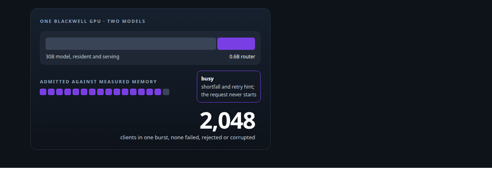
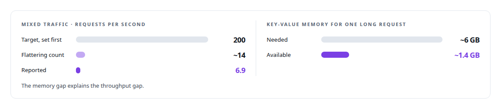
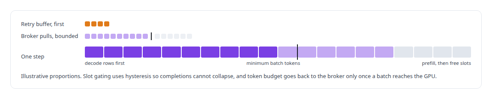
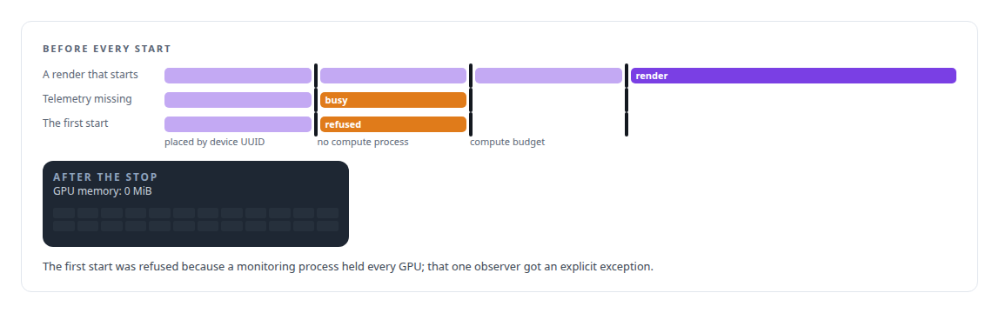

# GPU admission control and co-residency

**Two models on one GPU, with the second admitting work against measured memory and refusing with a number: a 0.6B router beside a 30B model, through a 2,048-client burst.**

Canonical: https://coreyjames.ai/technologies/gpu-admission-control-and-co-residency/  
Author: Corey James · Published: 2026-10-28 · Kind: technology  
Systems: [Helix](https://github.com/coreyjames-ai/helix) · [Inference Fabric](https://github.com/coreyjames-ai/inference-fabric) · [Capabilities model](https://github.com/coreyjames-ai/capabilities-model)  
Skills: [high-throughput batch inference](https://github.com/coreyjames-ai/portfolio/tree/main/skills/high-throughput-batch-inference) · [inference serving architecture](https://github.com/coreyjames-ai/portfolio/tree/main/skills/inference-serving-architecture) · [GPU inference optimisation](https://github.com/coreyjames-ai/portfolio/tree/main/skills/gpu-inference-optimisation) · [AI-assisted engineering methodology](https://github.com/coreyjames-ai/portfolio/tree/main/skills/ai-assisted-engineering-methodology)  



## Result

| Figure | What it measures |
| --- | --- |
| **2,740** | MiB, the router's whole footprint beside the resident model |
| **85.9/s** | requests served through the 2,048-client burst |
| **45.5/s** | short requests sustained |

## What was built

### A router beside a 30B model

[Capabilities model](https://coreyjames.ai/systems/capabilities-model) had to run on a Blackwell GPU whose memory belonged to a 30-billion-parameter model that stayed resident and serving. Agents call the discovery model before most actions, so many would call it at once, and a wrong answer under load would be worse than a slow one.

I gave it a fixed memory budget and made two thousand concurrent clients an acceptance criterion from the start.


The engine admits work against the memory it has measured, so overload becomes a queue and then a refusal and never a corrupted answer. Before it accepts a request it checks that the request's key-value memory fits; when it does not, the caller gets a typed busy response carrying the shortfall and a retry hint, and the request never starts. The engine binds into the serving path only after a canary request succeeds, and it drains gracefully. A load ladder climbed from one client to 2,048 with abort conditions at every rung, so a failure stopped the test. The full account is [A router beside a production model](https://coreyjames.ai/stories/a-router-beside-a-production-model).

On mixed traffic the engine fell far short of its pre-registered target, because long requests needed more key-value memory than was left beside the resident model, and I reported the honest figure.



### A GPU that never idles and never stalls

[Inference Fabric](https://coreyjames.ai/systems/inference-fabric) had the opposite problem. I put admission control in front of TensorRT-LLM's in-flight batcher, and backpressure counts consumption at the GPU, which keeps the broker from overfeeding a stalled engine.



An early version of the runtime stopped the GPU entirely with sequences in flight; I added a progress-only step that always advances active sequences. See [From 44K to 163K tokens per second](https://coreyjames.ai/stories/from-44k-to-163k-tokens-per-second).

### Shown free before a render starts

[Helix](https://coreyjames.ai/systems/helix) shares GPUs between real-time voice and the agents' render jobs, and I decided a render may start only after the service has shown a GPU is free. A GPU that looks idle has to be shown idle, and missing telemetry fails safe.



I protect correctness ahead of throughput when two workloads share a card. These are single-host designs; co-residency is managed in software with budgets and admission.

> I set the acceptance numbers before the engine exists so the result cannot be reframed afterwards.

## What was verified

Each line is a claim the canonical page supports, with the figure as the page states it.

- GPU co-residency and admission control: a 0.6B router in 2,740 MiB beside a 30B serving model, admitting work against measured memory and refusing with the shortfall and a retry hint.
- Load testing at concurrency: a ladder to 2,048 clients with abort conditions at every rung, the burst served at 85.9 requests per second with none failed, rejected or corrupted.
- Honest performance reporting: mixed traffic reported at 6.9 requests per second against a pre-registered target of 200 rather than a flattering count of about 14.
- High-throughput batch inference: admission in front of TensorRT-LLM's in-flight batcher with a minimum-batch token gate and backpressure counted at the GPU.

## Related

- [A router beside a production model](https://github.com/coreyjames-ai/capabilities-model/tree/main/stories/a-router-beside-a-production-model) · https://coreyjames.ai/stories/a-router-beside-a-production-model/
- [From 44K to 163K tokens per second](https://github.com/coreyjames-ai/inference-fabric/tree/main/stories/from-44k-to-163k-tokens-per-second) · https://coreyjames.ai/stories/from-44k-to-163k-tokens-per-second/
- System: [Helix](https://github.com/coreyjames-ai/helix)
- System: [Inference Fabric](https://github.com/coreyjames-ai/inference-fabric)
- System: [Capabilities model](https://github.com/coreyjames-ai/capabilities-model)

## Citation

Corey James. "GPU admission control and co-residency." coreyjames.ai, 2026. https://coreyjames.ai/technologies/gpu-admission-control-and-co-residency/

```bibtex
@misc{coreyjames-gpu-admission-control-and-co-residency,
  author = {Corey James},
  title = {GPU admission control and co-residency},
  year = {2026},
  howpublished = {\url{https://coreyjames.ai/technologies/gpu-admission-control-and-co-residency/}},
  note = {GitHub copy: https://github.com/coreyjames-ai/portfolio/tree/main/technologies/gpu-admission-control-and-co-residency}
}
```

Part of [Corey James's portfolio](https://github.com/coreyjames-ai/portfolio) · site: https://coreyjames.ai/ · MCP server: https://coreyjames.ai/mcp · agent card: https://coreyjames.ai/.well-known/agent.json
