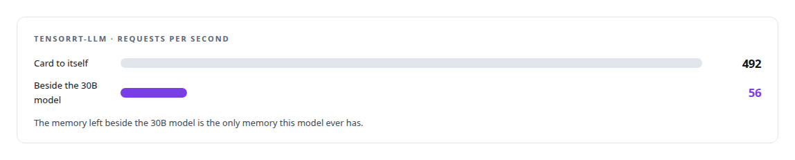
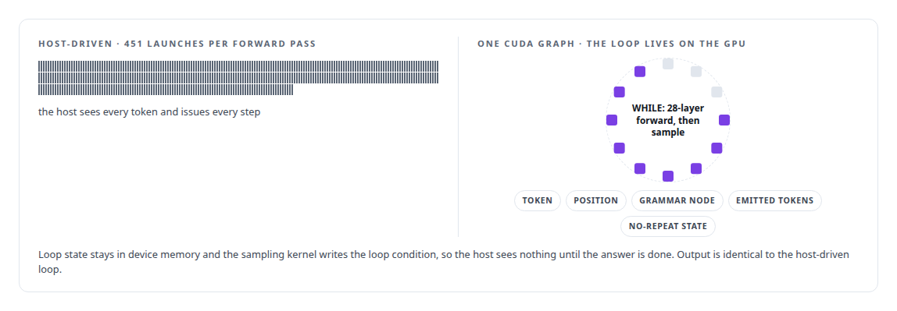
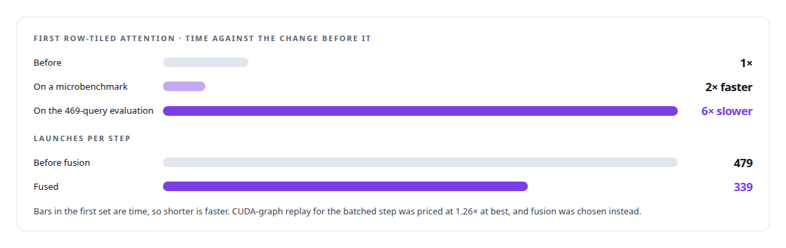

# GPU inference engine engineering

**I built a batched continuous-decode engine with paged key-value memory, admission control, canary-gated binding and typed refusals, and I tried the vendor's industrial stack first and closed it on measurements.**

Canonical: https://coreyjames.ai/technologies/gpu-inference-engine-engineering/  
Author: Corey James · Published: 2026-10-28 · Kind: technology  
Systems: [Capabilities model](https://github.com/coreyjames-ai/capabilities-model)  
Skills: [GPU inference optimisation](https://github.com/coreyjames-ai/portfolio/tree/main/skills/gpu-inference-optimisation) · [TensorRT and TensorRT-LLM engineering](https://github.com/coreyjames-ai/portfolio/tree/main/skills/tensorrt-and-tensorrt-llm-engineering) · [inference serving architecture](https://github.com/coreyjames-ai/portfolio/tree/main/skills/inference-serving-architecture) · [LLM quantization (FP8, INT8, 4-bit)](https://github.com/coreyjames-ai/portfolio/tree/main/skills/llm-quantization-fp8-int8-4-bit)  


## Result

| Figure | What it measures |
| --- | --- |
| **518 µs** | removed per token by the on-GPU decode loop, up to 696 under load |
| **13.4×** | faster prefill in 256-token chunks, identical answers |
| **503 MiB** | CUDA context, reported apart so admission stays honest |
| **2.53×** | less device memory with NVFP4 weights, about 5 percent slower |

## What was built

### Measuring the industrial path first

[Capabilities model](https://coreyjames.ai/systems/capabilities-model) is a 0.6-billion-parameter tool-discovery model that had to serve two thousand concurrent agents. It had only the memory a resident 30-billion-parameter model left free on one NVIDIA Blackwell GPU. I had the vendor's industrial stack tried first. Its weight conversion corrupted some tensors by up to a thousand times. That is [Trying the industrial path first](https://coreyjames.ai/stories/trying-the-industrial-path-first).



I can take a model from weights to a custom inference engine whose speed and numerics I can defend.


### The whole decode loop on the GPU

I then directed the build of a purpose-built engine in Rust and CUDA, with its lab. It uses hand-written FP32-accumulating kernels with no cuBLAS and no tensor cores. Batch-one decode is a matrix-vector product, so tensor cores would sit idle, and staying off cuBLAS removes its silent TF32 default.

I put the entire generate-until-stop loop on the GPU as one CUDA graph: a seed sampling step, then a conditional WHILE node.



The output layer is grammar-bounded. The grammar knows the next token is one of the current trie node's outgoing edges, so the engine lists those candidates first and computes logits for those rows only. Prefill runs all prompt tokens through the weights in one pass per chunk.

### Batching without running out of cache

The batched engine replaces three things that do not survive batching. KV memory is a paged pool with a per-sequence block table. Every step is a set of rows, each carrying its own token, sequence and position, so decode rows from many sequences and a slice of one long prompt share a launch and long prompts never block short ones. Grammar state is 16 bytes per sequence: no-repeat becomes a 64-bit set of used tools tested against a static per-edge set of the tools below it, so sequences share the trie read-only and never write to each other's state.


Admission refuses with a typed reason and the numbers when the pages are not there. The engine computes its memory need without allocating, tested against a real load. A failed load now frees what it took; before, four retries drained the card to 2 MiB.

### The same bits in any batch

Determinism is structural. Reductions use a fixed 32-lane shuffle tree, or a fixed 256-thread tree for the head, and attention sums positions inside one thread. The batched engine reuses the serial engine's row kernels. That story is [Bit-identical across batch compositions](https://coreyjames.ai/stories/bit-identical-across-batch-compositions).


Every speed change had to be bit-identical to its reference: register-tiled projections, hardware FP8 decoding in place of a divergent table lookup, row-tiled attention that stages a shared prompt prefix once for eight rows, and fused launches. The one value-changing switch, BF16 key-value storage with hand-written round-to-nearest-even, went in only after a full determinism re-run.

### Speed that counts end to end

A change stays only if it moves the 469-query end-to-end time. My first row-tiled attention added a launch per row in decode and tiled prompts with no prefix worth sharing. I fixed both and kept the rule. NVFP4 is the footprint option and FP8 is the default build.



Beside the 30B model the engine used 2,740 MiB and served a burst of 2,048 clients at 85.9 requests per second. The engine serves one architecture. On mixed long requests it sustained 6.9 requests per second against a target of 200; the limit is key-value memory beside the 30B model, and [A router beside a production model](https://coreyjames.ai/stories/a-router-beside-a-production-model) explains it.

> I build custom only after measuring the standard option.

## What was verified

Each line is a claim the canonical page supports, with the figure as the page states it.

- GPU inference optimisation: a purpose-built Rust and CUDA decode engine for a 0.6B tool-discovery model, with the decode loop as one CUDA graph removing 518 microseconds per token.
- Deterministic GPU computation: one block per output row and fixed reduction trees, passing 12 of 12 bit-identity gates and 2,345 of 2,345 rank-one results across shuffled batches.
- TensorRT and TensorRT-LLM engineering: the vendor stack measured first at 492 requests per second with the card to itself and 56 beside the serving model, before building custom.
- LLM quantization: NVFP4 weights using 2.53 times less device memory than FP8 at about 5 percent slower.

## Related

- [From 44K to 163K tokens per second](https://github.com/coreyjames-ai/inference-fabric/tree/main/stories/from-44k-to-163k-tokens-per-second) · https://coreyjames.ai/stories/from-44k-to-163k-tokens-per-second/
- [Trying the industrial path first](https://github.com/coreyjames-ai/capabilities-model/tree/main/stories/trying-the-industrial-path-first) · https://coreyjames.ai/stories/trying-the-industrial-path-first/
- [Bit-identical across batch compositions](https://github.com/coreyjames-ai/capabilities-model/tree/main/stories/bit-identical-across-batch-compositions) · https://coreyjames.ai/stories/bit-identical-across-batch-compositions/
- [A router beside a production model](https://github.com/coreyjames-ai/capabilities-model/tree/main/stories/a-router-beside-a-production-model) · https://coreyjames.ai/stories/a-router-beside-a-production-model/
- System: [Capabilities model](https://github.com/coreyjames-ai/capabilities-model)

## Citation

Corey James. "GPU inference engine engineering." coreyjames.ai, 2026. https://coreyjames.ai/technologies/gpu-inference-engine-engineering/

```bibtex
@misc{coreyjames-gpu-inference-engine-engineering,
  author = {Corey James},
  title = {GPU inference engine engineering},
  year = {2026},
  howpublished = {\url{https://coreyjames.ai/technologies/gpu-inference-engine-engineering/}},
  note = {GitHub copy: https://github.com/coreyjames-ai/portfolio/tree/main/technologies/gpu-inference-engine-engineering}
}
```

Part of [Corey James's portfolio](https://github.com/coreyjames-ai/portfolio) · site: https://coreyjames.ai/ · MCP server: https://coreyjames.ai/mcp · agent card: https://coreyjames.ai/.well-known/agent.json
