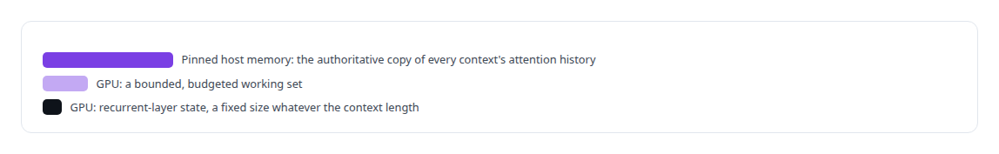
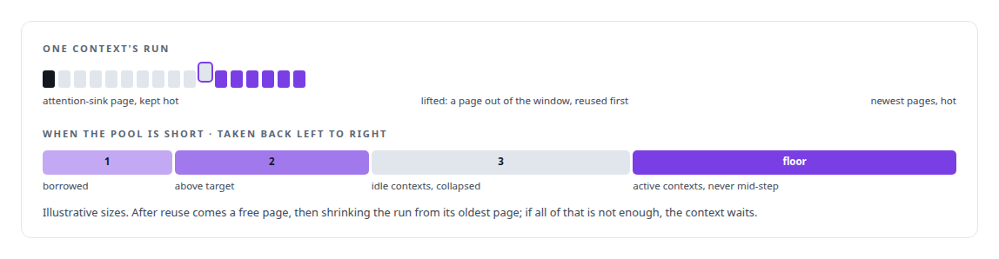
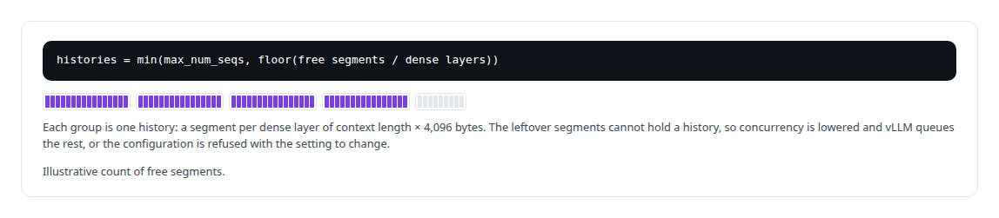
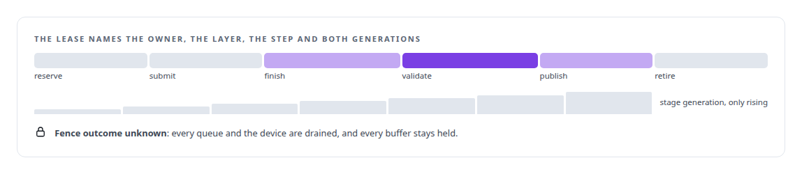
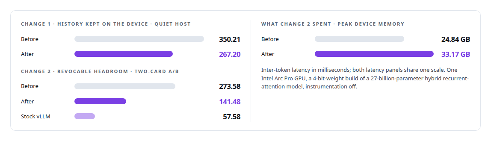
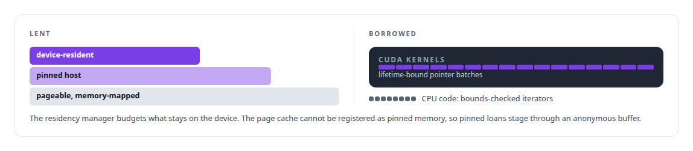

# GPU memory management

**ActiveKV inverts who owns memory: history in pinned host RAM, the GPU a budgeted working set.**

Canonical: https://coreyjames.ai/technologies/gpu-memory-management/  
Author: Corey James · Published: 2026-10-28 · Kind: technology  
Systems: [Inference Fabric](https://github.com/coreyjames-ai/inference-fabric) · [ActiveKV](https://github.com/coreyjames-ai/activekv)  
Skills: [KV-cache offload for LLM inference](https://github.com/coreyjames-ai/portfolio/tree/main/skills/kv-cache-offload-for-llm-inference) · [GPU inference optimisation](https://github.com/coreyjames-ai/portfolio/tree/main/skills/gpu-inference-optimisation) · [TensorRT and TensorRT-LLM engineering](https://github.com/coreyjames-ai/portfolio/tree/main/skills/tensorrt-and-tensorrt-llm-engineering) · [inference serving architecture](https://github.com/coreyjames-ai/portfolio/tree/main/skills/inference-serving-architecture)  


## Result

| Figure | What it measures |
| --- | --- |
| **147 MiB** | recurrent-layer state per context, fixed whatever the length |
| **2 GiB** | of pinned host memory per 32K-token history |
| **16** | dense layers sharing one device arena |
| **0** | CUDA allocations after the first second of a trace, down from about 4,200 |

## What was built

### Inverting who owns memory

[ActiveKV](https://coreyjames.ai/systems/activekv) began with a constraint I did not accept. Stock vLLM keeps a request's whole key-value cache on the GPU, so on a 32 GB Intel Arc Pro GPU the card decides how much context a model can hold. I inverted who owns memory and gave the device a stated budget, so the operator chooses the trade-off.



I give GPU memory owners, budgets and lifetimes, on two vendors' hardware.


### Pages held by right, borrowed or free

The device side is one arena shared by every dense layer: staging pages for 32K-token tiles plus a pool of pages. Each context has a target it holds by right, a burst it may borrow while pages are free, and a floor it needs to run. On every step the engine keeps the newest pages and an attention-sink page hot, and pages that turn hot below the current frontier are copied in once.



Reclamation runs least-recently-active first, in a fixed order, and every step of it is counted.

### A host pool that explains its own size

Startup computes how many histories fit on the host and prints the formula, so a refusal or a reduced concurrency limit explains itself.



The engine refuses an automatic device pool size outright. I allow explicit pool sizes only, because an automatic size hides the decision the operator is making.

### Staging as a lease

Staging is a lease with a lifecycle, and its stage generation only increases. Copies run on their own H2D and D2H queues, and attention waits on the copy event on the device. Only the changed tail rows are written back, after attention signals.



A buffer is released only on signalled fences, after waits on every copy and kernel that touched it, and an unknown fence outcome quarantines it. Copy tickets keep a lease on the host pages, so a page cannot be recycled while DMA reads it.

### Spending the memory it frees

Moving history to the host frees device memory, and I spend it on purpose. One change retains each context's immutable history on the device and materialises it with a device-to-device copy that overlaps the incoming suffix. A second change keeps that history in revocable headroom, device memory the engine profiled as free and can take back under pressure. I spent about 8 GB of it to roughly halve long-context latency under concurrency. The full design is [Context beyond VRAM](https://coreyjames.ai/stories/context-beyond-vram).



ActiveKV runs on one card in eager mode, and at the longest contexts the cost of staging across PCIe still makes it slower per token than stock vLLM.

### Nothing allocated after warm-up

[Inference Fabric](https://coreyjames.ai/systems/inference-fabric) had two memory problems. The throughput runtime around TensorRT-LLM had to hold steady for hours, so I ruled that it allocates everything at warm-up. The runtime rejects synchronisation on the compute stream and forbids CUDA-graph capture on its own streams.

The Vector Shard Manager had to hand stored vectors to hand-written CUDA kernels. I put a type-only interface crate between storage and CUDA, and a budgeted residency manager decides what stays on the GPU and can explain each decision.



> Memory is a design decision, not a default.

## What was verified

Each line is a claim the canonical page supports, with the figure as the page states it.

- KV-cache offload for LLM inference: pinned host memory as the copy of record and the GPU as a budgeted page arena, with 2 GiB of host memory per 32K-token history.
- Latency engineering under concurrency: reclaimed device memory spent to cut inter-token latency from 273.58 to 141.48 ms on long prompts with four concurrent requests.
- GPU memory management: staging leases released only on completed fences, quarantine on an unknown fence outcome, and a host-pool fit that prints its own formula.
- TensorRT and TensorRT-LLM engineering: a throughput runtime with 0 CUDA allocations after the first second of a trace, down from about 4,200.

## Related

- [Context beyond VRAM](https://github.com/coreyjames-ai/activekv/tree/main/stories/context-beyond-vram) · https://coreyjames.ai/stories/context-beyond-vram/
- System: [Inference Fabric](https://github.com/coreyjames-ai/inference-fabric)
- System: [ActiveKV](https://github.com/coreyjames-ai/activekv)

## Citation

Corey James. "GPU memory management." coreyjames.ai, 2026. https://coreyjames.ai/technologies/gpu-memory-management/

```bibtex
@misc{coreyjames-gpu-memory-management,
  author = {Corey James},
  title = {GPU memory management},
  year = {2026},
  howpublished = {\url{https://coreyjames.ai/technologies/gpu-memory-management/}},
  note = {GitHub copy: https://github.com/coreyjames-ai/portfolio/tree/main/technologies/gpu-memory-management}
}
```

Part of [Corey James's portfolio](https://github.com/coreyjames-ai/portfolio) · site: https://coreyjames.ai/ · MCP server: https://coreyjames.ai/mcp · agent card: https://coreyjames.ai/.well-known/agent.json
