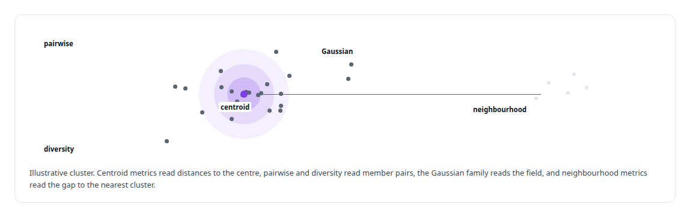
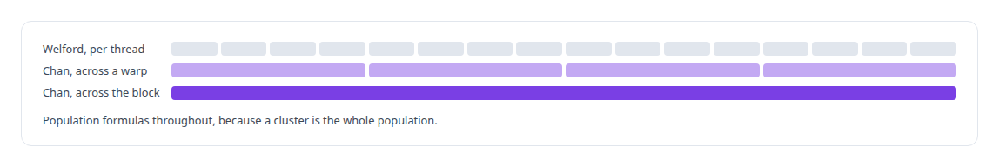
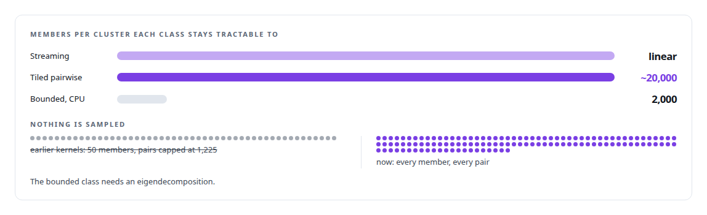
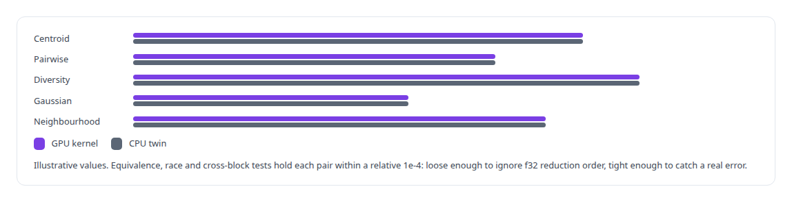

# GPU numerical kernel design

**Kernels with fixed-order reductions, one block per output row, no K-split tiling: determinism by construction.**

Canonical: https://coreyjames.ai/technologies/gpu-numerical-kernel-design/  
Author: Corey James · Published: 2026-10-28 · Kind: technology  
Systems: [Inference Fabric](https://github.com/coreyjames-ai/inference-fabric) · [Capabilities model](https://github.com/coreyjames-ai/capabilities-model)  
Skills: [CUDA kernel development](https://github.com/coreyjames-ai/portfolio/tree/main/skills/cuda-kernel-development) · [NVIDIA Blackwell development](https://github.com/coreyjames-ai/portfolio/tree/main/skills/nvidia-blackwell-development) · [Rust systems engineering](https://github.com/coreyjames-ai/portfolio/tree/main/skills/rust-systems-engineering) · [tool synthesis and governed API integration](https://github.com/coreyjames-ai/portfolio/tree/main/skills/tool-synthesis-and-governed-api-integration)  


## Result

| Figure | What it measures |
| --- | --- |
| **38** | per-cluster metrics, every family with a CPU reference |
| **12 of 12** | bit-identity gates across batch compositions in the decoder |
| **256** | bins in the histogram that yields each Gaussian width |
| **3** | Lloyd iterations, fixed into the silhouette's definition |

## What was built

### Per-cluster diagnostics no library offered

[Inference Fabric](https://coreyjames.ai/systems/inference-fabric) stores clustered embeddings, and a clustered embedding space needs constant quality checks: is a cluster tight, drifting, bimodal, contaminated by outliers, redundant with a neighbour? The GPU libraries I had offered search and whole-dataset clustering, with no per-cluster diagnostics, and none targeted CUDA 13 on Blackwell from Rust. I decided to write the kernels, and I set their numerical rules before any were written.

The engine is called through the raw CUDA driver API and compiled to native Blackwell binaries. It targets Blackwell only and computes in f32 with no tensor-core path. Its per-cluster metrics fall into a few families.



### Moments that stay stable in f32

The centroid family gives cohesion and inertia from member-to-centroid distances, spread and skew of those distances, the ratio of centroid strength to the spread of member norms, distance to the global centroid, and the fractions of members beyond two standard deviations or within one.

Welford and Chan merges keep variance and skew stable in f32 across thousands of threads.



### Pairwise metrics without a distance matrix

The pairwise family gives coherence from mean pairwise cosine, compactness from mean pairwise distance, and silhouette from a two-means split. The two-means step starts from the first and last member and also yields a clustering tendency from the drop in inertia and a balance between the two halves.

The diversity family counts redundant and distinct pairs against cosine thresholds, measures breadth and coverage, and takes entropy from a 20-bin histogram of pairwise distances. That needs two passes, because the bin edges come from the minimum and maximum the first pass finds. A Gaussian family treats members as potentials of width σ, where σ is a scale times the median pairwise distance taken from a histogram filled during the tile loop; a histogram gives that median without storing the distances, at the cost of one bin width of precision. Neighbourhood metrics compare each cluster with its nearest clusters, including question-to-answer divergence for paired embeddings.

Pairwise kernels are tiled and reduce as they go, so memory is bounded by the tile. Each kernel belongs to a scaling class, and nothing is sampled.



### A CPU twin for every family

Thresholds are kernel arguments, and every metric has a lineage file naming its kernel, its destination and its timing. Equivalence tolerances are set from how f32 reductions behave on long vectors.



A bad cluster has to read as bad.


### The same bits in any batch

[Capabilities model](https://coreyjames.ai/systems/capabilities-model) needed a different property from its decoding kernels: the ranking of tools must not depend on which other requests share the batch. I ruled that output bits must be identical across batch compositions and set the structure to get it: one block per output row, fixed reduction trees, no K-split tiling, and row kernels shared between the serial and batched engines. The story is [Bit-identical across batch compositions](https://coreyjames.ai/stories/bit-identical-across-batch-compositions).


I make numerical decisions deliberately: what to reduce in which order, what to approximate and by how much, what to clamp and what never to clamp, and what property the application actually needs.

> I left diagnostics unclamped, because a metric forced into range hides the failure it exists to catch.

## What was verified

Each line is a claim the canonical page supports, with the figure as the page states it.

- CUDA kernel development: 38 per-cluster metrics in five families for Blackwell, called from Rust through the raw CUDA driver API, with every member used and nothing sampled.
- Numerical stability in f32: Welford updates per thread with Chan merges across warps, a 256-bin histogram median, and every family checked against a CPU twin within a relative 1e-4.
- Deterministic GPU computation: one block per output row, fixed shuffle trees and no K-split tiling, passing 12 of 12 bit-identity gates across batch compositions.

## Related

- [Bit-identical across batch compositions](https://github.com/coreyjames-ai/capabilities-model/tree/main/stories/bit-identical-across-batch-compositions) · https://coreyjames.ai/stories/bit-identical-across-batch-compositions/
- [Bringing a serving stack up on new silicon](https://github.com/coreyjames-ai/activekv/tree/main/stories/bringing-a-serving-stack-up-on-new-silicon) · https://coreyjames.ai/stories/bringing-a-serving-stack-up-on-new-silicon/
- [Thirty-eight metrics in a dozen passes](https://github.com/coreyjames-ai/inference-fabric/tree/main/stories/thirty-eight-metrics-in-a-dozen-passes) · https://coreyjames.ai/stories/thirty-eight-metrics-in-a-dozen-passes/
- System: [Inference Fabric](https://github.com/coreyjames-ai/inference-fabric)
- System: [Capabilities model](https://github.com/coreyjames-ai/capabilities-model)

## Citation

Corey James. "GPU numerical kernel design." coreyjames.ai, 2026. https://coreyjames.ai/technologies/gpu-numerical-kernel-design/

```bibtex
@misc{coreyjames-gpu-numerical-kernel-design,
  author = {Corey James},
  title = {GPU numerical kernel design},
  year = {2026},
  howpublished = {\url{https://coreyjames.ai/technologies/gpu-numerical-kernel-design/}},
  note = {GitHub copy: https://github.com/coreyjames-ai/portfolio/tree/main/technologies/gpu-numerical-kernel-design}
}
```

Part of [Corey James's portfolio](https://github.com/coreyjames-ai/portfolio) · site: https://coreyjames.ai/ · MCP server: https://coreyjames.ai/mcp · agent card: https://coreyjames.ai/.well-known/agent.json
