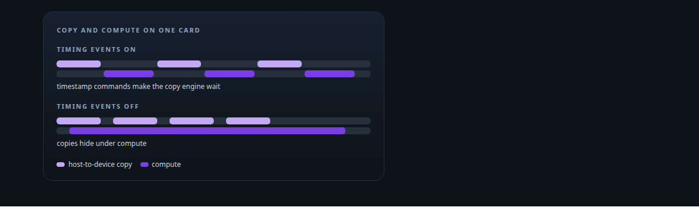
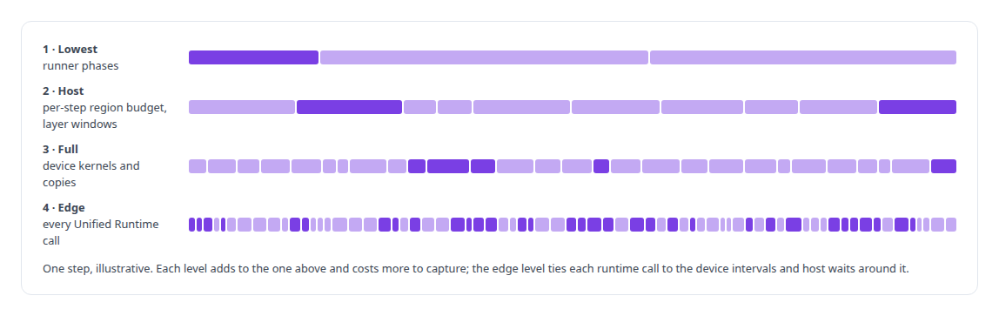
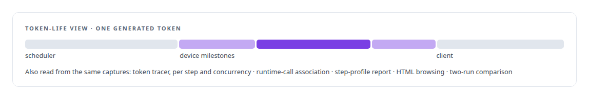
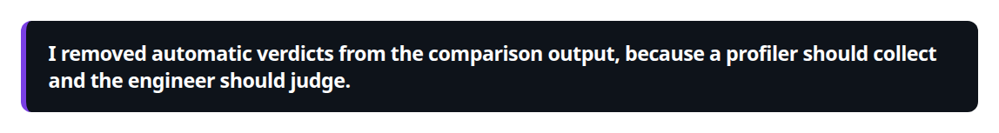
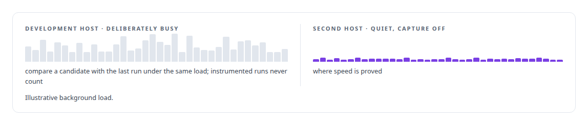
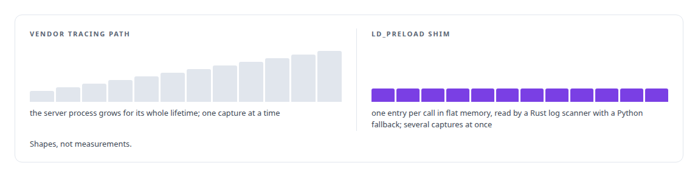

# GPU profiling and tracing

**I instrument ActiveKV down to the runtime call level and I measure the instrument: a profiler that serialised the copy engine it was observing got its verdict retracted in the plan.**

Canonical: https://coreyjames.ai/technologies/gpu-profiling-and-tracing/  
Author: Corey James · Published: 2026-10-28 · Kind: technology  
Systems: [ActiveKV](https://github.com/coreyjames-ai/activekv)  
Skills: [Intel GPU and SYCL/oneAPI engineering](https://github.com/coreyjames-ai/portfolio/tree/main/skills/intel-gpu-and-sycl-oneapi-engineering)  



## Result

| Figure | What it measures |
| --- | --- |
| **4** | capture levels, from runner phases to every runtime call |
| **0.21** | copy overlap at best with timing events on, down to 0.02 |
| **1.09** | the same overlap at best with them off, down to 0.79 |

## What was built

### Capture levels chosen per run

[ActiveKV](https://coreyjames.ai/systems/activekv) is only faster if I can see where each decode step spends its time, on the host and on the device, and the act of looking changes the answer. I decided to build the instrument and then measure the instrument. I directed the build of a step-profiling suite with capture levels chosen per run.



### Readers that follow every token

Readers sit on top of the captures. The token-life view follows every generated token from the scheduler through each device milestone to the client.



I keep association and causation apart, and I treat an idle-looking queue as a question about the hardware. Each chart prints its own uncertainty, including the unproven device-to-host clock conversion.



### The observer that changed the answer

Two problems shaped the suite. A trace showed host-to-device copies failing to overlap with compute, and I acted on it. A controlled experiment then showed that the timing-enabled events used to see the overlap were being lowered into timestamp commands that made the copy engine wait. I retracted my verdict in the plan. That is [The observer that changed the answer](https://coreyjames.ai/stories/the-observer-that-changed-the-answer).

Every claim about overlap or serialisation now gets an uninstrumented control before anyone acts on it. I know the GPU runtime below the framework well enough to catch my own instrument distorting a result, and I correct my conclusions in writing when that happens.



### A shim when the vendor tracer leaked

Later, edge-level captures grew the server process for its whole lifetime. Micro-loop experiments put the leak in the vendor's tracing path, so I had the runtime calls intercepted directly with an LD_PRELOAD shim and left the tracer alone.



The suite is built for ActiveKV on Intel hardware; the vendor profilers and runtime are Intel's and PyTorch's, used and intercepted, and unmodified.

> I removed automatic verdicts from the comparison output, because a profiler should collect and the engineer should judge.

## What was verified

Each line is a claim the canonical page supports, with the figure as the page states it.

- GPU profiling and tracing: a step profiler for ActiveKV on Intel Arc with 4 capture levels, from runner phases to every Unified Runtime call, and token-life views from scheduler to client.
- Measurement integrity: a profiler shown to serialise the copy engine, with copy overlap 0.02 to 0.21 with timing events on against 0.79 to 1.09 off, and the verdict retracted.
- LD_PRELOAD symbol interposition: runtime calls intercepted by a flat-memory shim when the vendor tracing path leaked, so several captures could run at once.

## Related

- [The observer that changed the answer](https://github.com/coreyjames-ai/activekv/tree/main/stories/the-observer-that-changed-the-answer) · https://coreyjames.ai/stories/the-observer-that-changed-the-answer/
- System: [ActiveKV](https://github.com/coreyjames-ai/activekv)

## Citation

Corey James. "GPU profiling and tracing." coreyjames.ai, 2026. https://coreyjames.ai/technologies/gpu-profiling-and-tracing/

```bibtex
@misc{coreyjames-gpu-profiling-and-tracing,
  author = {Corey James},
  title = {GPU profiling and tracing},
  year = {2026},
  howpublished = {\url{https://coreyjames.ai/technologies/gpu-profiling-and-tracing/}},
  note = {GitHub copy: https://github.com/coreyjames-ai/portfolio/tree/main/technologies/gpu-profiling-and-tracing}
}
```

Part of [Corey James's portfolio](https://github.com/coreyjames-ai/portfolio) · site: https://coreyjames.ai/ · MCP server: https://coreyjames.ai/mcp · agent card: https://coreyjames.ai/.well-known/agent.json
