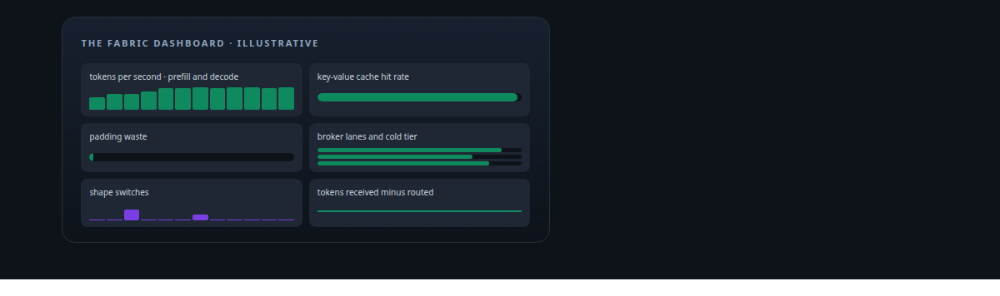
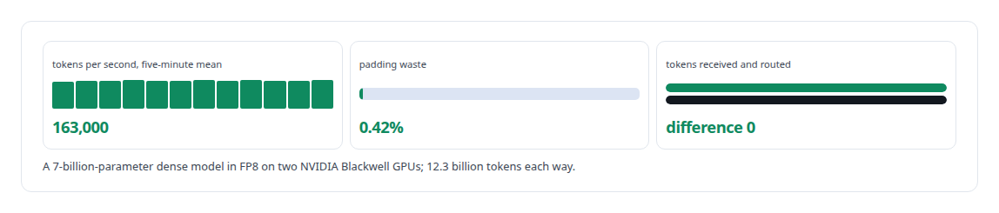
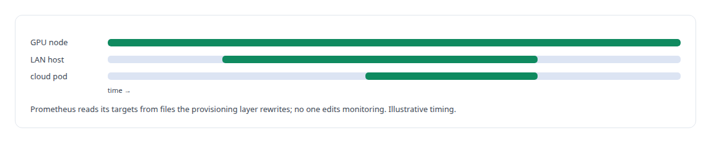
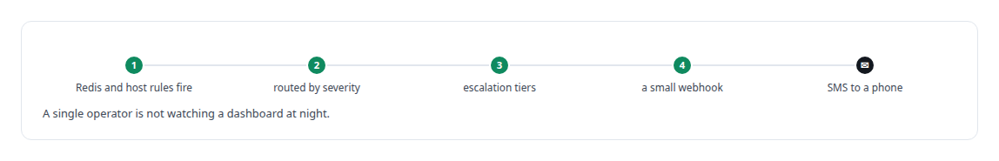
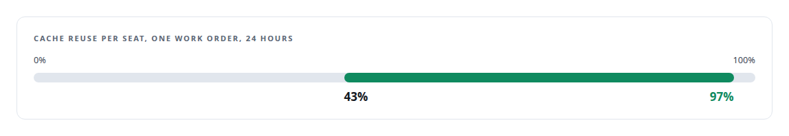

# Grafana

**Dashboards are how I captured the numbers on this site.**

Canonical: https://coreyjames.ai/technologies/grafana/  
Author: Corey James · Published: 2026-10-28 · Kind: technology  
Systems: [Inference Fabric](https://github.com/coreyjames-ai/inference-fabric) · [Auth and access plane](https://github.com/coreyjames-ai/auth-and-access-plane) · [AgentOS](https://github.com/coreyjames-ai/agentos) · [FAFO Core and Function Forge](https://github.com/coreyjames-ai/fafo-core) · [Capabilities model](https://github.com/coreyjames-ai/capabilities-model)  
Skills: [observability and alerting](https://github.com/coreyjames-ai/portfolio/tree/main/skills/observability-and-alerting) · [cost attribution for AI work](https://github.com/coreyjames-ai/portfolio/tree/main/skills/cost-attribution-for-ai-work) · [embedding analytics and cluster metrics](https://github.com/coreyjames-ai/portfolio/tree/main/skills/embedding-analytics-and-cluster-metrics) · [AI-assisted engineering methodology](https://github.com/coreyjames-ai/portfolio/tree/main/skills/ai-assisted-engineering-methodology)  



## Result

| Figure | What it measures |
| --- | --- |
| **~137** | metrics exported by the broker |
| **31** | panels on the broker's dashboard |
| **~203,000** | hidden-state extractions in a single test run |

## What was built

### Dashboards built around the measures

[Inference Fabric](https://coreyjames.ai/systems/inference-fabric) made claims about GPU efficiency that I wanted to prove from a screen, so I built its dashboards around the measures that justify the design. The panels show tokens per second split into prefill and decode, padding waste, shape switches, key-value cache hit rate, the broker's lanes and cold tier, probes and extractions per second, and a token-accounting difference that should always read zero. I chart domain measures first, because padding waste and token-accounting drift say more about a GPU pipeline than host load does, and I built each fabric dashboard alongside the feature it measured, so a change was visible the day it landed.

Every fabric figure on this site comes from these panels. See [From 44K to 163K tokens per second](https://coreyjames.ai/stories/from-44k-to-163k-tokens-per-second) and [Millions of queued items that were not there](https://coreyjames.ai/stories/millions-of-queued-items-that-were-not-there).




Further dashboards cover the GPU runtime, the vector store's storage health, Redis queue health with a capacity projection, and a system overview, and DCGM and node exporters cover the GPUs and hosts.



Grafana and Prometheus are third-party; my work is the choice of measures, the discovery wiring and the alert routing.

### Alerts that reach one operator

[Auth and access plane](https://coreyjames.ai/systems/auth-and-access-plane) is where one operator has to learn about a failure before anyone else does. The same Prometheus and Grafana stack carries the estate's alerting. A separate Prometheus and Grafana pair serves the agent runtime.



### Spend and cache reuse per seat

[AgentOS](https://coreyjames.ai/systems/agentos) stores the cost of every agent session in PostgreSQL, rolled up by work order, task, role, model and phase. I wanted to choose models per role from measured spend, so Grafana dashboards read those rollups and show cost and cache reuse per seat for a work order.



> I decide what to measure as part of the design, and I build the instruments that let me defend each number.

## What was verified

Each line is a claim the canonical page supports, with the figure as the page states it.

- Observability and alerting: dashboards built around domain measures, ~137 broker metrics on 31 panels, file-based target discovery and Alertmanager routing to SMS.
- GPU pipeline metrics: tokens per second, padding waste, cache hit rate and a token-accounting difference that reads zero, with 163,000 tokens per second read from the panels.
- Cost attribution for AI work: per-seat cost and cache reuse for a work order read from PostgreSQL rollups, cache reuse spanning 43% to 97% across seats.

## Related

- [A message broker that understands tokens](https://github.com/coreyjames-ai/inference-fabric/tree/main/stories/a-message-broker-that-understands-tokens) · https://coreyjames.ai/stories/a-message-broker-that-understands-tokens/
- [From 44K to 163K tokens per second](https://github.com/coreyjames-ai/inference-fabric/tree/main/stories/from-44k-to-163k-tokens-per-second) · https://coreyjames.ai/stories/from-44k-to-163k-tokens-per-second/
- [The workload that shaped the platform](https://github.com/coreyjames-ai/fafo-core/tree/main/stories/the-workload-that-shaped-the-platform) · https://coreyjames.ai/stories/the-workload-that-shaped-the-platform/
- [Millions of queued items that were not there](https://github.com/coreyjames-ai/inference-fabric/tree/main/stories/millions-of-queued-items-that-were-not-there) · https://coreyjames.ai/stories/millions-of-queued-items-that-were-not-there/
- System: [Inference Fabric](https://github.com/coreyjames-ai/inference-fabric)
- System: [Auth and access plane](https://github.com/coreyjames-ai/auth-and-access-plane)
- System: [AgentOS](https://github.com/coreyjames-ai/agentos)
- System: [FAFO Core and Function Forge](https://github.com/coreyjames-ai/fafo-core)
- System: [Capabilities model](https://github.com/coreyjames-ai/capabilities-model)

## Citation

Corey James. "Grafana." coreyjames.ai, 2026. https://coreyjames.ai/technologies/grafana/

```bibtex
@misc{coreyjames-grafana,
  author = {Corey James},
  title = {Grafana},
  year = {2026},
  howpublished = {\url{https://coreyjames.ai/technologies/grafana/}},
  note = {GitHub copy: https://github.com/coreyjames-ai/portfolio/tree/main/technologies/grafana}
}
```

Part of [Corey James's portfolio](https://github.com/coreyjames-ai/portfolio) · site: https://coreyjames.ai/ · MCP server: https://coreyjames.ai/mcp · agent card: https://coreyjames.ai/.well-known/agent.json
