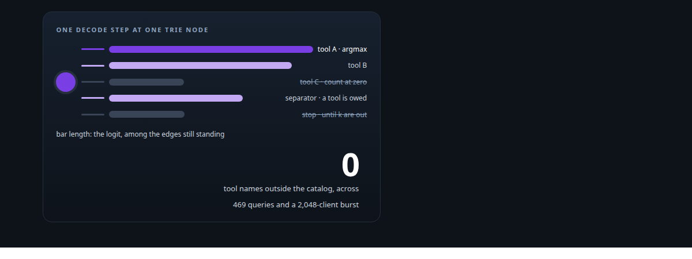
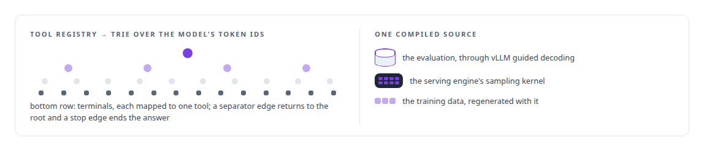
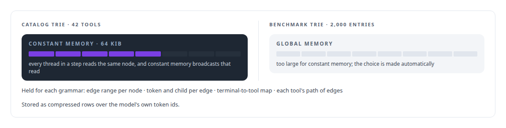
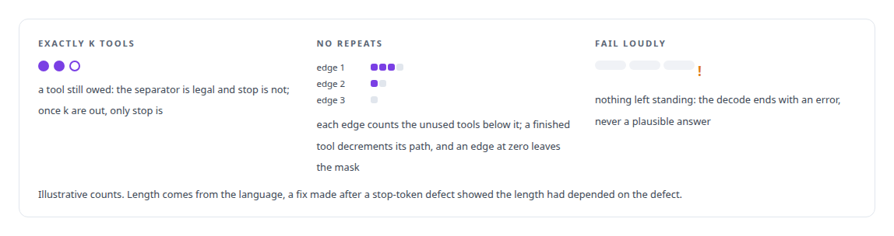
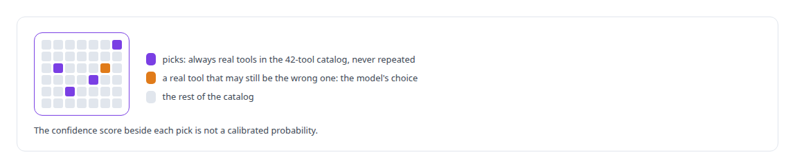

# Grammar-constrained decoding

**A grammar compiled from the tool registry constrains the decoder so that names outside the catalog cannot be produced.**

Canonical: https://coreyjames.ai/technologies/grammar-constrained-decoding/  
Author: Corey James · Published: 2026-10-28 · Kind: technology  
Systems: [Capabilities model](https://github.com/coreyjames-ai/capabilities-model)  
Skills: [CUDA kernel development](https://github.com/coreyjames-ai/portfolio/tree/main/skills/cuda-kernel-development) · [GPU inference optimisation](https://github.com/coreyjames-ai/portfolio/tree/main/skills/gpu-inference-optimisation) · [inference serving architecture](https://github.com/coreyjames-ai/portfolio/tree/main/skills/inference-serving-architecture) · [AI-assisted engineering methodology](https://github.com/coreyjames-ai/portfolio/tree/main/skills/ai-assisted-engineering-methodology)  



## Result

| Figure | What it measures |
| --- | --- |
| **172 µs** | per token cheaper than unconstrained decoding |
| **5.58** | extra round trips per query in the old no-repeat loop |
| **33–47%** | what the industrial stack's workaround cost |

## What was built

### A grammar compiled from the tool registry

[Capabilities model](https://coreyjames.ai/systems/capabilities-model) answers an agent's discovery call with a ranked list of tool pointers. A small model can produce a plausible tool name that does not exist, and an agent that calls a fictional tool fails slowly and confusingly. I decided validity belonged in decoding. I also decided the constraint should make decoding cheaper.

The grammar compiles from the tool registry, through the same frozen contract the evaluation scores against, into a trie over the model's own token ids. One compiled source feeds both the evaluation constraint and the serving constraint, so what was measured is what is served, and a registry change regenerates the grammar along with the training data.



### Where the trie lives on the GPU

When the trie fits in the GPU's constant memory, the decoder keeps it there.



Constant memory is one buffer per program, so a second grammar silently overwrote the first during a health probe. The engine now tracks which grammar owns constant memory and re-binds it before every launch.

### Rules that live in the mask

At each step the sampling kernel reads the current node's outgoing edges, drops any that are not allowed, and takes the argmax over the logits of what remains. Ties break toward the lower token id, so the answer never depends on which thread won a race.



No-repeat used to be a server-side loop that rebuilt a smaller grammar and asked again, at about 7.5 times the latency on short requests. I replaced it with counts in the mask: one on-device decrement per finished tool. I had the industrial serving stack tested with the real constraint first. Its string-level grammar with token-level state on top could not hold no-repeat soundly, and the workaround did not become correct. That is [Trying the industrial path first](https://coreyjames.ai/stories/trying-the-industrial-path-first).

### Cheaper than decoding without it

In the serving engine the grammar decides which output-layer rows get computed at all, which is how constrained decoding became cheaper than unconstrained decoding (see [GPU inference engine engineering](https://coreyjames.ai/technologies/gpu-inference-engine-engineering)). The wider problem is [A hundred tokens instead of forty-two thousand](https://coreyjames.ai/stories/a-hundred-tokens-instead-of-forty-two-thousand).




> I treat a constraint as information the hardware can use, and I put guarantees where they can be enforced, with their exact scope stated.

## What was verified

Each line is a claim the canonical page supports, with the figure as the page states it.

- Constrained decoding for LLMs: a grammar compiled from the tool registry into a trie over token ids, so a tool name outside the catalog has no edge to take and cannot be produced.
- CUDA kernel development: masking in the sampling kernel with no-repeat counts on trie edges and the trie in constant memory, making decoding 172 microseconds per token cheaper than unconstrained.
- Inference serving architecture: no-repeat moved from a server-side loop costing 5.58 extra round trips per query to one on-device decrement per completed tool.

## Related

- [A hundred tokens instead of forty-two thousand](https://github.com/coreyjames-ai/capabilities-model/tree/main/stories/a-hundred-tokens-instead-of-forty-two-thousand) · https://coreyjames.ai/stories/a-hundred-tokens-instead-of-forty-two-thousand/
- [Trying the industrial path first](https://github.com/coreyjames-ai/capabilities-model/tree/main/stories/trying-the-industrial-path-first) · https://coreyjames.ai/stories/trying-the-industrial-path-first/
- [GPU inference engine engineering](https://github.com/coreyjames-ai/portfolio/tree/main/technologies/gpu-inference-engine-engineering) · https://coreyjames.ai/technologies/gpu-inference-engine-engineering/
- System: [Capabilities model](https://github.com/coreyjames-ai/capabilities-model)

## Citation

Corey James. "Grammar-constrained decoding." coreyjames.ai, 2026. https://coreyjames.ai/technologies/grammar-constrained-decoding/

```bibtex
@misc{coreyjames-grammar-constrained-decoding,
  author = {Corey James},
  title = {Grammar-constrained decoding},
  year = {2026},
  howpublished = {\url{https://coreyjames.ai/technologies/grammar-constrained-decoding/}},
  note = {GitHub copy: https://github.com/coreyjames-ai/portfolio/tree/main/technologies/grammar-constrained-decoding}
}
```

Part of [Corey James's portfolio](https://github.com/coreyjames-ai/portfolio) · site: https://coreyjames.ai/ · MCP server: https://coreyjames.ai/mcp · agent card: https://coreyjames.ai/.well-known/agent.json
