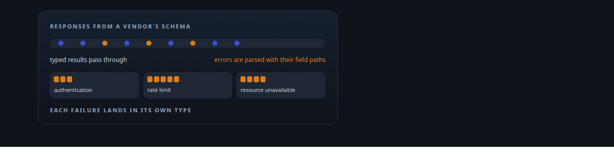
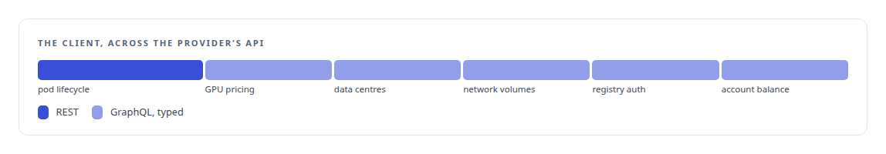
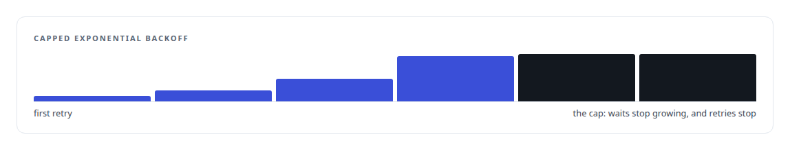

# GraphQL

**A typed Rust client for a cloud GPU provider's GraphQL API.**

Canonical: https://coreyjames.ai/technologies/graphql/  
Author: Corey James · Published: 2026-10-28 · Kind: technology  
Systems: [FAFO Core and Function Forge](https://github.com/coreyjames-ai/fafo-core)  
Skills: [Rust systems engineering](https://github.com/coreyjames-ai/portfolio/tree/main/skills/rust-systems-engineering) · [tool synthesis and governed API integration](https://github.com/coreyjames-ai/portfolio/tree/main/skills/tool-synthesis-and-governed-api-integration)  



## Result

| Figure | What it measures |
| --- | --- |
| **~2,400** | lines across the client, query and type modules |

## What was built

### A typed client for a GPU provider

GraphQL appears in one place: the cloud GPU provider integration inside the provisioning layer of my execution substrate, [FAFO Core and Function Forge](https://coreyjames.ai/systems/fafo-core). I have a typed Rust client for that provider's GraphQL API.



Pod lifecycle goes over the same provider's REST API; the GraphQL client remains in the crate.


This is a well-typed client against a vendor's schema, not GraphQL server or schema design.

### Typed failures, bounded retry

GraphQL errors are parsed with their field paths and mapped to typed errors rather than matched as strings, so the provisioning layer can tell "no capacity" from "bad credentials" and react differently. Retry is bounded, with capped exponential backoff, rather than unbounded against a paid API.



> I chose REST for the pod path where the provider's REST interface was simpler, instead of keeping GraphQL for its own sake.

## What was verified

Each line is a claim the canonical page supports, with the figure as the page states it.

- Typed API clients in Rust: a ~2,400-line typed client for a cloud GPU provider's GraphQL API, with errors mapped through their field paths to typed failures.
- Resilient integration with paid APIs: bounded retry with capped exponential backoff, and REST chosen for the pod path where it was the simpler interface.

## Related

- System: [FAFO Core and Function Forge](https://github.com/coreyjames-ai/fafo-core)

## Citation

Corey James. "GraphQL." coreyjames.ai, 2026. https://coreyjames.ai/technologies/graphql/

```bibtex
@misc{coreyjames-graphql,
  author = {Corey James},
  title = {GraphQL},
  year = {2026},
  howpublished = {\url{https://coreyjames.ai/technologies/graphql/}},
  note = {GitHub copy: https://github.com/coreyjames-ai/portfolio/tree/main/technologies/graphql}
}
```

Part of [Corey James's portfolio](https://github.com/coreyjames-ai/portfolio) · site: https://coreyjames.ai/ · MCP server: https://coreyjames.ai/mcp · agent card: https://coreyjames.ai/.well-known/agent.json
