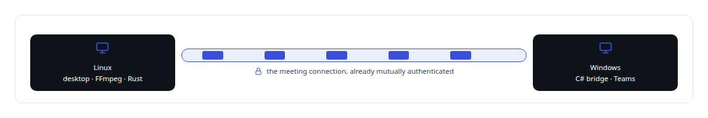
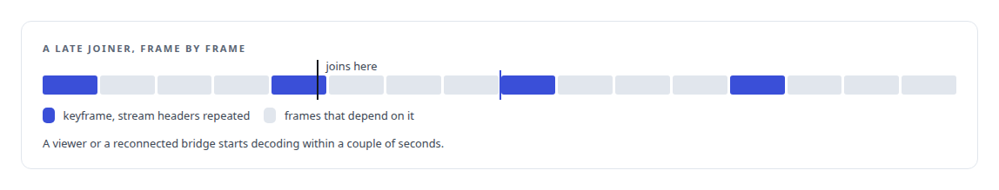
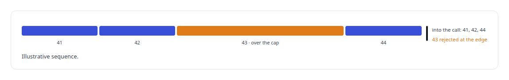

# H.264

**H.264 framing from a headless Linux desktop to the Windows media bridge, so an AI meeting attendee can share a terminal or browser as it works.**

Canonical: https://coreyjames.ai/technologies/h-264/  
Author: Corey James · Published: 2026-10-28 · Kind: technology  
Systems: [Helix](https://github.com/coreyjames-ai/helix)  
Skills: [Microsoft Teams real-time media](https://github.com/coreyjames-ai/portfolio/tree/main/skills/microsoft-teams-real-time-media) · [Rust systems engineering](https://github.com/coreyjames-ai/portfolio/tree/main/skills/rust-systems-engineering) · [AI-assisted engineering methodology](https://github.com/coreyjames-ai/portfolio/tree/main/skills/ai-assisted-engineering-methodology) · [tool synthesis and governed API integration](https://github.com/coreyjames-ai/portfolio/tree/main/skills/tool-synthesis-and-governed-api-integration)  


## What was built

### Screen sharing through Teams' own path

[Helix](https://coreyjames.ai/systems/helix) puts a digital employee in Teams meetings, and people wanted to watch it work: a browser page it was reading, a terminal it was typing into. I decided the employee would share a real screen through Teams' own screen-sharing path, with H.264 as the video format end to end. A headless Linux desktop (virtual display, window manager, Chromium, terminal) is captured and encoded by FFmpeg as an H.264 elementary stream. The employee can share a browser, a terminal or the whole desktop, and stop cleanly. Terminal text is typed at a pace people can follow, faster for long outputs so large updates finish.



The rest of the meeting surface, from chat to the stage to raised hands, is the story [A meeting attendee that will not fake it](https://coreyjames.ai/stories/a-meeting-attendee-that-will-not-fake-it), and the media bridge itself is [A self-hosted colleague in a Teams call](https://coreyjames.ai/stories/a-self-hosted-colleague-in-a-teams-call).

### Settings for text and for late joiners

I chose the settings for text on screen and for people who join late: a low output frame rate, zero-latency tuning, main profile, a short fixed group of pictures with scene-cut detection off, and access-unit delimiters with the stream headers repeated at every keyframe.




The encoder is FFmpeg's x264 path used through configuration.

### A frame contract between Linux and Windows

Between the Linux voice engine, written in Rust, and the Windows media bridge, written in C#, I defined a small frame contract that carries one H.264 access unit per frame. Frames are cut on access-unit boundaries, so the receiver never re-parses a byte stream to find them.



I can carry a media format from a Linux container through a Windows bridge into a vendor's platform and tune it for what the person watching needs. Teams' screen-sharing transport is Microsoft's platform, used as provided.

> I picked a low frame rate on purpose, because the content is text and the bandwidth is better spent on sharpness.

## What was verified

Each line is a claim the canonical page supports, with the figure as the page states it.

- Microsoft Teams real-time media: an AI participant sharing a browser, terminal or desktop into Teams as H.264 over the existing authenticated meeting connection.
- Binary wire protocol design: a small frame contract carrying one H.264 access unit per frame between a Rust voice engine and a C# media bridge, cut on access-unit boundaries.
- Video encoding for legibility: a low frame rate and stream headers repeated at every keyframe, so a late joiner or reconnected bridge starts decoding within a couple of seconds.

## Related

- [A meeting attendee that will not fake it](https://github.com/coreyjames-ai/helix/tree/main/stories/a-meeting-attendee-that-will-not-fake-it) · https://coreyjames.ai/stories/a-meeting-attendee-that-will-not-fake-it/
- [A self-hosted colleague in a Teams call](https://github.com/coreyjames-ai/helix/tree/main/stories/a-self-hosted-colleague-in-a-teams-call) · https://coreyjames.ai/stories/a-self-hosted-colleague-in-a-teams-call/
- System: [Helix](https://github.com/coreyjames-ai/helix)

## Citation

Corey James. "H.264." coreyjames.ai, 2026. https://coreyjames.ai/technologies/h-264/

```bibtex
@misc{coreyjames-h-264,
  author = {Corey James},
  title = {H.264},
  year = {2026},
  howpublished = {\url{https://coreyjames.ai/technologies/h-264/}},
  note = {GitHub copy: https://github.com/coreyjames-ai/portfolio/tree/main/technologies/h-264}
}
```

Part of [Corey James's portfolio](https://github.com/coreyjames-ai/portfolio) · site: https://coreyjames.ai/ · MCP server: https://coreyjames.ai/mcp · agent card: https://coreyjames.ai/.well-known/agent.json
