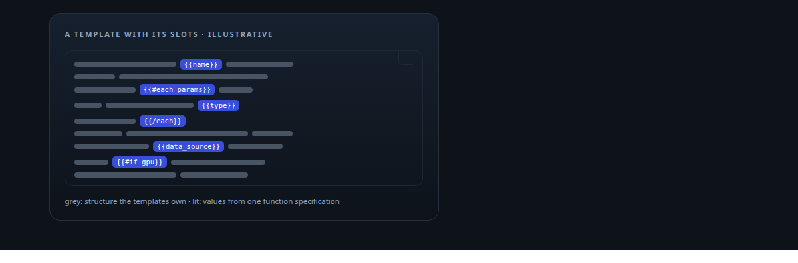
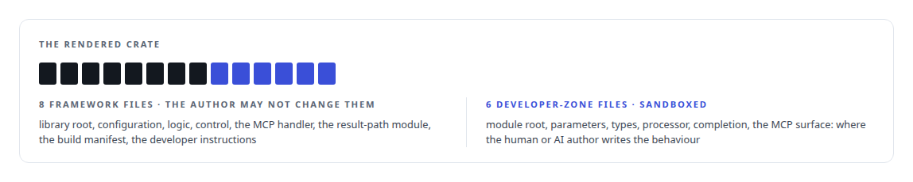
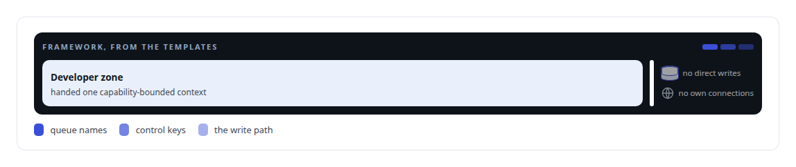
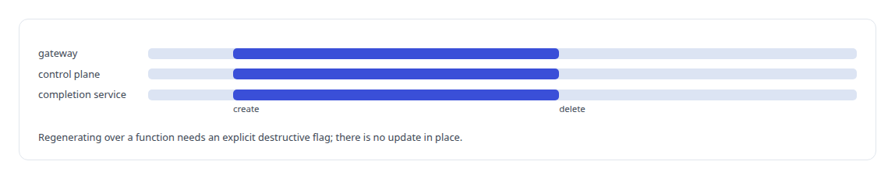

# Handlebars

**Handlebars templates drive the function generator's fourteen-file output.**

Canonical: https://coreyjames.ai/technologies/handlebars/  
Author: Corey James · Published: 2026-10-28 · Kind: technology  
Systems: [FAFO Core and Function Forge](https://github.com/coreyjames-ai/fafo-core)  
Skills: [tool synthesis and governed API integration](https://github.com/coreyjames-ai/portfolio/tree/main/skills/tool-synthesis-and-governed-api-integration) · [Rust systems engineering](https://github.com/coreyjames-ai/portfolio/tree/main/skills/rust-systems-engineering) · [AI-assisted engineering methodology](https://github.com/coreyjames-ai/portfolio/tree/main/skills/ai-assisted-engineering-methodology)  



## Result

| Figure | What it measures |
| --- | --- |
| **7 of 14** | function crates in the estate carry the generator's fingerprints |

## What was built

### A generator agents can call

[FAFO Core and Function Forge](https://coreyjames.ai/systems/fafo-core) had a gap I wanted closed: agents could call tools but could not add one, and every new capability meant a person wiring a crate into the gateway, the orchestrator and the result path by hand. I built Function Forge, a generator that lets an agent author a new function, and Handlebars is its template engine. The generator is a Rust crate exposed as an MCP (Model Context Protocol) tool. From one function specification (name, parameters, data source, flags) it renders a crate.



One flag reshapes the generated code for a function that submits GPU inference work and exits, with routing by model id enforced. The authoring guide is compiled into the tool and served to the agent that is about to use it.

### Conventions the author cannot skip

The estate's conventions arrive in every generated function by construction.




### Wired fully, or not at all

The generator edits several services in one operation with rollback, so a failed generation leaves nothing half-wired; a symmetric delete reverses every edit. Generated crates register themselves at link time, so a function is either compiled fully wired or the build fails, and there is no runtime registry to fall out of step with the code. A new function takes effect only after a person rebuilds and restarts the gateway. The story is [Tools that build tools, under governance](https://coreyjames.ai/stories/tools-that-build-tools-under-governance).



I build platforms that extend themselves under control: an agent can add a capability, and the structure decides what that capability is allowed to touch.

> Templates own everything structural and authors write only inside a bounded zone, which keeps agent-written code inside the platform's write-path architecture.

## What was verified

Each line is a claim the canonical page supports, with the figure as the page states it.

- Code generation and metaprogramming: a Rust generator exposed as an MCP tool that renders a function crate from one specification, with fixed framework files and a sandboxed developer zone.
- Tool synthesis under governance: one operation that wires gateway, control plane and completion service with rollback and link-time registration; 7 of 14 function crates carry the generator's fingerprints.

## Related

- [Tools that build tools, under governance](https://github.com/coreyjames-ai/fafo-core/tree/main/stories/tools-that-build-tools-under-governance) · https://coreyjames.ai/stories/tools-that-build-tools-under-governance/
- System: [FAFO Core and Function Forge](https://github.com/coreyjames-ai/fafo-core)

## Citation

Corey James. "Handlebars." coreyjames.ai, 2026. https://coreyjames.ai/technologies/handlebars/

```bibtex
@misc{coreyjames-handlebars,
  author = {Corey James},
  title = {Handlebars},
  year = {2026},
  howpublished = {\url{https://coreyjames.ai/technologies/handlebars/}},
  note = {GitHub copy: https://github.com/coreyjames-ai/portfolio/tree/main/technologies/handlebars}
}
```

Part of [Corey James's portfolio](https://github.com/coreyjames-ai/portfolio) · site: https://coreyjames.ai/ · MCP server: https://coreyjames.ai/mcp · agent card: https://coreyjames.ai/.well-known/agent.json
