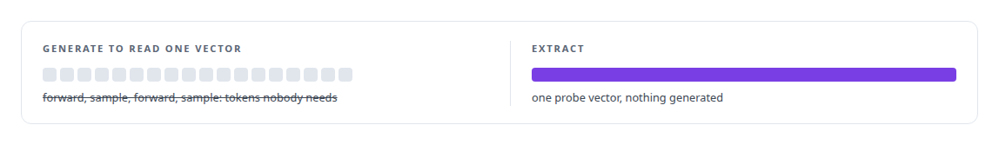
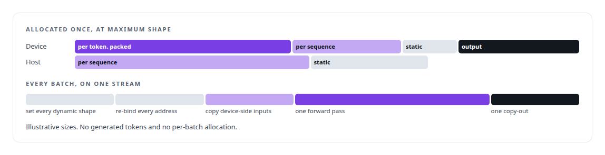
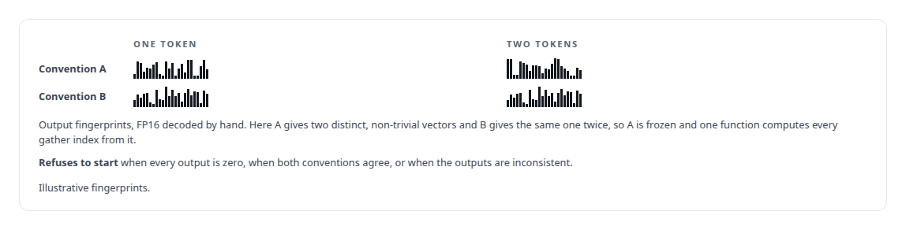
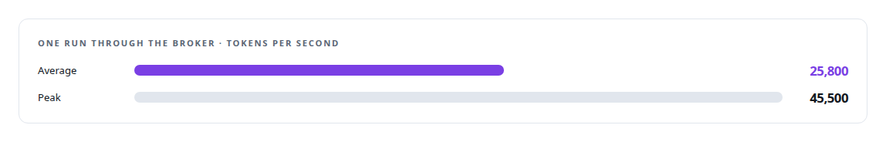

# Hidden-state extraction

**The Inference Fabric's runtime has a single-pass hidden-state extraction mode with an empirical, fail-closed tensor-semantics detector.**

Canonical: https://coreyjames.ai/technologies/hidden-state-extraction/  
Author: Corey James · Published: 2026-10-28 · Kind: technology  
Systems: [Inference Fabric](https://github.com/coreyjames-ai/inference-fabric)  
Skills: [high-throughput batch inference](https://github.com/coreyjames-ai/portfolio/tree/main/skills/high-throughput-batch-inference) · [TensorRT and TensorRT-LLM engineering](https://github.com/coreyjames-ai/portfolio/tree/main/skills/tensorrt-and-tensorrt-llm-engineering) · [GPU inference optimisation](https://github.com/coreyjames-ai/portfolio/tree/main/skills/gpu-inference-optimisation) · [inference serving architecture](https://github.com/coreyjames-ai/portfolio/tree/main/skills/inference-serving-architecture)  


## Result

| Figure | What it measures |
| --- | --- |
| **~203,000** | hidden-state extractions in one run through the broker |
| **10.8M** | tokens in that run |
| **4,096** | values per probe vector, up to 524,288 tokens per pass |

## What was built

### One forward pass, no generation

[Inference Fabric](https://coreyjames.ai/systems/inference-fabric) was built for a distillation workload that needs a model's internal representation of every example, at dataset scale. Serving stacks return tokens, and running full generation to read one vector wastes the GPU. I added an extraction mode to the runtime itself, so the GPU spends nothing on tokens nobody needs.

An engine built without a key-value cache routes to a raw TensorRT path that runs one forward pass per batch and returns the final hidden state of each sequence. A consumer has to pass a contract check before it may join the broker.



### Buffers bound once, batches in a fixed order

At load the runtime enumerates every tensor the engine exposes. After that, a batch packs tokens contiguously, writes positions and request types, and runs a strict order. Re-binding after every shape change is what keeps TensorRT from reading stale addresses.



### Asking the engine which token to gather

The hard part is one integer per sequence. A wrong guess at it ruins the dataset quietly, on every probe. So the runtime measures the engine's gather convention at start-up and fails closed on an ambiguous answer.




When both conventions look consistent, the detector takes the one with the larger separation between sequences. That is the method's weakest point, and I keep it visible in the code.

### Results that describe themselves

Results leave as self-describing payloads carrying data type, shape, a hash and the identity of the extraction request, so a stored vector can be interpreted without knowing which engine produced it. The vector store checks lineage back to the originating work item before it stores anything. The throughput side of the same runtime is [From 44K to 163K tokens per second](https://coreyjames.ai/stories/from-44k-to-163k-tokens-per-second), and the workload behind it is [The workload that shaped the platform](https://coreyjames.ai/stories/the-workload-that-shaped-the-platform).



I can see a capability mainstream serving stacks do not offer, design it from producer to storage, and find the one silent failure that would corrupt the result. The forward pass is NVIDIA TensorRT, with no custom model kernels.

> Validating vectors later cannot catch a well-formed vector for the wrong token.

## What was verified

Each line is a claim the canonical page supports, with the figure as the page states it.

- Hidden-state extraction at scale: a single-pass TensorRT mode returning 4,096-value vectors, about 203,000 extractions over 10.8M tokens of a 7-billion-parameter FP8 model.
- Fail-closed engineering: a warm-up probe that measures the engine's gather convention under both candidates and refuses to start on an ambiguous answer.
- High-throughput batch inference: buffers bound once at maximum shape and a fixed shape, address and copy order, averaging 25,800 tokens per second with a peak of 45,500.

## Related

- [From 44K to 163K tokens per second](https://github.com/coreyjames-ai/inference-fabric/tree/main/stories/from-44k-to-163k-tokens-per-second) · https://coreyjames.ai/stories/from-44k-to-163k-tokens-per-second/
- [The workload that shaped the platform](https://github.com/coreyjames-ai/fafo-core/tree/main/stories/the-workload-that-shaped-the-platform) · https://coreyjames.ai/stories/the-workload-that-shaped-the-platform/
- System: [Inference Fabric](https://github.com/coreyjames-ai/inference-fabric)

## Citation

Corey James. "Hidden-state extraction." coreyjames.ai, 2026. https://coreyjames.ai/technologies/hidden-state-extraction/

```bibtex
@misc{coreyjames-hidden-state-extraction,
  author = {Corey James},
  title = {Hidden-state extraction},
  year = {2026},
  howpublished = {\url{https://coreyjames.ai/technologies/hidden-state-extraction/}},
  note = {GitHub copy: https://github.com/coreyjames-ai/portfolio/tree/main/technologies/hidden-state-extraction}
}
```

Part of [Corey James's portfolio](https://github.com/coreyjames-ai/portfolio) · site: https://coreyjames.ai/ · MCP server: https://coreyjames.ai/mcp · agent card: https://coreyjames.ai/.well-known/agent.json
