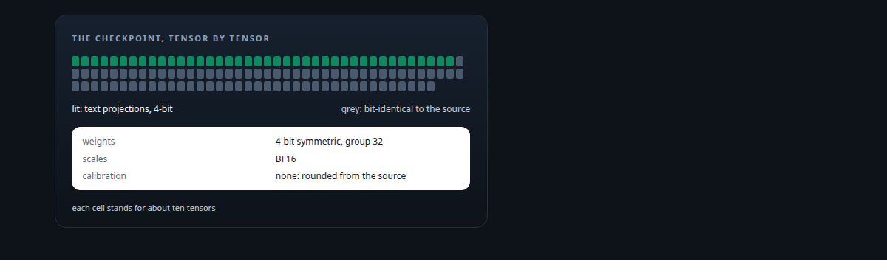
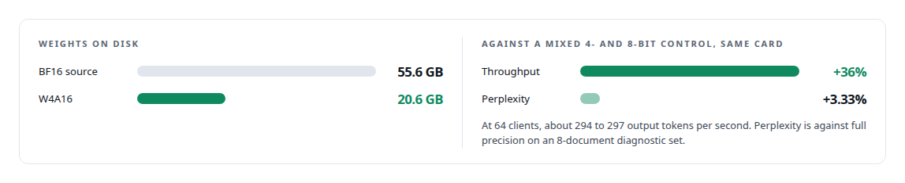
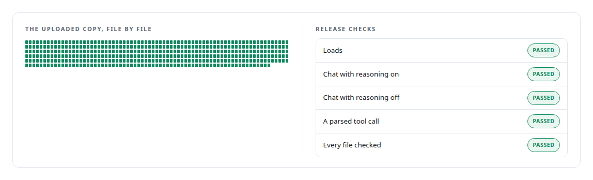
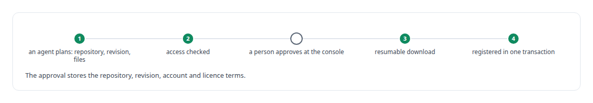

# Hugging Face Hub

**I published a 4-bit quantization of a 27-billion-parameter model with its card, provenance and measured trade-off.**

Canonical: https://coreyjames.ai/technologies/hugging-face-hub/  
Author: Corey James · Published: 2026-10-28 · Kind: technology  
Systems: [ActiveKV](https://github.com/coreyjames-ai/activekv) · [Helix](https://github.com/coreyjames-ai/helix)  
Skills: [LLM quantization (FP8, INT8, 4-bit)](https://github.com/coreyjames-ai/portfolio/tree/main/skills/llm-quantization-fp8-int8-4-bit) · [AI-assisted engineering methodology](https://github.com/coreyjames-ai/portfolio/tree/main/skills/ai-assisted-engineering-methodology) · [evidence-gated acceptance](https://github.com/coreyjames-ai/portfolio/tree/main/skills/evidence-gated-acceptance) · [separation of duties for AI work](https://github.com/coreyjames-ai/portfolio/tree/main/skills/separation-of-duties-for-ai-work)  



## Result

| Figure | What it measures |
| --- | --- |
| **400** | text projection modules quantized to 4-bit |
| **799** | tensors left bit-identical to the source |
| **433** | files checked on the uploaded copy |

## What was built

### A 4-bit checkpoint for one Intel card

[ActiveKV](https://coreyjames.ai/systems/activekv) needed a 27-billion-parameter model on one 32 GB Intel Arc Pro GPU, and the hybrid recurrent-attention open-weight model I chose does not fit on it in BF16. I decided to quantize it myself on Intel's stock XPU vLLM build, measure the trade-off, and publish the result on the Hugging Face Hub so anyone with an Intel Arc Pro GPU could run it.

The recipe is weight-only W4A16 on the text projection modules, with every other tensor bit-identical to the source. I pinned the source to a revision and checked every shard hash, and a per-module manifest lists what was quantized. I skipped calibration, so the checkpoint can be reproduced from the source weights alone.



The model ActiveKV serves in its own benchmarks is a same-recipe build of a different checkpoint. The full story is [A 27B model on one 32 GB Intel card](https://coreyjames.ai/stories/a-27b-model-on-one-32gb-intel-card).

### A card that states the cost

I published it under the Apache-2.0 licence with the base model declared and the quantized relationship set in the card metadata. The model card carries the method, the exact tested environment (one Intel Arc Pro GPU, Intel's XPU vLLM container), a run command, the measured trade-off and the places the model was not tested. It states cost and gain and leaves comparison with other quantizations to the reader.




A community discussion opened on the repository within a day. I can take a model to a new accelerator, attribute the speed I gained to its causes, and publish exactly what a user gets.

### Models a person approves

[Helix](https://coreyjames.ai/systems/helix) includes a media studio where agents render images and video on local GPUs, and those models come from the Hub. Downloads are large and licence-bound, so I decided an agent may propose a download and only a person may approve it.



Model approval happens only at the local console, and no remote call can approve a download. A background reconciler finds files added to model folders by hand and reports their check status, so a host with no models reports zero. I publish one model on the Hub and consume others through it.

> I ran the release checks on the bytes that were uploaded, because a copy step can change them.

## What was verified

Each line is a claim the canonical page supports, with the figure as the page states it.

- LLM quantization (4-bit): a W4A16 build of a 27-billion-parameter model, 400 modules quantized and 799 tensors bit-identical, 55.6 GB to 20.6 GB, +36% throughput for +3.33% perplexity.
- Model release engineering: a published model card with method, tested environment and untested areas, and release checks run on the uploaded copy across 433 files.
- Human-approved model acquisition: agents plan a download and only a person at the local console approves it, with registration in a single transaction.

## Related

- [A 27B model on one 32 GB Intel card](https://github.com/coreyjames-ai/capabilities-model/tree/main/stories/a-27b-model-on-one-32gb-intel-card) · https://coreyjames.ai/stories/a-27b-model-on-one-32gb-intel-card/
- System: [ActiveKV](https://github.com/coreyjames-ai/activekv)
- System: [Helix](https://github.com/coreyjames-ai/helix)

## Citation

Corey James. "Hugging Face Hub." coreyjames.ai, 2026. https://coreyjames.ai/technologies/hugging-face-hub/

```bibtex
@misc{coreyjames-hugging-face-hub,
  author = {Corey James},
  title = {Hugging Face Hub},
  year = {2026},
  howpublished = {\url{https://coreyjames.ai/technologies/hugging-face-hub/}},
  note = {GitHub copy: https://github.com/coreyjames-ai/portfolio/tree/main/technologies/hugging-face-hub}
}
```

Part of [Corey James's portfolio](https://github.com/coreyjames-ai/portfolio) · site: https://coreyjames.ai/ · MCP server: https://coreyjames.ai/mcp · agent card: https://coreyjames.ai/.well-known/agent.json
