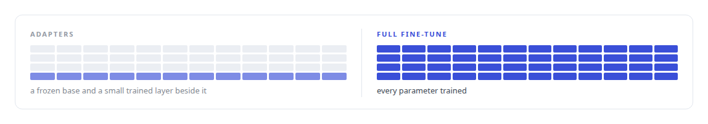
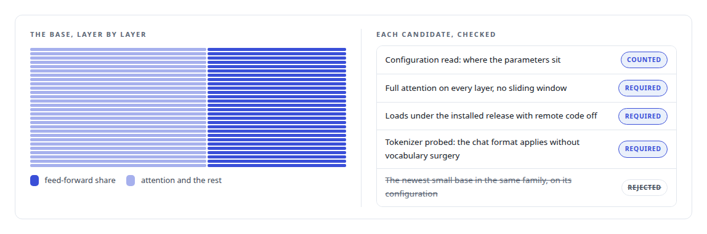
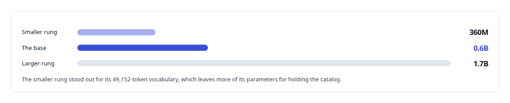
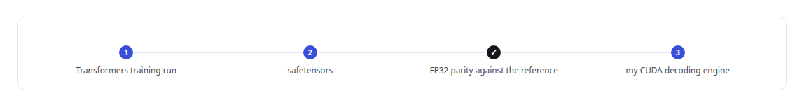

# Hugging Face Transformers

**Hugging Face Transformers is the training path for my capabilities model: a full fine-tune of every parameter, finished in minutes, rebuilt whenever the catalog changes.**

Canonical: https://coreyjames.ai/technologies/hugging-face-transformers/  
Author: Corey James · Published: 2026-10-28 · Kind: technology  
Systems: [Capabilities model](https://github.com/coreyjames-ai/capabilities-model)  
Skills: [AI-assisted engineering methodology](https://github.com/coreyjames-ai/portfolio/tree/main/skills/ai-assisted-engineering-methodology) · [inference serving architecture](https://github.com/coreyjames-ai/portfolio/tree/main/skills/inference-serving-architecture) · [GPU inference optimisation](https://github.com/coreyjames-ai/portfolio/tree/main/skills/gpu-inference-optimisation)  


## Result

| Figure | What it measures |
| --- | --- |
| **~44%** | of the base's parameters in feed-forward layers |
| **28** | layers, all with full attention |

## What was built

### A model rebuilt on every catalog change

[Capabilities model](https://coreyjames.ai/systems/capabilities-model) holds an agent's tool catalog in the weights of a small model, and the catalog changes every week. If retraining took a day, the model would be stale on arrival. I chose a full fine-tune of every parameter of a small open-weight base model with Hugging Face Transformers, on a corpus generated from the tool registry. At this size the run takes minutes, so the model is rebuilt whenever the registry changes.

I ran a full fine-tune over adapters, because at this size the cost that usually justifies adapters was absent and the full fine-tune removes a layer of indirection.



### Choosing the base by its architecture

I chose the base model by checking each candidate. The product is a catalog recalled from a short query, which is a parametric-knowledge task, so a standard feed-forward transformer was a requirement.




### A capacity ladder

The capacity ladder changes total size while keeping the architecture comparable, so the comparison measures capacity alone.



### Handing weights to my own engine

Trained weights leave Transformers as safetensors and load directly into my own CUDA decoding engine, and parity checks guard that hand-off. This is fine-tuning of an existing base model with Transformers used as provided. The full problem is [A hundred tokens instead of forty-two thousand](https://coreyjames.ai/stories/a-hundred-tokens-instead-of-forty-two-thousand), and the evaluation that judged the model is [The baseline that tied us](https://coreyjames.ai/stories/the-baseline-that-tied-us).



> I choose models by reading their architecture against the task, and I make training cheap enough to repeat on every catalog change.

## What was verified

Each line is a claim the canonical page supports, with the figure as the page states it.

- LLM fine-tuning: a full fine-tune of every parameter of a small base model with Hugging Face Transformers, rebuilt whenever the tool catalog changes.
- Model selection by architecture: candidates checked for feed-forward share (~44%), full attention on all 28 layers, remote code off and tokenizer fit, on a 360M, 0.6B and 1.7B capacity ladder.
- Training-to-inference handoff: safetensors loaded into a custom CUDA decoding engine behind an FP32 parity check.

## Related

- [A hundred tokens instead of forty-two thousand](https://github.com/coreyjames-ai/capabilities-model/tree/main/stories/a-hundred-tokens-instead-of-forty-two-thousand) · https://coreyjames.ai/stories/a-hundred-tokens-instead-of-forty-two-thousand/
- [The baseline that tied us](https://github.com/coreyjames-ai/capabilities-model/tree/main/stories/the-baseline-that-tied-us) · https://coreyjames.ai/stories/the-baseline-that-tied-us/
- System: [Capabilities model](https://github.com/coreyjames-ai/capabilities-model)

## Citation

Corey James. "Hugging Face Transformers." coreyjames.ai, 2026. https://coreyjames.ai/technologies/hugging-face-transformers/

```bibtex
@misc{coreyjames-hugging-face-transformers,
  author = {Corey James},
  title = {Hugging Face Transformers},
  year = {2026},
  howpublished = {\url{https://coreyjames.ai/technologies/hugging-face-transformers/}},
  note = {GitHub copy: https://github.com/coreyjames-ai/portfolio/tree/main/technologies/hugging-face-transformers}
}
```

Part of [Corey James's portfolio](https://github.com/coreyjames-ai/portfolio) · site: https://coreyjames.ai/ · MCP server: https://coreyjames.ai/mcp · agent card: https://coreyjames.ai/.well-known/agent.json
