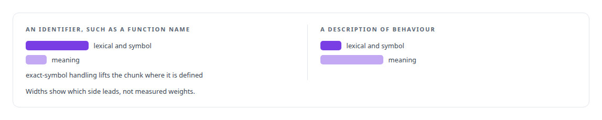
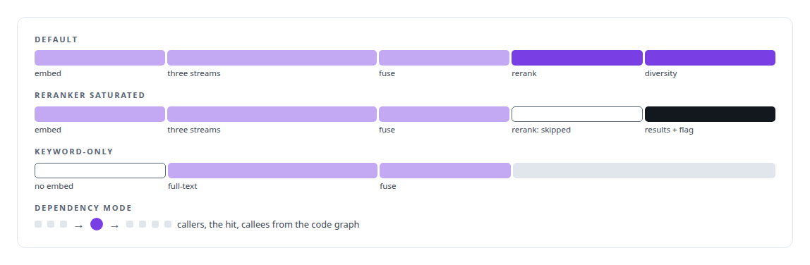
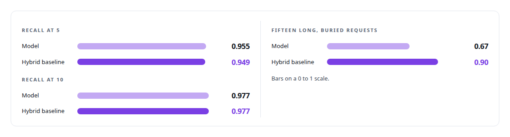

# Hybrid retrieval

**Dense embeddings fused with BM25 and reranked, with every constant found by sweep.**

Canonical: https://coreyjames.ai/technologies/hybrid-retrieval/  
Author: Corey James · Published: 2026-10-28 · Kind: technology  
Systems: [FAFOHive](https://github.com/coreyjames-ai/fafohive) · [Capabilities model](https://github.com/coreyjames-ai/capabilities-model)  
Skills: [inference serving architecture](https://github.com/coreyjames-ai/portfolio/tree/main/skills/inference-serving-architecture) · [AI-assisted engineering methodology](https://github.com/coreyjames-ai/portfolio/tree/main/skills/ai-assisted-engineering-methodology)  


## Result

| Figure | What it measures |
| --- | --- |
| **~294,000** | structure-aware chunks from about 19,000 files in one code index |
| **129** | configuration cells swept for the baseline's constants |
| **5** | embedding models in the bake-off before the sweep |

## What was built

### Two kinds of question, three streams

The memory service in [FAFOHive](https://coreyjames.ai/systems/fafohive) serves agents that ask two kinds of question: an exact identifier such as a function name, and a description of behaviour in plain language. A dense vector search alone misses the first and lexical search alone misses the second, so I made code search and decision search hybrid.

A query runs up to three streams at once (dense similarity on embeddings from a multilingual embedding model, weighted full-text search, and a metadata stream) and the ranked lists are fused with reciprocal-rank fusion. A classifier looks at each query first and sets how much each stream counts, because identifier queries and descriptive queries need different blends.



### Holding up under agent load

After fusion, an optional cross-encoder rerank reorders the top results and a diversity pass drops near-duplicates, so an agent does not receive five copies of one paragraph. Capacity is part of the design: the embedding and rerank endpoints are bounded, and under load the reranker is the first stage dropped.



The graph side of the service is [A code explainer that is not allowed to invent](https://coreyjames.ai/stories/a-code-explainer-that-is-not-allowed-to-invent).

### A baseline as strong as I could build

[Capabilities model](https://coreyjames.ai/systems/capabilities-model) needed a bar to beat, and I ruled that the bar would be the strongest classical retriever I could build. That retriever is hybrid retrieval: dense embeddings fused with BM25 over the full tool catalog, with every weight and cutoff chosen by a sweep after an embedding-model bake-off.


Midway through the experiment a known-answer control failed to reproduce; the cause was a GPU precision setting that changed rankings relative to the CPU, and I pinned it off and re-ran the whole matrix. Every ranker in the experiment ran on both catalog sizes, so no comparison could pair a 42-tool model with a 2,000-entry baseline. The tie is the result I publish: [The baseline that tied us](https://coreyjames.ai/stories/the-baseline-that-tied-us).



The embedding models, the reranker and BM25 are third-party; the fusion, routing, capacity behaviour and measurement are mine.

> I swept the baseline's constants, because a baseline tuned less carefully than the model it judges proves nothing.

## What was verified

Each line is a claim the canonical page supports, with the figure as the page states it.

- Hybrid search and retrieval: dense, weighted full-text and metadata streams fused by reciprocal rank with cross-encoder rerank, over a code index of about 294,000 chunks.
- Information retrieval evaluation: a hybrid baseline swept across 129 configuration cells that tied the model at recall at 10 (0.977) and beat it on long, buried requests, 0.90 to 0.67.
- Search under load: bounded embedding and rerank endpoints, the reranker the first stage dropped under load with a flag, and a keyword-only mode with no embedding call.

## Related

- [The baseline that tied us](https://github.com/coreyjames-ai/capabilities-model/tree/main/stories/the-baseline-that-tied-us) · https://coreyjames.ai/stories/the-baseline-that-tied-us/
- [A code explainer that is not allowed to invent](https://github.com/coreyjames-ai/fafohive/tree/main/stories/a-code-explainer-that-is-not-allowed-to-invent) · https://coreyjames.ai/stories/a-code-explainer-that-is-not-allowed-to-invent/
- System: [FAFOHive](https://github.com/coreyjames-ai/fafohive)
- System: [Capabilities model](https://github.com/coreyjames-ai/capabilities-model)

## Citation

Corey James. "Hybrid retrieval." coreyjames.ai, 2026. https://coreyjames.ai/technologies/hybrid-retrieval/

```bibtex
@misc{coreyjames-hybrid-retrieval,
  author = {Corey James},
  title = {Hybrid retrieval},
  year = {2026},
  howpublished = {\url{https://coreyjames.ai/technologies/hybrid-retrieval/}},
  note = {GitHub copy: https://github.com/coreyjames-ai/portfolio/tree/main/technologies/hybrid-retrieval}
}
```

Part of [Corey James's portfolio](https://github.com/coreyjames-ai/portfolio) · site: https://coreyjames.ai/ · MCP server: https://coreyjames.ai/mcp · agent card: https://coreyjames.ai/.well-known/agent.json
