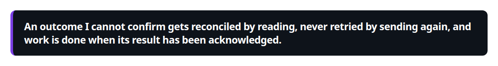
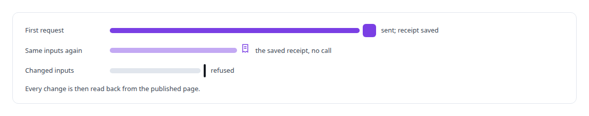
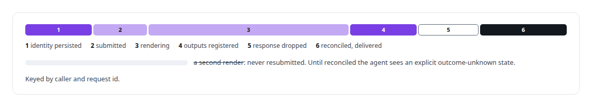
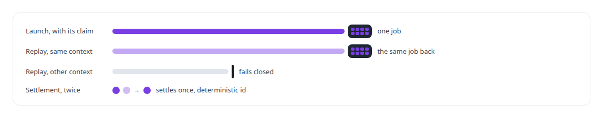
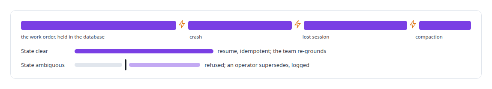
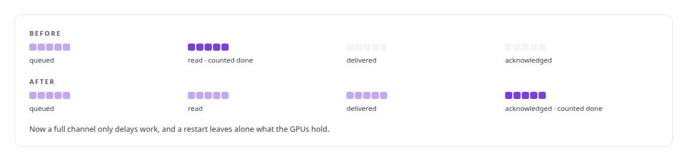

# Idempotency, exactly-once effects and crash recovery

**A restart never repeats a provider call, a broker restart never re-runs work the GPUs hold, and an agent's claimed completion is a claim.**

Canonical: https://coreyjames.ai/technologies/idempotency-exactly-once-effects-and-crash-recovery/  
Author: Corey James · Published: 2026-10-28 · Kind: technology  
Systems: [AgentOS](https://github.com/coreyjames-ai/agentos) · [Agent Swarm](https://github.com/coreyjames-ai/agent-swarm) · [Helix](https://github.com/coreyjames-ai/helix) · [FAFOHive](https://github.com/coreyjames-ai/fafohive) · [Inference Fabric](https://github.com/coreyjames-ai/inference-fabric)  
Skills: [exactly-once delivery and crash recovery](https://github.com/coreyjames-ai/portfolio/tree/main/skills/exactly-once-delivery-and-crash-recovery) · [distributed systems correctness](https://github.com/coreyjames-ai/portfolio/tree/main/skills/distributed-systems-correctness) · [message broker and queue design](https://github.com/coreyjames-ai/portfolio/tree/main/skills/message-broker-and-queue-design)  


## What was built

The rule I apply in every system below is simple to state.



I design for the crash window explicitly and decide, per system, whether a duplicate or a gap is the worse failure.

## No repeated payment, no second post

[FAFOHive](https://coreyjames.ai/systems/fafohive) lets agents use a payments provider, an email/CRM provider and social-publishing providers through a governed gateway. A repeated payment or a second marketing email is a real-world harm, so I made the gateway account for every call durably, and a restart does not repeat a provider call. The gateway's design is in [Agents with real tools and no keys](https://coreyjames.ai/stories/agents-with-real-tools-and-no-keys).

In my own social modules a duplicate public post is worse than a missing one. One service owns the send log, and intent is persisted before a side effect: a durable sending state and a budget reservation are committed before any external call. After a crash, anything that was mid-send becomes uncertain, a first-class state that stays until a read-only check or a person resolves it. The Reddit module binds each request to an idempotency key that binds its inputs.



## Renders that are never produced twice

[Helix](https://coreyjames.ai/systems/helix) keeps durable state for conversations and the work agents do inside them. Its store uses idempotent lifecycle operations and an append-only event log, and a worker that has been replaced cannot overwrite the state of its successor. A pending-intent reconciler finishes or closes out work a crash interrupted. Documents agents create in a conversation are immutable versions with optimistic concurrency, so two writers cannot silently overwrite each other.

In the agents' media studio, renders are long and expensive and a dropped response must never cause a second one.



## One request, one agent

[Agent Swarm](https://coreyjames.ai/systems/agent-swarm) must never start two agents for one request. The writer that moves agent activity into PostgreSQL deduplicates at two layers and checks the body of any replay.



## Built to be interrupted

[AgentOS](https://coreyjames.ai/systems/agentos) is built to be interrupted. A crash, a lost session or a context compaction leaves the work order intact. See [Why long agent runs fail](https://coreyjames.ai/stories/why-long-agent-runs-fail).



## Counted when acknowledged, not when read

[Inference Fabric](https://coreyjames.ai/systems/inference-fabric) had a broker that counted work as consumed when it was read. That is [Millions of queued items that were not there](https://coreyjames.ai/stories/millions-of-queued-items-that-were-not-there).



> An outcome I cannot confirm gets reconciled by reading, never retried by sending again, and work is done when its result has been acknowledged.

## What was verified

Each line is a claim the canonical page supports, with the figure as the page states it.

- Exactly-once delivery and crash recovery: intent and budget committed before any provider call, and uncertain outcomes resolved by a read and never by a resend.
- Idempotency key design: keys bound to request inputs, so a replay returns the saved receipt and a replay with changed inputs is refused.
- Distributed systems correctness: a broker that counts work done only when acknowledged, and agent launches bound to an authorised claim so a replay returns the existing job.

## Related

- [Agents with real tools and no keys](https://github.com/coreyjames-ai/fafohive/tree/main/stories/agents-with-real-tools-and-no-keys) · https://coreyjames.ai/stories/agents-with-real-tools-and-no-keys/
- [Millions of queued items that were not there](https://github.com/coreyjames-ai/inference-fabric/tree/main/stories/millions-of-queued-items-that-were-not-there) · https://coreyjames.ai/stories/millions-of-queued-items-that-were-not-there/
- [Why long agent runs fail](https://github.com/coreyjames-ai/agentos/tree/main/stories/why-long-agent-runs-fail) · https://coreyjames.ai/stories/why-long-agent-runs-fail/
- System: [AgentOS](https://github.com/coreyjames-ai/agentos)
- System: [Agent Swarm](https://github.com/coreyjames-ai/agent-swarm)
- System: [Helix](https://github.com/coreyjames-ai/helix)
- System: [FAFOHive](https://github.com/coreyjames-ai/fafohive)
- System: [Inference Fabric](https://github.com/coreyjames-ai/inference-fabric)

## Citation

Corey James. "Idempotency, exactly-once effects and crash recovery." coreyjames.ai, 2026. https://coreyjames.ai/technologies/idempotency-exactly-once-effects-and-crash-recovery/

```bibtex
@misc{coreyjames-idempotency-exactly-once-effects-and-crash-recovery,
  author = {Corey James},
  title = {Idempotency, exactly-once effects and crash recovery},
  year = {2026},
  howpublished = {\url{https://coreyjames.ai/technologies/idempotency-exactly-once-effects-and-crash-recovery/}},
  note = {GitHub copy: https://github.com/coreyjames-ai/portfolio/tree/main/technologies/idempotency-exactly-once-effects-and-crash-recovery}
}
```

Part of [Corey James's portfolio](https://github.com/coreyjames-ai/portfolio) · site: https://coreyjames.ai/ · MCP server: https://coreyjames.ai/mcp · agent card: https://coreyjames.ai/.well-known/agent.json
